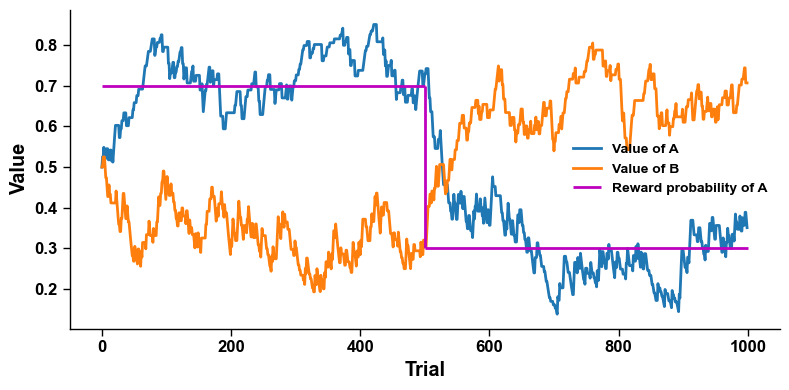

# 8.4 强化学习模型和参数估计

这一节我们将介绍如何基于前面的基础知识，使用强化学习模型来分析真实的实验数据。

## **简单强化学习模型（Naïve RL Model）**

**Naïve Reinforcement Learning Model** 是一种最基础的、未经复杂变化的强化学习模型，往往是最基本的学习方式。这种模型的学习机制通常基于试探法（trial-and-error），通过环境反馈不断调整行为策略。价值更新过程为：

$$
V_t = V_{t-1} + \alpha * (r_t - V_{t-1})
$$

## 生成学习数据

我们先来生成数据。实验一共T个trial，假定A和B两个选项，前一半的trial中A和B的奖赏概率分别是0.7和0.3, 后一半trial的两者的奖赏概率反转为0.3和0.7。决策概率用softmax/logistic函数来代替

$$
p(A) = \frac{1}{1+exp(-\beta(Va-Vb))}
$$

其中$$p(A)$$是一个试次中选择A的概率，$$\beta$$是反温度参数(inverse temperature parameter)，$$V_a$$和$$V_b$$分别代表的是某个试次中A和B两个选项的价值。


```python
import numpy as np
from scipy.stats import bernoulli

def softmax(a,b, beta): # softmax 决策函数
    return np.exp(-beta*a)/(np.exp(-beta*a)+np.exp(-beta*b)),np.exp(-beta*b)/(np.exp(-beta*a)+np.exp(-beta*b))
```


下面我们来定义一个实验一共1000个试次，前500个试次A和B的奖赏概率分别是0.7和0.3，后500个试次奖赏概率反转。

```python
p = 0.7 # reward probability
T = 1000

Va, Vb, choice, reward, pa = np.zeros(T+1), np.zeros(T+1), np.zeros(T), np.zeros(T),np.zeros(T)
Va[0], Vb[0] = 0.5, 0.5 # 假定A和B的初始价值都是0.5
alpha = 0.05 # learning rate
beta = 1 # inverse temperature

for i in range(T): #loop trials
    
    # 我们用logstic函数来生成选择A的概率并且做出选择
    pa[i] = softmax(Va[i], Vb[i], beta)[0] # 第一个trial为0.5
    
    choice[i] = bernoulli.rvs(pa[i]) # 选A为1，选B为0

    # 根据被试的选择来给与奖赏
    if i <= T/2: # 前半实验
        reward[i] = bernoulli.rvs(p) if choice[i]==1 else bernoulli.rvs(1-p)
    else: # 后半实验
        reward[i] = bernoulli.rvs(1-p) if choice[i]==1 else bernoulli.rvs(p)

    # 被试根据reward，按照强化学习的逻辑更新
    if choice[i] == 1: # 被试选择A
        # update Va
        Va[i+1] = Va[i] + alpha * (reward[i] - Va[i]) # update Va
        Vb[i+1] = Vb[i] # keep Vb
    else: # choose B
        # update Vb
        Vb[i+1] = Vb[i] + alpha * (reward[i] - Vb[i]) # update Vb
        Va[i+1] = Va[i] # keep Va
```

这`choice` 和`reward` 分别代表模拟出来的受试在1000个试次的选择和获得的奖赏。我们可以画出随着学习，受试对于A和B两个选项价值的走势图


```python
import matplotlib.pyplot as plt

plt.figure(figsize=(8, 4))
plt.plot(Va[:T], '-', label='Value of A')
plt.plot(Vb[:T], '-', label='Value of B')
plt.hlines(p, 0, T/2, color='m', label='Reward probability of A')
plt.hlines(1-p, T/2, T, color='m')
plt.vlines(T/2, 1-p, p, color='m')
plt.xlabel('Trial')
plt.ylabel('Value')
plt.legend()
```


<figure><figcaption><p>图8-28 强化学习模型模拟的选项价值变化与奖励概率反转</p></figcaption></figure>

我们可以看到受试会根据反馈在前半部分的试次中逐渐提高对A选项的价值估计，并降低对B选项的价值估计。这一模式在后半试次中反转过来。

## 拟合强化学习模型

下面我们来拟合强化学习模型。假定一个受试完成了上述的实验，我们收集到了所有试次中该受试的选择和获得的奖赏`choice` 和`reward` ，这就是实验数据，我们反过来要根据该数据来拟合该受试的参数。

在以上这个基础强化学习模型中，个体的自由参数有两个: $$\alpha$$ (学习率)，$$\beta$$ (参数)。

那我们要算出的是如果已知参数，受试做出选择的概率是多少，然后采用最大似然的方法来求解。首先我们写出似然函数:


```python
def nll_rl(params):
    alpha = params[0] # learning rate
    beta = params[1] # inverse temperature

    Va, Vb, pp = np.empty(T+1),np.empty(T+1),np.empty(T)
    Va[0], Vb[0] = 0.5, 0.5 # 初始化A和B的价值
    for i in range(T): # loop trial
        # 获得这个trial被试做出这个选择的概率
        pa = softmax(Va[i], Vb[i], beta)[0] 
        pp[i] = pa if choice[i]==1 else 1-pa # 我们把该概率记录下来
        
        # 做出选择之后，模拟受试受到反馈后更新对选择选项的价值
        if choice[i] == 1: # 如果选择A
            # update Va
            Va[i+1] = Va[i] + alpha * (reward[i] - Va[i])
            # b的价值保持不变
            Vb[i+1] = Vb[i]
        else: # 如果选择B
            # update Vb
            Vb[i+1] = Vb[i] + alpha * (reward[i] - Vb[i])
            # A的价值保持不变
            Va[i+1] = Va[i]
    
    pp = 0.999 * pp + np.finfo(np.float32).eps # 一个小的trick，防止为概率为0
    return -np.log(pp).sum() # 求log，求和，取符号得到所有试次的负对数似然函数
```


针对以上的负对数似然函数，我们优化得到解。


```python
from scipy.optimize import minimize
res = minimize(fun=nll_rl, x0=(0.1, 1.1), bounds=((1e-3, 1),(1e-3, 3)))
print('Learning rate is ', res.x[0])
print('Inverse temperature is ', res.x[1])
```



```
Learning rate is  0.06579052912607086
Inverse temperature is  1.0944994734058027
```


生成数据的时候$$\alpha = 0.05$$，$$\beta = 1$$。估计的参数比较接近生成数据用参数。

这是针对一个个体的参数估计。假定我们有一个实验，一群正常人，一群抑郁症病人。我们可以很轻松的针对个体的数据进行参数估计，然后简单统计检验两群人的学习率和反温度参数，来比较两组人在强化学习上的区别。
