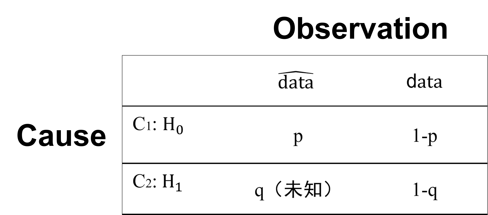

# 3.6 拓展阅读：p值的物理意义

讲完了概率推断的基础知识，我们不妨回顾一下心理统计中常见的一个问题，就是在统计中 $$p$$ 值的具体定义。虽然很多学生在学习心理统计之后，都可以手动算出例如一个简单 $$t$$ 检验的 $$t$$ 值和查找对应 $$p$$ 值。但是从概率上讲，任何的概率值都会对应一个物理意义。那么心理统计中常见的 $$p$$ 值的物理意义是什么呢？也许很多同学并没有思考过这个问题。著名期刊 Nature 曾经多次发文讨论在研究过程中对 $$p$$ 值的错误理解或者是误用⁠4⁠,⁠5。

我在下面开脑洞，随便想了一个简单的统计题。


### <mark style="color:red;">**思考题**</mark>

为了比较某校学生2025年和2024年的饭量差异，我们分别测量了一些学生各自在两年的饭量平均值，并将此数据集记为 $$D$$.

那么，根据心理统计的原理，我们可以构成零假设和备择假设

$$H_0$$: 2025年和2024年的饭量没有差异

$$H_1$$: 2025年和2024年的饭量有差异 

然后你做了一个简单 $$t$$ 检验，计算出了 $$p$$ 值，请问这个 $$p$$ 值的物理意义? 我提供下面一系列的选项

1. $$H_0$$ 为真的概率, 即 $$p(H_0=\mathrm{True})$$
2. $$H_1$$ 为真的概率, 即 $$p(H_1=\mathrm{True})$$
3. 基于当前数据，$$H_0$$ 为真的概率，即 $$p(H_0=\mathrm{True} \mid  D)$$
4. 基于当前数据，$$H_1$$ 为真的概率，即 $$p(H_1=\mathrm{True} \mid  D)$$
5. 如果 $$H_0$$ 为真，观察到当前数据的概率，即 $$p(D \mid  H_0=\mathrm{True})$$
6. 如果 $$H_1$$ 为真，观察到当前数据的概率，即 $$p(D \mid  H_1=\mathrm{True})$$
7. 如果 $$H_0$$ 为真，观察到当前数据甚至更极端的数据的概率，即 $$p(D\text{ 或者更极端} \mid  H_0=\mathrm{True})$$
8. 如果 $$H_1$$ 为真，观察到当前数据甚至更极端的数据的概率，即 $$p(D\text{ 或者更极端} \mid  H_1=\mathrm{True})$$


因为我们这一章节学习了概率推断和条件概率等概念，那么上面的这些概率表达，你肯定能理解什么意思。

不知道你能否算出来，正确答案是: 7

在假设检验中，我们认为数据可能是在两种原因下产生的，一是 $$H_0$$，二是 $$H_1$$。在 $$t$$ 检验中，我们假设 $$H_0$$ 为真，$$p$$ 值代表的含义是观察到当前数据以及更极端数据的可能性。因此，如果我们使用条件概率的方式来看待熟悉的假设检验，正确的表示为：$$p值 =  p(D\text{ 或者更极端} \mid  H_0=\mathrm{True})$$


### <mark style="color:red;">**进一步思考**</mark>

1. $$p(D\text{ 或者更极端}\mid  H_0=\mathrm{True}) + p(D\text{ 或者更极端}\mid  H_1=\mathrm{True}) = 1$$ 一定成立吗？
2. 有没有可能 $$p(D\text{ 或者更极端} \mid  H_1=\mathrm{True}) < p(D\text{ 或者更极端} \mid  H_0=\mathrm{True})$$？


***

如果我们使用本章所学的[似然函数](3.2-si-ran-han-shu.md#si-ran-han-shu)的角度看待这个问题，我们可以将此问题中出现的概率填入[洒水问题](3.2-si-ran-han-shu.md#tiao-jian-gailfen-bu)相似的表格。

首先，将 $$D$$ 或者更极端记做 $$\hat {\text  data}$$，比 $$D$$ 更常见记做 $${\text  data}$$，把 $$p(D\text{ 或者更极端}\mid  H_0=\mathrm{True})$$ 记作 $$p$$，把 $$p(D\text{ 或者更极端}\mid  H_1=\mathrm{True})$$ 记作 $$q$$，可以得到表格如下：

<figure><figcaption></figcaption></figure>

对于问题 1：

由似然函数的性质可知，$$p(D\text{ 或者更极端}\mid  H_0=\mathrm{True}) + p(D\text{ 或者更极端}\mid  H_1=\mathrm{True}) = p+q$$ 不一定等于 1。

需要注意，$$p$$ 和 $$q$$ 是同一个事件在不同假设下的条件概率，并不是同一条件下两个互补事件的概率。表格中，相加等于 1 的是 $$p$$ 与 $$1-p$$，以及 $$q$$ 与 $$1-q$$。&#x20;

对于问题 2：

$$p(D\text{ 或者更极端} \mid  H_1=\mathrm{True}) < p(D\text{ 或者更极端} \mid  H_0=\mathrm{True}) \iff q<p$$。单看这个表格，我们其实不能确定 $$p$$ 和 $$q$$ 的大小关系。

这里需要注意，“更极端”始终以 $$H_0$$ 为参照，无论计算 $$p$$ 还是 $$q$$ ，我们使用的都是同一个标准——在双侧 $$t$$ 检验中，我们看的是 $$t$$ 值的绝对值是否不小于本次观测值的绝对值；如果单侧检验只考察饭量增加，我们看的就是 $$t$$ 值是否不小于本次观测值。

在这个场景中，如果我们做的是通常的双侧 $$t$$ 检验，并且数据满足它的模型假设，那么两年真实平均饭量没有差异时， $$t$$ 值落入上述两侧极端区域的概率最小，而这个概率就是 $$p$$。因此，$$q$$ 是不能小于 $$p$$ 的。不过，如果我们只考察“饭量增加（或减少）”方向的极端结果，而真实饭量反而减少（或增加），那么这些结果出现的概率就会比 $$H_0$$ 为真时更小。此时，若用 $$q$$ 表示这种真实减少情形下的概率，就会出现 $$q <p$$ 的情况。
