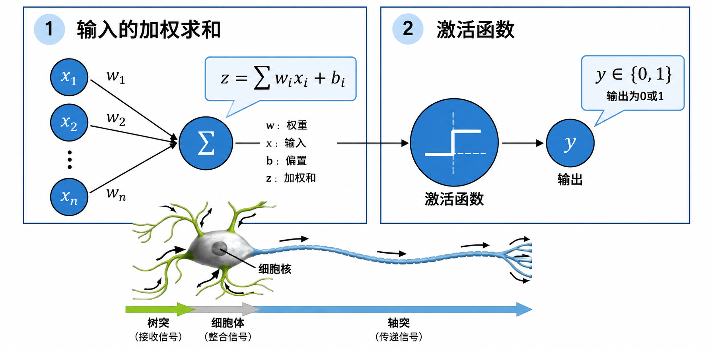
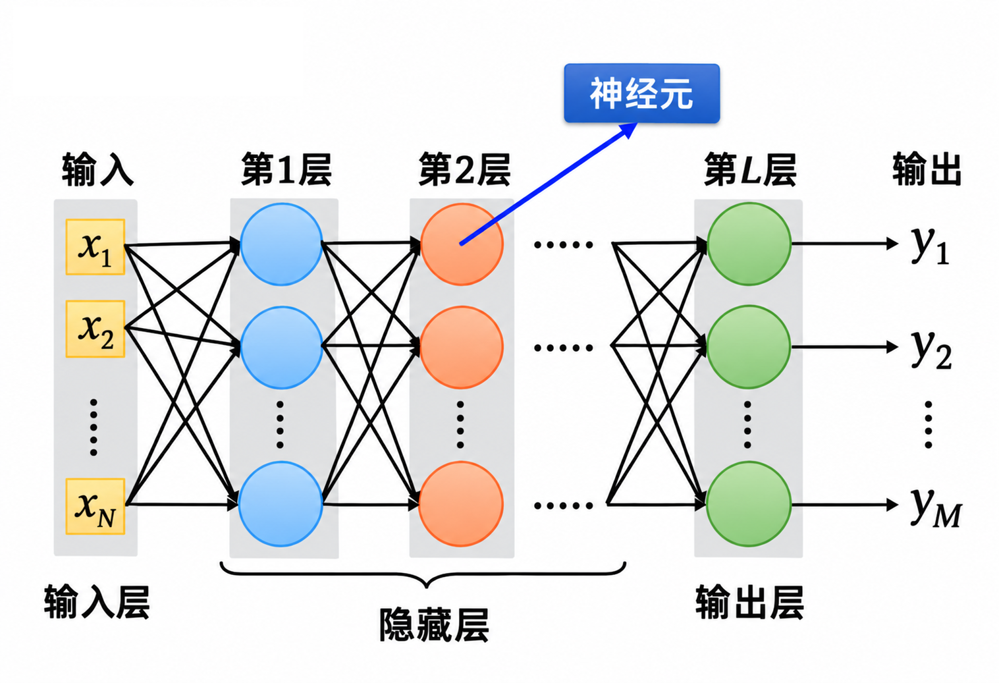
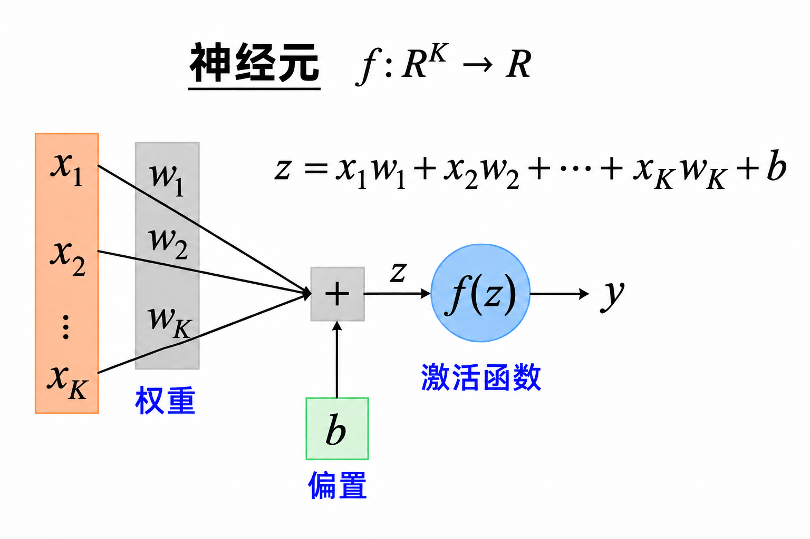
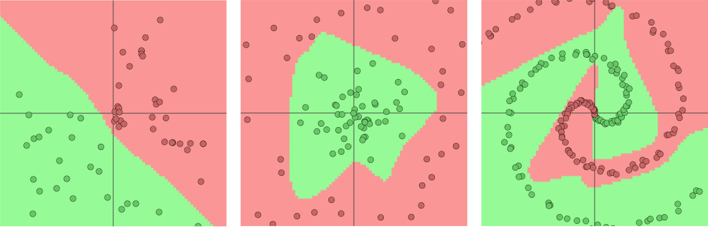
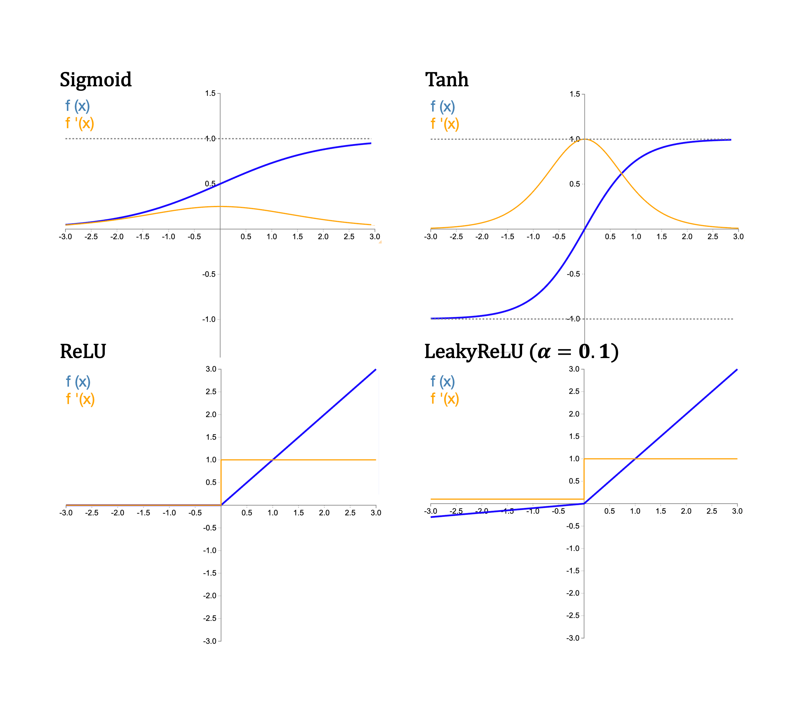
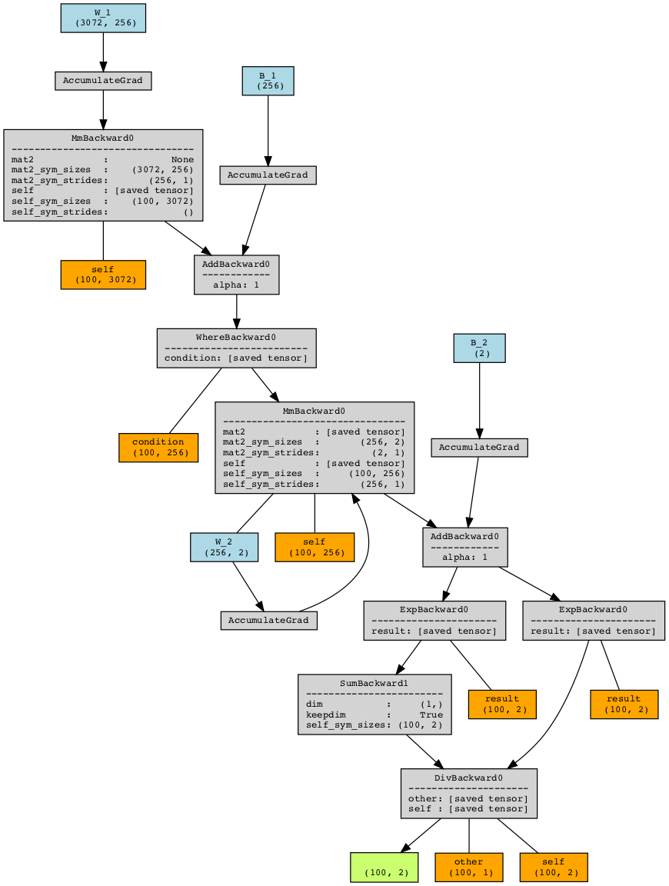

# 10.1.1 神经网络的架构

## 神经网络的基本思想

* **表征学习**：神经网络能够从数据中学习适合任务的内部表征。
  * 例如：在表情识别任务中，网络可以将离散的像素信息转换为区分不同表情的连续表征。
* **非线性拟合**：神经网络利用非线性变换，刻画多个输入共同作用时产生的复杂关系。
  * 例如：在根据脑电信号识别动作意图时，网络可以综合不同电极位置、不同频段的输入，学习这些特征的组合与动作意图的关系。
* **层次加工**：多层网络通过逐层组合和转换前一层的表征，从而有可能学习到由较简单特征构成的、更复杂或更抽象的表征。
  * 例如：在语言学习中，模型可以逐层整合词语及上下文信息，学习句法结构与句子含义相关的表征。

## 多层感知机


感知机：神经网络的基石

20世纪中期，研究者已在探索如何用数学和计算机模拟人类的学习与认知过程。在早期相关研究中，一种思路是借鉴神经元之间的连接方式，构建能够通过调整连接强度进行学习的计算模型。1957年，美国心理学家弗兰克·罗森布拉特（Frank Rosenblatt）提出了**感知机（perceptron）。**&#x5176;基本的单层形式将输入特征按不同权重加以整合，并根据分类错误调整这些权重，从而学习将输入划分为两类。这种通过调节权重实现学习的方法，为后续人工神经网络的研究提供了重要基础。


感知机通过调整连接权重进行学习的思路，为后续人工神经网络的发展提供了重要基础。在此基础上，一类将人工神经元组织为输入层、一个或多个隐藏层以及输出层的前馈网络，被称为**多层感知机（Multilayer Perceptron，MLP）**。

MLP中单个人工神经元的设计借鉴了生物神经元接收、整合并传递信号的基本特点。生物神经元接收来自其他神经元的突触输入，并对这些输入引起的膜电位变化进行整合；当膜电位达到阈值时，便产生动作电位。人工神经元则接收一组输入数值 $$(x_i)$$，先计算加权和 $$(z=\sum_i w_ix_i +b)$$，再通过激活函数得到输出 $$(y=f(z))$$。其中**权重** $$(w_i)$$表示各项输入对计算结果的影响，**偏置** $$(b)$$用于调整激活函数的输入，而非线性**激活函数**使网络能够表达更复杂的输入与输出关系。

<figure><figcaption><p>图10-1 突触启发的感知机结构</p></figcaption></figure>

从网络结构来看，MLP中的神经元以层为单位组织。标准 MLP 的相邻层之间采用全连接方式：后一层的每个人工神经元接收前一层所有神经元的输出，并使用各自的权重和偏置进行计算，再通过激活函数得到输出。信息从输入层经过隐藏层，逐层传向输出层。这种前向计算过程称为前向传播，构成了 MLP 处理信息的基本方式。

<figure><figcaption><p>图10-2 多层感知机的结构</p></figcaption></figure>

* **输入层** $$(X=(x_1, x_2, ..., x_N)^\top)$$**：**&#x63A5;收输入数据，每个输入数据对应一个输入节点/神经元。
* **中间隐藏层：**&#x9690;藏层位于输入层和输出层之间，负责对输入数据进行处理和特征提取。
* **输出层** $$(Y=(y_1, y_2, ..., y_M)^\top)$$：神经网络的最后一层，用于生成最终的预测结果。


神经网络的层数概念

在神经网络中，**层数**通常是指网络中包含的**隐藏层**和**输出层**的数量，而不包括输入层。

例如，一个神经网络有1个输入层、3个隐藏层和1个输出层，那么这个神经网络通常被称为四层神经网络；而如果网络中有1个输入层、1个隐藏层和1个输出层，它就是一个两层神经网络。


### 权重和偏置

神经网络的层与层之间是通过网络**权重**来连接的，它们决定了输入信号在传递到下一层时的重要性，每一条连接都有一个对应的权重。

以图10-3为例，在神经网络某一层中神经元的激活分别为$$x_1,x_2,...x_K$$，向下一层的连接权重对应为$$w_1,w_2,...w_K$$，经过加权后信号变为$$w_1 x_1 , w_2 x_2, ... w_K x_K$$，最终加权求和得到总的输入信号：

$$
z = w_1x_1 + w_2x_2 +...+ w_Kx_K \qquad (10-1)
$$

**偏置**则是在加权求和的基础上增加了一个常数项，使得神经元的激活函数具有更多的灵活性。偏置相当于神经元的一个固定输入，当所有输入为零时，偏置决定了神经元的输出。这使得神经网络能够更好地适应数据，特别是在输入为零时确保神经元仍能激活。从数学形式上，加入偏置$$b$$之后，总的输入信号变为：

$$
z = w_1x_1 + w_2x_2 +...+ w_Kx_K+b \qquad (10-2)
$$

<p align="center">（公式10-2本质上是线性映射，将 <span class="math">K</span>维输入向量<span class="math">X=(x_1,..,x_K)^\top\in \R^K</span>映射到一维实数空间 <span class="math">y\in \R</span>）</p>

神经网络的权重和偏置是重要的网络参数，会在训练过程中进行迭代和调整，使得网络能够更好地拟合数据。


<figure><figcaption><p>图10-3 神经网络中的连接权重与偏置</p></figcaption></figure>


权重和偏置的矩阵表示

矩阵可以将一层中所有神经元的计算统一表示。假设某一层接收 (M) 个输入，并包含 (N) 个输出神经元。将输入和输出都写成列向量：

$$X=[x_1,x_2,\ldots,x_M]^\top\in\mathbb R^M,\qquad Y=[y_1,y_2,\ldots,y_N]^\top\in\mathbb R^N.$$

所有连接的权重可以组成 $$W\in \R^{M\times N}$$，其中，元素 $$W_{ij}$$表示第 $$i$$个输入与第 $$j$$个输出神经元之间的连接权重。因此 $$W$$的每一列包含每一个输出神经元的全部输入权重。

将各输出神经元的偏置写成列向量 $$b=[b_1,b_2,\ldots,b_N]^\top$$，这一层的加权求和与输出则可以表示为：

$$Z=W^\top X+b,\qquad Y=f(Z).$$

偏置也可以合并到权重矩阵中。具体而言，在输入向量末尾添加一个恒为 (1) 的分量，并在权重矩阵底部添加一行偏置：

&#x20;

$$
\tilde{X} =
\begin{bmatrix}
X \\
1
\end{bmatrix}
\in \mathbb{R}^{M+1},
\qquad
\tilde{W} =
\begin{bmatrix}
W \\
B
\end{bmatrix}
\in \mathbb{R}^{(M+1)\times N}.
$$

新增的最后一行为 $$B=[b_1,b_2,\ldots,b_N]$$。

因此上述计算可以统一表示为：

$$Z=\tilde W^\top\tilde X,\qquad Y=f(Z).$$


### 激活函数

#### 激活函数的作用

人工神经元首先对输入进行加权求和，得到 $$z=\sum_i w_i x_i+b$$，再通过激活函数将其转换为输出，即 $$y=f(z)$$。激活函数规定了神经元如何响应整合后的输入，其主要作用包括：

* **确定输出形式**：激活函数将加权和转换为相应的输出。
  * 例如，图10-1的阶跃函数根据输入是否达到阈值输出 0 或 1。
* **引入非线性**：如果各层只进行加权求和，那么无论叠加多少层，整体计算仍可合并为一次仿射变换。非线性激活函数使多层网络能够表达更复杂的输入与输出关系。

<figure><figcaption><p>图10-4 输入输出关系实例 <a href="https://cs.stanford.edu/people/karpathy/convnetjs/demo/classify2d.html">[来源]</a></p></figcaption></figure>

#### 常见激活函数

* **Sigmoid**：Sigmoid函数将输入从实数域映射到$$(0,1)$$之间，表达式为：

$$
\sigma (z) = \frac{1}{1+e^{-z}} \qquad (10-3)
$$

Sigmoid激活函数常用于分类模型的输出层，将输出解释为某一类别的预测概率。当输入的绝对值较大时，函数输出接近0或1，进入饱和区，其导数也接近于0。在深层网络的隐藏层中使用Sigmoid时，梯度在反向传播过程中可能逐层减小，使靠近输入端的参数更新缓慢，产生梯度消失问题。


* **Tanh**: Tanh函数将输入从实数映射到$$(-1,1)$$之间，函数图像关于原点对称，能同时产生正值与负值。表达式为：

$$
\mathrm{tanh}(x) = \frac{e^z-e^{-z}}{e^z+e^{-z}} \qquad (10-4)
$$

相比于Sigmoid函数，Tanh函数的输出形式在某些任务中更为合适。但当输入值的绝对值较大时，Tanh同样会进入饱和区，因此也可能出现梯度消失的问题。


* **ReLU**：ReLU(Rectified Linear Unit) 函数是目前常用的激活函数，它将输入大于0的部分保留，小于或等于0的部分设为0，表达式为：

$$
\mathrm{ReLU}(z) = max(0,z) \qquad (10-5)
$$

ReLU的输出范围是$$[0, \infin)$$。其计算简单，在正输入区间导数恒为1，有助于缓解由激活函数饱和引起的梯度消失，因此广泛应用于深度神经网络的隐藏层。但如果某个神经元对所有训练样本的加权和持续为负，其输出通过该神经元反向传播的梯度都会为0，相应的输入权重与偏置无法通过这一梯度路径进行更新。这一现象被称为“神经元死亡”。


* **Leaky ReLU**：Leaky ReLU是ReLU的改进版本，在负输入区间保留一个较小的斜率，表达式为：

$$
\mathrm{Leaky ReLU}(x) = \max(\alpha z,z) \qquad (10-6)
$$

其中，$$\alpha$$通常是一个很小的正数，比如0.1。当输入可以取任意实数$$\alpha>0$$时，Leaky ReLU的输出范围是$$[-\infty, +\infty)$$。由于负输入区间的导数为$$\alpha$$，梯度可以传播，因此缓解了ReLU的“神经元死亡”问题，但需要设定额外的超参数$$\alpha$$。

激活函数在神经网络中扮演着至关重要的角色，通过引入非线性，使得神经网络能够学习和表达复杂的非线性关系。不同的激活函数有各自的优缺点，选择合适的激活函数可以显著提高模型的学习效果和性能。

<figure><figcaption><p>图10-5 常见激活函数及其导数 <a href="https://dashee87.github.io/deep%20learning/visualising-activation-functions-in-neural-networks/">[来源]</a></p></figcaption></figure>

#### 分类输出函数：Softmax

与上述激活函数分别对每个神经元的输入进行变换不同，Softmax函数联合处理一组输入，并将其转换为各分量为正、总和为1的概率分布。因此在类别互斥的多分类任务中，它通常用于输出层，将各类别的原始得分 $$(\mathrm{logits})$$转换为预测概率。对于包含 $$(K)$$个类别的任务，第 $$(i)$$类的预测概率为：

$$
\mathrm{Softmax}(z_i)=\frac{e^{z_i}}{\sum_{j=1}^{K}e^{z_j}} \qquad(10-7)
$$

为了控制原始得分与预测概率间的转换关系，Softmax函数可以引入温度系数 $$(T)$$调整概率分布的集中程度：

$$
\mathrm{Softmax}(z_i)=\frac{e^{z_i/T}}{\sum_{j=1}^{K}e^{z_j/T}} \qquad (10-8)
$$

* 当 $$T=1$$时，公式10-8与标准Softma公式10-8等价；
* 当 $$0<T<1$$时，得分除以温度后的差距增大，概率分布更加集中，；
* 当 $$T>1$$时，得分除以温度后的差距缩小，概率分布更加平缓。

Softmax通常与交叉熵损失函数（Cross-Entropy Loss）结合使用。在采用真实类别标签的多分类训练中，最小化交叉熵损失会促使模型提高分配给真实类别的预测概率。常见应用包括图像分类（如MNIST手写数字识别）以及文本分类（如情感分析）。在自回归语言模型中，Softmax将词表中各候选词元（token）的得分转换为概率分布，模型据此预测下一个词元，并通过逐步预测生成文本。在具有离散动作空间的强化学习中，Softmax也可以将各动作的得分转换为选择概率，使智能体能够按照该分布采样动作。

## 应用实例

本节以图像分类为例，介绍如何将仿射变换与激活函数结合，构建一个包含单层隐藏层的多层感知机。假设每张输入图片均为$$32\times 32$$ 像素的RGB彩色图像，且只属于猫和狗两个类别中的一个。

<figure><figcaption><p>图10-6 图像分类任务举例</p></figcaption></figure>

1. **图像预处理**

首先，多层感知机的输入是一维向量，而图片通常是三维张量（宽度 $$\times$$高度$$\times$$颜色通道），因此需要将图片的维度展开为一维。将图像的红、绿、蓝三个通道中的像素值按照固定顺序展开，组成长度为3072维$$(32\times 32\times 3)$$的输入向量。

```python
# 引入必要的工具包
## torch+torchvision 下载来源：https://pytorch.org/
## pip install datasets
import torch
from torch.utils.data import Subset
from torchvision import datasets, transforms
from datasets import load_dataset

# 从 Hugging Face 下载数据集
dataset = load_dataset("crystalhuang0228/cifar10-cat-dog-toy")
# 图像转换为 PyTorch Tensor
to_tensor = transforms.ToTensor()
# 提取训练数据：图片+标签
train_set = dataset["train"]
X = torch.stack([to_tensor(sample["image"]) for sample in train_set])
Y = torch.tensor(train_set["label"],dtype=torch.long)

# 维度展平 [100, 3, 32, 32] -> [100, 3072]
X = X.flatten(start_dim=1)
print(X.shape)  # [100, 3072]
print(Y.shape)  # torch.Size([100])
```

2. **输入层到隐藏层的仿射变换**

假设隐藏层的维度为256，并接收输入层3072维的输入向量进行变换。输入层与隐藏层的连接权重组成 $$3072 \times 256$$的矩阵 $$W_1$$ ，隐藏层各神经元的偏置组成长度为256的向量$$B_1$$。线性变换的过程如下：

$$
Z_1 = XW_1 + B_1 \qquad(10-9)
$$

```python
import torch
import torch.nn as nn

# X: [100, 3072]
input_dim = 3072
hidden_dim = 256

# 输入层到隐藏层
## 实际应用可以直接使用封装模块(nn.Linear)
## 初始化权重和偏置，并设置为可学习和更新的参数
W_1 = nn.Parameter(torch.randn(input_dim, hidden_dim) * 0.01)
B_1 = nn.Parameter(torch.zeros(hidden_dim))
## 线性变换
Z_1 = X @ W_1 + B_1

print(Z_1.shape)   # torch.Size([100, 256])

```

3. **隐藏层的非线性激活**

在得到仿射变换的结果 $$Z_1$$后，激活函数对其进行非线性的变换。假设ReLU（Rectified Linear Unit）为中间层的激活函数。激活后的隐藏层输出$$h$$ 计算如下：

$$
H=\mathrm{ReLU}(Z_1)=\max(0,Z_1)\qquad(10-10)
$$

```python
H = torch.where(Z_1 > 0, Z_1, torch.zeros_like(Z_1)) 
print(H.shape) # torch.Size([100, 256])
## 实际使用：torch.nn.ReLU / torch.relu
```

4. **隐藏层到输出层的仿射变换**

隐藏层的输出$$H$$ 接下来作为输入传递到输出层。在当前二分类场景下，输出层可以设置为单个或2个神经元；假设输出层包含2个神经元，则分别表示预测猫或狗的得分。隐藏层到输出层的连接权重构成 $$256 \times 2$$的权重矩阵 $$W_2$$，偏置向量$$B_2$$的长度为2。

```python
class_num = 2
W_2 = nn.Parameter(torch.randn(hidden_dim, class_num) * 0.01)
B_2 = nn.Parameter(torch.zeros(class_num))
## 线性变换
Z_2 = H @ W_2 + B_2

print(Z_2.shape)   # torch.Size([100, 2]))
```

5. **输出层的分类输出**

最后，输出层两个类别的得分（logits）通过Softmax函数转换为和为1的预测概率。

$$
p(i)=\frac{e^{Z_{2i}}}{\sum_{j=1}^{2}e^{Z_{2j}}} \qquad(10-11)
$$

其中，$$p(i)$$表示模型预测输入图片属于第 $$i$$ 类（猫或狗）的概率。

```python
P = torch.div(torch.exp(Z_2), torch.sum(torch.exp(Z_2),dim=1, keepdim=True))
## 实际使用：torch.nn.Softmax/ torch.softmax
print(P.shape) # torch.Size([100, 2]))
```

6. **网络结构可视化**

通过逐层的加权求和、偏置相加和激活函数变换，人工神经元构成了一个完整的前馈神经网络。在支持自动微分的深度学习框架中，前向计算涉及的运算及其依赖关系可以表示为**计算图**。训练时，框架沿计算图进行反向传播，计算损失函数对各参数的梯度，再由优化器更新权重和偏置。借助可视化工具，我们可以查看网络的层次结构，更直观地理解各部分之间的连接关系：

```python
## 安装：
### conda install graphviz
### pip install torchviz
from torchviz import make_dot

graph = make_dot(P,params={"W_1": W_1, "B_1": B_1, "W_2": W_2,"B_2": B_2}, 
                show_attrs=True, show_saved=True,)
graph.render("mlp_computational_graph", format="png", cleanup=True)
```

<figure><figcaption><p>图10-7 网络参数连接关系</p></figcaption></figure>

神经网络通过前向传播得到预测结果后，利用损失函数衡量预测结果与目标之间的差异，再通过反向传播计算损失对各参数的梯度，并由优化器更新参数。下一节将进一步介绍如何定义损失函数、计算梯度和更新网络参数。

## 拓展阅读

### **单层感知机的缺陷: 异或问题**

最初提出的感知机（图10-1）即为单层结构，输入与输出神经元直接连接，不包含隐藏层。输出神经元首先计算输入的加权和并加上偏置，再通过阶跃函数得到类别标签 $$y$$。虽然阶跃函数本身是非线性的，但类别的边界仍由 $$\sum_i w_i x_i+b$$决定。因此单层感知机在二维空间中的决策边界是一条直线，在更高维空间则是一个超平面。**对于线性不可分的数据，它无法正确分类所有样本。**

$$
\hat y=
\begin{cases}
1,& \sum_i w_i x_i+b\geq0,\\
0,& \sum_i w_i x_i+b<0.
\end{cases} \qquad (10-12)
$$

**异或（exclusive OR，XOR）问题**是一个典型例子。对于两个取值为0或1的输入，异或运算 $$(x_1\oplus x_2)$$的规则是：两个输入相同时输出0，不同时输出1。因此，四个输入组合及其标签为：

$$
(0,0)\mapsto0,\quad (1,1)\mapsto0,\quad
(0,1)\mapsto1,\quad (1,0)\mapsto1.
$$

将这些输入 $$(x_1,x_2)$$表示为二维平面上的点，可以看到同一类别的两个点位于正方形的对角位置，无法用一条直线将两类点完全分开。因此，XOR是线性不可分问题，单层感知机无论如何调整权重和偏置，都不足以将数据点同时正确分类。

XOR问题的重要性在于，它明确展示了单层感知机的局限性。由于单层感知机只能处理线性可分的问题，类似更复杂的线性不可分问题需要更复杂的模型结构。

这直接推动了多层感知机（MLP）的发展。通过引入至少一个具有非线性激活函数的隐藏层，MLP能够对输入数据进行非线性变换，使得模型可以在高维空间中找到一个线性可分的决策边界，从而正确解决像XOR这样的非线性问题。

具体来说，在多层感知机中，隐藏层通过将输入数据映射到更高维度的特征空间，可以在这个空间中实现原始输入数据的线性可分。这使得网络能够处理复杂的非线性关系，从而解决XOR问题，并在许多其他实际应用中表现出色。

