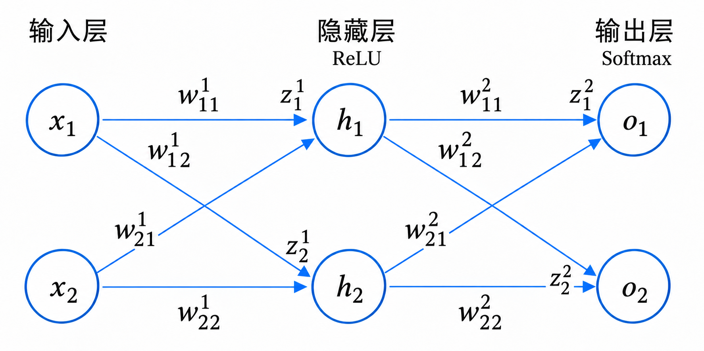
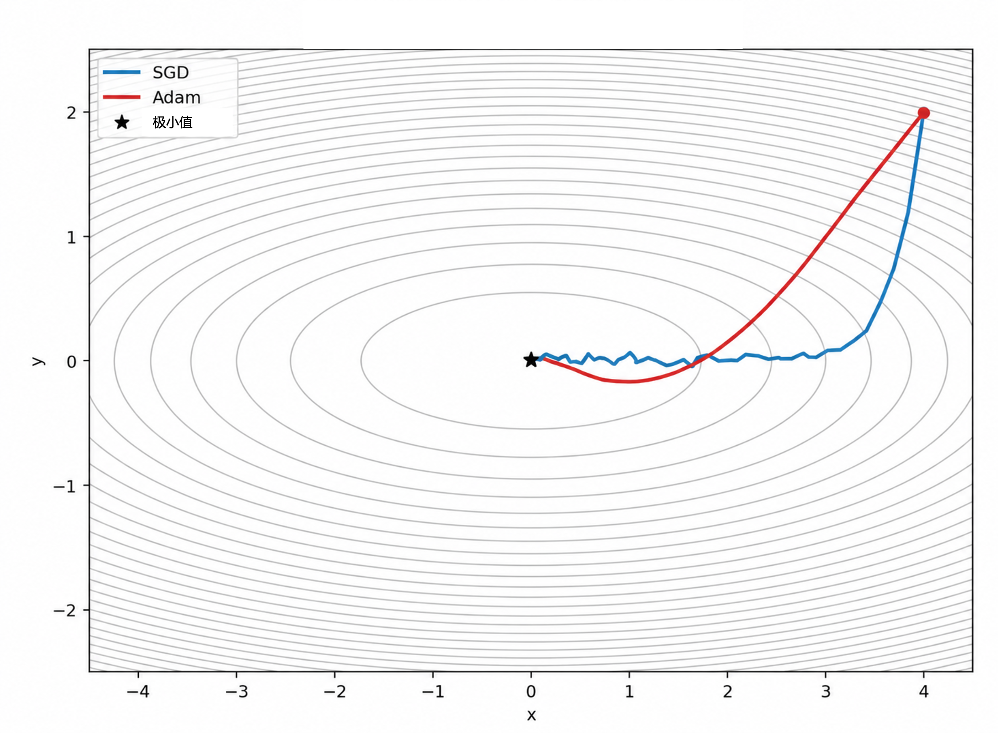

# 10.1.2 反向传播算法

在前一节中，我们介绍了神经网络的基本组成，以及多层感知机如何通过逐层的仿射变换和激活函数完成前向计算。本节将进一步介绍神经网络训练的三个关键环节：用损失函数衡量预测结果与目标之间的差异，通过反向传播计算损失对各参数的梯度，再由优化器利用这些梯度更新参数。

## 损失函数

在前向传播过程中，输入数据依次经过网络各层的仿射变换、激活函数等操作，最终得到预测结果。在监督学习的训练过程中，**损失函数**根据预测结果与目标值（如类别标签）间的差异计算损失值（loss），用于量化预测结果偏离目标的程度。不同的损失函数采用不同的衡量方式，需要根据任务选择。训练时，模型通过调整参数，尽可能减小训练数据上的损失，从而改善预测表现。因此，损失函数既提供了评价预测结果的标准，也为参数优化确定了目标。

### 常见损失函数

根据不同的任务类型（如回归、分类等），我们可以选择不同的损失函数。以下是几种常见的损失函数：

* **均方误差（Mean Squared Error, MSE）**： MSE是回归任务中最常用的损失函数之一，它计算预测值与实际值之间的平方差的均值。公式为：

$$
\mathcal{L}_{\text{MSE}}= \frac{1}{N} \sum_{i=1}^{N}(y_i-\hat{y_i})^2 \qquad(10-13)
$$

其中，$$y_i$$ 是第 $$i$$个样本的实际值，$$\hat{y_i}$$​ 是模型的预测值，$$N$$是用于计算损失的样本数量。MSE对预测误差取平方后求平均，因此较大的误差对损失产生更显著的影响。

* **平均绝对误差（Mean Absolute Error, MAE）**： MAE是另一个常用于回归任务的损失函数，它计算预测值与实际值之间误差绝对值的均值。公式为：

$$
\mathcal{L}_{\text{MAE}} = \frac{1}{N} \sum_{i=1}^{N}|y_i-\hat{y_i}| \qquad(10-14)
$$

MAE随误差的绝对值线性增长，因此相较于MSE，受极端误差的影响更小。

* **交叉熵损失（Cross-Entropy Loss）**： 交叉熵损失是分类任务中最常用的损失函数。它衡量了真实类别分布与预测类别分布之间的差异。对于二分类问题，交叉熵损失函数的公式为：

$$
\mathcal{L}_{\text{CE}}= -\frac{1}{N}\sum_{i=1}^{N}[y_i \log(\hat{y_i})+(1-y_i)\log(1-\hat{y_i})] \qquad (10-15)
$$

其中，$$y_i$$​ 是真实标签（0或1），$$\hat{y_i}$$是预测概率。对于多分类问题，交叉熵损失可以扩展为：

$$
\mathcal{L}_{\text{CE}} = -\frac{1}{N} \sum_{i=1}^{N} \sum_{c=1}^{M} y_{i,c} \log(p_{i,c}) \qquad(10-16)
$$

其中，$$M$$ 是类别数量，$$y_{i,c}$$​ 为类别的独热编码，仅真实标签为1，其余为0；$$p_{i,c}$$是模型对于类别$$c$$的预测概率。

损失函数的选择直接影响模型的性能和训练效果。不同类型的任务需要不同的损失函数：**回归任务**中MSE和MAE是最常见的选择。MSE对较大的误差更为敏感，而MAE则对异常值更具鲁棒性。**分类任务**中交叉熵损失是最常用的，特别是在与Softmax结合使用时。

### 应用实例

沿用上一节图像分类的例子，网络通过Softmax得到每张图片属于各类的预测概率。根据预测概率与已知的真实类别标签，我们采用交叉熵损失函数衡量预测与目标结果之间的差异：

```python
print(P.shape) # 预测概率[N, 2]
print(Y.shape) # 真实类别标签[N]
# 提取真实标签对应的概率，计算交叉熵损失均值
loss = -torch.log(P[torch.arange(Y.shape[0]), Y]).mean()
```

## 反向传播算法

反向传播（backpropagation）是计算损失函数对网络参数的梯度的方法，其数学基础是链式法则。在前向传播和损失计算完成后，反向传播沿计算图的相反方向逐层计算梯度，得到损失对各层权重和偏置的偏导数。这些梯度反映了当前参数附近，参数的微小变化会如何影响损失，为参数调整提供依据。

随后，优化器利用梯度更新参数，以减小损失为目标。训练过程中，前向传播、损失计算、反向传播和参数更新反复进行，直到达到预设的停止条件。


### 反向传播与神经网络的历史

1986年，David E. Rumelhart、Geoffrey E. Hinton和Ronald J. Williams在《Nature》发表论文《Learning representations by back-propagating errors》（通过误差反向传播学习表征），展示了如何利用反向传播训练多层神经网络，使隐藏层学习任务所需的内部表征。尽管反向传播及其数学基础已有更早的研究，这篇论文仍是推动该方法广泛应用的工作之一。

这一工作的第一作者Rumelhart是一位认知心理学家，长期利用计算模型研究人类的知觉、语言理解和记忆。共同作者Hinton后来获得了2018年图灵奖和2024年诺贝尔物理学奖。


### 数学推导

下面通过一个简化的二分类任务推导反向传播。考虑一个仅包含一层隐藏层的多层感知机，输入层、隐藏层和输出层均包含两个神经元。为便于计算，假设网络的输入包含两个特征，输出用于判断类别，分别以标签0和1表示。输出层的两个神经元分别给出两个类别的原始得分，再通过Softmax转换为对应的预测概率。

本例省略各层的偏置项，仅将连接权重作为可训练参数，以简化反向传播的推导。

<figure><figcaption><p>图10-9 反向传播示例网络</p></figcaption></figure>

这是一个两层的全连接网络，输入为二维向量 $$(X=[x_1, x_2]^\top)$$，输出为概率向量 $$(O=[o_1, o_2]^\top)$$。网络结构包括：

* **输入层**：包含2个神经元，对应输入向量 $$X$$。
* **隐藏层**：包含2个神经元，权重矩阵为 $$W^1$$，加权输入为$$Z^1$$，激活函数为 ReLU，激活值为$$H$$。
* **输出层**：包含2个神经元，权重矩阵为 $$W^2$$，加权输入为$$Z^2$$，激活函数为 Softmax，激活值为$$O$$。

网络中共包含8个可训练参数，分别来自隐藏层的权重矩阵$$W^1$$和输出层的权重矩阵$$W^2$$。我们使用**交叉熵损失函数**，根据模型输出的类别概率与真实的独热标签 $$Y=[y_1, y_2]^\top$$计算损失。反向传播的目标是计算损失 $$L_{\mathrm{CE}}$$ 对网络参数（$$W ^1$$ 和 $$W ^2$$ ）的梯度。

下面从输出层开始，沿前向计算的相反方向，逐层推导输出层和隐藏层的梯度。

令$$i$$ 表示输入层神经元的编号，$$j$$ 表示隐藏层神经元的编号，$$k$$ 表示输出层神经元的编号，$$\ell$$ 表示权重所在的层，各编号均取 (1,2)。

对于图10-9中的例子，交叉熵损失为

$$
L_{\mathrm{CE}} = -\frac 1 N\sum_{n=1}^{N}\sum_{c=1}^2y_{n,c} \log(o_{n,c})=-\frac 1 N\left[
\sum_{n:\,y_n=0}\log(o_{n,1}) +\sum_{n:\,y_n=1} \log(o_{n,2})\right] \qquad (10-17)
$$

对于单个样本：

$$
L_{\mathrm{CE}}=-\sum_{c=1}^{2}y_c\log(o_c).\qquad (10-18)
$$

首先计算损失对输出层预测概率 $$O$$ 的梯度，偏导数为：

$$
\frac{\partial L_{\mathrm{CE}}}{\partial o_c}
=-\frac{y_c}{o_c}  \qquad(10-19)
$$

由于Softmax对每个输出都依赖两个类别的原始得分，计算损失对加权输入 $$z^2_k$$的梯度时，需要合并所有输出对应的路径。已知Softmax的偏导数为：

$$
\frac{\partial o_c}{\partial z^2_k}
=o_c(\delta_{ck}-o_k) \qquad (10-20)
$$

其中 $$c=k$$ 时 $$\delta_{ck}=1$$，否则为0。

然后，我们继续计算损失函数$$L_{\mathrm{CE}}$$对 $$z^2_k$$ 的偏导数，根据链式法则：

$$
\begin{aligned}
\frac{\partial L_{\mathrm{CE}}}{\partial z^2_k}
&=\sum_{c=1}^{2}
\frac{\partial L_{\mathrm{CE}}}{\partial o_c}
\frac{\partial o_c}{\partial z^2_k}\\
&=-\sum_{c=1}^{2}y_c(\delta_{ck}-o_k)\\
&=-y_k+o_k\sum_{c=1}^{2}y_c\\
&=o_k-y_k
\end{aligned}  \qquad (10-21)
$$

因此，输出层的梯度可以简写为：

$$
\Delta^{2}
=\frac{\partial L_{\mathrm{CE}}}{\partial Z^2}
=O-Y,
\qquad O=[o_1,o_2]^\top \qquad (10-22)
$$

接着，计算输出层权重的梯度。由于

$$
z^2_k=\sum_{j=1}^{2}W^{2}_{jk}h_j,
\qquad
\frac{\partial z^2_k}{\partial W^{2}_{jk}}=h_j \qquad (10-23)
$$

链式法则可得：

$$
\frac{\partial L_{\mathrm{CE}}}{\partial W^{2}_{jk}}
=\frac{\partial L_{\mathrm{CE}}}{\partial z^2_k}\frac{\partial z^2_k}{\partial W^{2}_{jk}}=(o_k-y_k)h_j \qquad (10-24)
$$

将所有权重的梯度组成矩阵：

$$
\begin{aligned} \frac{\partial L_{\mathrm{CE}}}{\partial W^{2}} &= \begin{bmatrix} \displaystyle\frac{\partial L_{\mathrm{CE}}}{\partial w^{2}_{11}} & \displaystyle\frac{\partial L_{\mathrm{CE}}}{\partial w^{2}_{12}} \\
\displaystyle\frac{\partial L_{\mathrm{CE}}}{\partial w^{2}_{21}} & \displaystyle\frac{\partial L_{\mathrm{CE}}}{\partial w^{2}_{22}} \end{bmatrix} \\[6pt] &=H(\Delta^{2})^\top =\begin{bmatrix}h_1\\h_2\end{bmatrix} \begin{bmatrix}o_1-y_1 & o_2-y_2\end{bmatrix} \\[6pt] &= \begin{bmatrix} h_1(o_1-y_1) & h_1(o_2-y_2)\\ h_2(o_1-y_1) & h_2(o_2-y_2) \end{bmatrix}. \end{aligned} \qquad (10-25)
$$

接下来，计算隐藏层及其输入权重的梯度。由于每个隐藏层神经元都与每个输出层神经元相连，损失对隐藏层激活值 $$h_j$$的梯度需要对所有输出路径求和：

$$
\frac{\partial L_{\mathrm{CE}}}{\partial h_j}
=\sum_{k=1}^{2}
\frac{\partial L_{\mathrm{CE}}}{\partial z^2_k}
\frac{\partial z^2_k}{\partial h_j}
=\sum_{k=1}^{2}w^{2}_{jk}(o_k-y_k) \qquad (10-26)
$$

由于隐藏层的加权输入$$z^1_j$$与激活值 $$h_j$$分别为：

$$
z^1_j=\sum_{i=1}^{2}w^{1}_{ij}x_i,
\qquad
h_j=\mathrm{ReLU}(z^1_j)=\max(0,z^1_j) \qquad (10-27)
$$

根据链式法则，损失对隐藏层的加权输入的梯度为：

$$
\Delta^{1}_j
=\frac{\partial L_{\mathrm{CE}}}{\partial z^1_j}
=\frac{\partial L_{\mathrm{CE}}}{\partial h_j}
\frac{\partial h_j}{\partial z^1_j}
=\left[\sum_{k=1}^{2}w^{2}_{jk}(o_k-y_k)\right]
\mathrm{I}[z^1_j>0] \qquad (10-28)
$$

其中 $$\mathrm{I}[\cdot]$$为指示函数，条件成立时取1，否则取0。

进一步，由于 $$\partial z^1_j/\partial w^{1}_{ij}=x_i$$，输入层到隐藏层的权重梯度为：

$$
\frac{\partial L_{\mathrm{CE}}}{\partial w^{1}_{ij}}
=\frac{\partial L_{\mathrm{CE}}}{\partial z^1_j}
\frac{\partial z^1_j}{\partial w^{1}_{ij}}
=x_i\Delta^{1}_j
=x_i\left[\sum_{k=1}^{2}w^{2}_{jk}(o_k-y_k)\right]
\mathrm{I}[z^1_j>0] \qquad (10-29)
$$

其矩阵形式为：

$$
\begin{aligned} \frac{\partial L_{\mathrm{CE}}}{\partial W^{1}}
& = \begin{bmatrix} \displaystyle\frac{\partial L_{\mathrm{CE}}}{\partial w^{1}_{11}} & \displaystyle\frac{\partial L_{\mathrm{CE}}}{\partial w^{1}_{12}} \\
\displaystyle\frac{\partial L_{\mathrm{CE}}}{\partial w^{1}_{21}} & \displaystyle\frac{\partial L_{\mathrm{CE}}}{\partial w^{1}_{22}} \end{bmatrix} \\[6pt] 
&=X(\Delta^{1})^\top \\[6pt]
&= \begin{bmatrix}
x_1\!\left[w^{2}_{11}(o_1-y_1)+w^{2}_{12}(o_2-y_2)\right]\mathrm{I}[z^1_1>0]
&
x_1\!\left[w^{2}_{21}(o_1-y_1)+w^{2}_{22}(o_2-y_2)\right]\mathrm{I}[z^1_2>0]
\\[6pt]
x_2\!\left[w^{2}_{11}(o_1-y_1)+w^{2}_{12}(o_2-y_2)\right]\mathrm{I}[z^1_1>0]
&
x_2\!\left[w^{2}_{21}(o_1-y_1)+w^{2}_{22}(o_2-y_2)\right]\mathrm{I}[z^1_2>0]
\end{bmatrix}
\end{aligned} \qquad (10-30)
$$

至此，网络中八个权重的梯度均已求出。以上推导针对单个样本，如果损失函数取 $$N$$个样本的平均值，则参数梯度也为各样本梯度的平均值：

$$
\frac{\partial L_{\mathrm{CE}}}{\partial W^{\ell}}
=\frac{1}{N}\sum_{n=1}^{N}
\frac{\partial L_{\mathrm{CE}}^{n}}{\partial W^{\ell}},
\qquad \ell=1,2 \qquad (10-31)
$$

### 应用实例

沿用上一节的图像分类实例，在计算交叉熵损失后，可以通过反向传播求得损失对各个网络参数的梯度。在实际应用中，常见的深度学习框架（例如Pytorch）提供了自动微分功能，能够沿计算图自动应用链式法则，完成梯度计算。随后，优化器利用这些梯度更新网络参数。

```python
print("Before backward:")
print("W_1.grad =", W_1.grad) # 输出 None
print("B_1.grad =", B_1.grad)
print("W_2.grad =", W_2.grad)
print("B_2.grad =", B_2.grad)

# 核心反向传播算法
loss.backward()

print("\nAfter backward:")
print("W_1.grad.mean =", W_1.grad.mean()) # 输出实数tensor
print("B_1.grad.mean =", B_1.grad.mean())
print("W_2.grad.mean =", W_2.grad.mean())
print("B_2.grad.mean =", B_2.grad.mean())
```

## 优化器

在通过反向传播完成网络参数的梯度计算后，我们获取到了各参数的微小变化对损失的影响，为参数调整提供了依据。优化器利用这些梯度，按照一定的规则更新网络参数，以降低损失。训练中，优化器对参数的更新通过与前向传播、损失计算、反向传播的结合反复进行，以微小的步长逐步调整参数，使损失函数达到极小值，从而不断提升模型对训练数据的拟合能力。

### 常见优化器

#### 随机梯度下降（Stochastic Gradient Descent, SGD）

* **训练初始化**：假设网络的初始参数为 $$W_0$$，训练集为 $$\{X_n, Y_n\}_{n=1}^N$$，每次迭代的批量大小为$$B$$，学习率序列为$$\{\eta_t\}$$，迭代次数为$$T$$。
* **训练目标**：更新后的参数$$W_T$$能更好地拟合训练数据。
* **执行过程**：从第$$t=0$$次迭代到第$$t=T-1$$次
  * 从训练集中抽取$$B$$个样本，得到集合$$\mathcal{B}_t$$;
  * 使用当前参数$$W_t$$对该批样本进行前向传播；
  * 计算损失： $$L_{t}         \gets \frac{1}{B}         \sum_{s\in\mathcal{B}_t}L_{}^{s}$$
  * 反向传播以计算所有参数的梯度： $$G_t\gets \left. \frac{\partial L_{t}} {\partial W}  \right|_{W=W_t}$$
  * 更新参数： $$W_{t+1} \gets W_t-\eta_t G_t$$

其中，$$B$$代表第 $$t$$次迭代中用于参数更新的样本数量。使用全部训练数据计算平均损失及其梯度，称为**全批量梯度下降**。它能够得到当前参数下完整训练集的损失梯度，但每次更新的计算开销较大。**小批量随机梯度下降**则每次选取训练集的一批样本，以该批样本的平均梯度估计完整训练集的梯度。这种方式通常能降低每次更新的计算和内存开销，使参数更新更加频繁。

在基本的SGD算法中，学习率 $$\eta_t$$是控制更新幅度的主要参数，与每次迭代的梯度大小共同决定参数变化的大小。学习率过大，可能使参数越过损失较低的区域，导致损失震荡甚至训练发散；学习率过小，则可能使训练进展缓慢。学习率在训练过程中可以保持不变，也可以根据预设规则随迭代次数调整，或根据实际情况（例如验证集损失大小）动态调整。

#### 随机优化方法（Adam）

SGD利用当前批次的梯度更新参数，其下降方向可以通过损失函数的一阶泰勒展开来理解：在当前参数附近，沿负梯度方向进行足够小的调整，可以降低当前批次的损失。

如今**常用的Adam算法**则是在一阶梯度优化的基础上结合了两种信息：

* **动量**（momentum） $$m_t$$：计算梯度的指数移动平均，综合多次迭代的**梯度方向**，有助于减少方向上的波动；
* **二阶矩**（second moment）估计 $$v_t$$: 计算梯度平方的指数移动平均，并据此分别调整各参数的更新**幅度**。

Adam 算法在迭代训练中通过保留这两种信息，使得参数更新更为稳定：

$$
\begin{aligned}
m_t &= \beta_1 m_{t-1}+(1-\beta_1)g_t,\\
v_t &= \beta_2 v_{t-1}+(1-\beta_2)g_t^2,\\
w_{t+1} &= w_t-\eta_t\frac{\hat{m}_t}{\sqrt{\hat{v}_t}+\epsilon}.
\end{aligned} \qquad (10-32)
$$

其中 $$\hat m_t$$和 $$\hat v_t$$是经过初始化偏差修正的估计值。

相比于基本的SGD，Adam除了需要设定学习率 $$\eta_t$$，还需要设定动量和二阶矩的指数衰减权重 $$\beta_1,\beta_2$$。它们控制历史信息与当前梯度在移动平均中的相对权重： $$\beta_1$$ 决定历史梯度方向的保留程度； $$\beta_2$$决定历史梯度平方的保留程度，用于估计梯度大小并调整各参数的更新幅度。系数越接近1，移动平均保留的历史信息越多，变化通常越平缓，但对近期梯度变化的响应也越慢。

<figure><figcaption><p>图10-10 参数更新轨迹比较：SGD和Adam <a href="https://amarviswanathan.github.io/blog/2026/optimizers-are-memory/">[来源]</a></p></figcaption></figure>

### 应用实例

沿用前面图像分类的例子，我们使用Adam优化器更新网络参数。每次训练迭代依次进行前向传播、损失计算、反向传播与参数更新。下面通过训练循环，将此前的代码步骤整合起来：

```python
import torch
import torch.nn as nn
from torch.optim import Adam
from torchvision import transforms
from datasets import load_dataset

# ==================== 1. 加载数据 ====================
dataset = load_dataset("crystalhuang0228/cifar10-cat-dog-toy")
to_tensor = transforms.ToTensor()
train_set, test_set = dataset["train"], dataset["validation"]

def transform_to_torch(dataset):
    X = torch.stack([to_tensor(sample["image"]) for sample in dataset])
    # [N, 3, 32, 32] -> [N, 3072]
    X = X.flatten(start_dim=1)
    Y = torch.tensor(dataset["label"], dtype=torch.long)
    return X, Y
X, Y = transform_to_torch(train_set)
X_test, Y_test = transform_to_torch(test_set)

print("X:", X.shape)
print("Y:", Y.shape)
# ==================== 2. 定义神经网络 ====================
model = nn.Sequential(nn.Linear(3072, 256), nn.ReLU(), nn.Linear(256, 2))
# CrossEntropyLoss 内部已经包含 LogSoftmax
# 因此模型不需要显式添加 Softmax
criterion = nn.CrossEntropyLoss()
optimizer = Adam(model.parameters(), lr=0.001, betas=(0.8, 0.8))
# ==================== 3. 模型训练 ====================
num_epochs = 100
for epoch in range(num_epochs):
    model.train()
    # 1. 清空上一轮梯度
    optimizer.zero_grad()
    # 2. 前向传播
    logits = model(X)             # [N, 2]
    # 3. 计算损失
    loss = criterion(logits, Y)
    # 4. 反向传播
    loss.backward()
    # 5. Adam 更新参数
    optimizer.step()

    if (epoch + 1) % 10 == 0: 
       # 6. 评估训练集和测试集
        model.eval()
        with torch.no_grad():
            # 训练集准确率
            train_logits = model(X)
            train_predictions = train_logits.argmax(dim=1)
            train_accuracy = (train_predictions == Y).float().mean()

            # 测试集准确率
            test_logits = model(X_test)
            test_predictions = test_logits.argmax(dim=1)
            test_accuracy = (test_predictions == Y_test).float().mean()

            print(
            f"Epoch [{epoch+1:3d}/{num_epochs}] "
            f"Train Loss: {loss.item():.4f} | "
            f"Train Acc: {train_accuracy.item():.2%} | "
            f"Test Acc: {test_accuracy.item():.2%}"
        )
```

## 拓展阅读

### 训练批次与回合

以上述猫狗分类任务为例，我们采取了**全批量**训练的方式，每次迭代利用完整的训练集计算平均损失及其梯度，并更新模型参数。在实际应用中，**小批量**训练是平衡计算开销与更新频率的常见方式：将训练集划分为若干批次（batch），每次输入一批图像，计算该批样本的平均损失，通过反向传播计算梯度，再由优化器更新模型参数。完整遍历一次训练集称为一个训练回合（epoch），通常包含多次参数更新。

因此，**批次（batch）** 指一次迭代所使用的数据样本的集合。批次大小（batch size）则是其中的样本数量，常见取值包括8、16、32、64、128等。在每个训练回合中，较小的批次（例如8或16）意味着更多次参数更新，每次计算所需的内存或显存通常较少，但不同批次之间的梯度波动往往较大。较大的批次（例如128或256）通常能减小这种波动，并提高并行计算的效率，但需要更多内存或显存。批次大小对训练速度和最终结果的影响，还取决于硬件条件、模型结构和学习率等因素。

一个训练**回合（Epoch）**&#x901A;常包括多次参数更新。对于固定的训练集，回合数决定完整遍历训练集的次数，批次大小决定每个回合包含多少次参数更新。若训练集包含 $$N$$个样本，批次大小为 $$B$$，训练回合数为 $$E$$，则参数更新的总次数为 $$T = E \times \lfloor N/B\rfloor$$。训练不足时，模型可能尚未学到数据中的主要规律，表现为**欠拟合（Underfitting）**；随着训练继续，模型也可能逐渐拟合训练数据中的噪声或偶然特征，表现为训练效果继续改善，而对非训练数据的解释变差，即**过拟合（Overfitting）**。为了观察模型的学习效果，可以增加不参与训练的验证集，并绘制训练集和验证集上的损失值或其他评估指标随着回合数或参数更新次数变化的曲线。

### 超参数

超参数是模型训练前预先设定的参数，不会在训练过程中更新。

常见的超参数包括：

* **学习率（Learning Rate）**：学习率控制每次参数更新的幅度。
* **批量大小（Batch Size）**：如前文所述，批量大小影响每次参数更新时使用的数据量。
* **正则化参数**：正则化方法（如L1正则化、L2正则化、Dropout等）用于防止模型过拟合。正则化参数控制正则化的强度。
* **优化算法**：选择合适的优化算法（如SGD、Adam、RMSprop等）也是超参数的一部分，不同的优化算法适用于不同的任务和数据集。

在这一节中，我们引入了损失函数，推导了反向传播过程，并介绍了常见的优化算法。

