# 10.1.3 卷积神经网络

卷积神经网络（Convolutional Neural Network, CNN）是深度学习中的一种重要模型架构，在图像分析中得到广泛应用。其核心思想是通过**卷积**提取局部特征，并结合非线性激活和多层加工，逐步组合这些特征，形成更高层次、更抽象的表征。与直接使用全连接层处理高维输入相比，卷积层通过局部连接和权重共享减少可训练参数；池化层或带步长的卷积层则可以降低表征的分辨率，控制后续计算开销。


卷积神经网络的广泛应用

CNN的应用并不限于二维图像。一维CNN可以沿时间轴提取局部变化模式，用于脑电信号等时间序列的分析；三维CNN则可以在视频中同时提取时空特征，用于动作识别等任务。三维CNN还可以沿三个空间维度处理脑部磁共振成像（MRI）数据，学习脑结构等局部形态及其组合特征。


这一部分我们将探讨卷积神经网络的基本原理和网络结构。

## **卷积**

卷积神经网络中的“卷积”源于数学中的卷积运算。对应两个一维连续函数 $$f$$和$$g$$，在积分存在的条件下，**卷积（Convolution）**&#x5B9A;义为：

$$
(f*g)(t)=\int_{- \infin}^{\infin}f(\tau)g(t-\tau)d \tau  \qquad (10-33)
$$

其中， $$t$$表示卷积结果的计算位置， $$\tau$$为积分变量。对应每个固定的 $$t$$， $$g(t-\tau)$$可以理解为将函数 $$g(\tau)$$关于原点翻转后再平移。随后将 $$f(\tau)$$与 $$g(t-\tau)$$在各个 $$\tau$$位置的值相乘，并对乘积进行积分，得到该位置的卷积结果 $$(f*g)(t)$$。随着 $$t$$改变，翻转后的函数 $$g$$在函数 $$f$$上滑动，从而得到不同位置的卷积结果。

对于一维离散序列，相应的卷积通过求和定义：

$$
(f*g)(i)=\sum_{k=- \infin}^{\infin}f(k)g(i-k) \qquad (10-34)
$$

对于二维离散数据，例如单通道图像，则需要沿两个空间维度求和：

$$
(f*g)(i,j)=\sum_{m=-\infin}^{\infin}\sum_{n=- \infin}^{\infin}f(m,n)g(i-m,j-n)  \qquad (10-35)
$$

其中 $$(i,j)$$表示输出位置，$$(m,n)$$为求和索引。实际图像和卷积核的大小均有限，因此计算通常只涉及有限范围内的元素。

需要区分的是，CNN中通常所称的“卷积”实际上采用互相关操作：

$$
(f\circ g)(i,j)=\sum_{m=-\infin}^{\infin}\sum_{n=-\infin}^{\infin}f(m,n)g(i+m,j+n) \qquad (10-36)
$$

在CNN中，通常直接将卷积核 $$f$$在输入数据上滑动，计算对应元素乘积之和，而不对卷积核进行翻转。由于卷积核的权重可以通过训练学习，翻转与否只是改变了权重的排列方式，并不改变模型能够表示的特征模式，因此通常仍将这一操作称为卷积。

## 基本网络结构

CNN通常包含三种层级结构：**卷积层**、**池化层**和**全连接层**。卷积层通过可学习的卷积核提取任务相关的局部特征，多层卷积进一步组合这些特征，扩大所利用的输入范围；池化层通常对局部特征进行汇聚，降低特征图的空间分辨率；全连接层则整合特征，生成预测结果。

### 卷积层

在卷积神经网络中，**卷积核**在输入数据上滑动（也称滤波器），将其权重与当前位置覆盖的输入元素逐一相乘并求和，生成输出特征图中的一个值。每个输出值只依赖输入中的一个局部区域，该区域称为这一输出单元的感受野。同一个卷积核在不同位置使用相同的权重，从而检测不同位置的局部特征。

以单通道图像为例，设输入图像 $$I\in \R^{m\times m}$$，卷积核为$$K\in \R^{k\times k}$$，且 $$k\leq m$$。当步长为1、不进行边界填充且暂不考虑偏置时，输出特征图的计算公式为：

$$
S(i,j)=\sum_{p=0}^{k-1}\sum_{q=0}^{k-1}I(i+p,j+q)K(p,q) \qquad (10-37)
$$

这里采用从0开始的索引， $$i,j\in \{0, ..., m-k\}$$。其中，$$I(i+p,j+q)$$是卷积核当前覆盖区域中的像素值，$$K(p,q)$$是对应的权重值，$$S(i,j)$$是输出特征图在位置$$(i,j)$$的值。因此，输出特征图的大小为 $$(m-k+1)\times (m-k+1)$$。

<figure>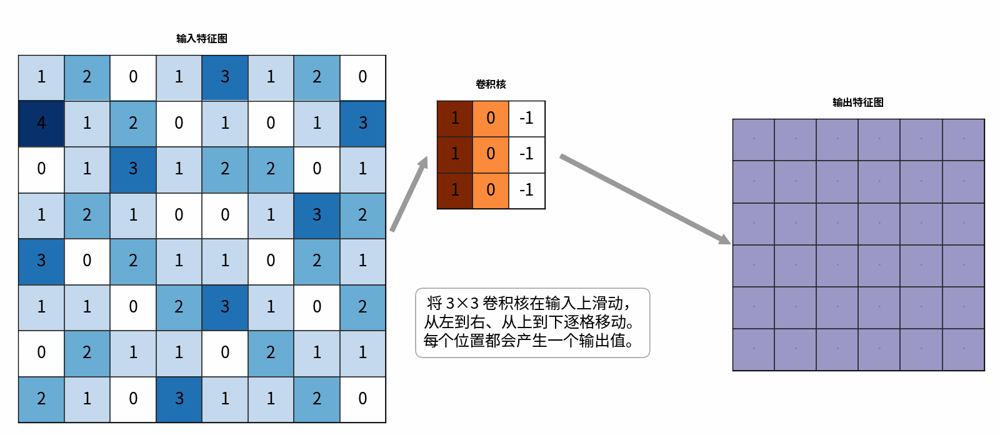<figcaption><p>图10-11 卷积的例子</p></figcaption></figure>

<figure>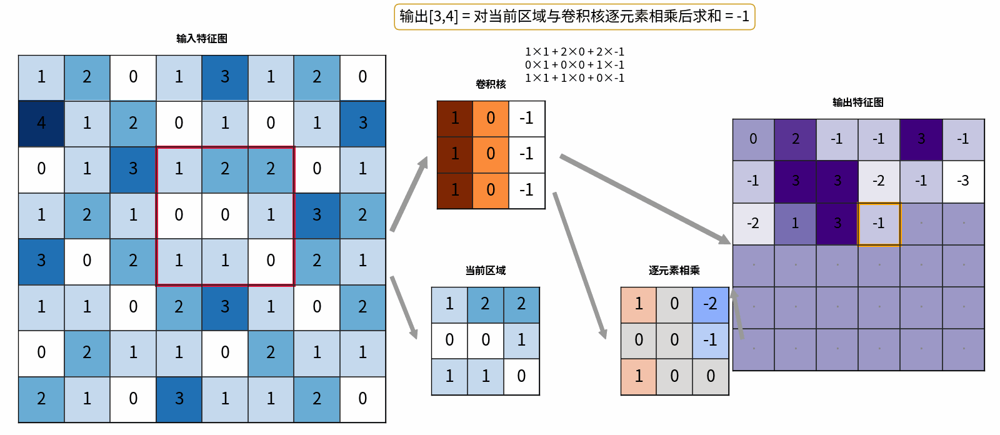<figcaption><p>图10-12 具体卷积计算的例子</p></figcaption></figure>

在设计二维CNN时，卷积核的空间尺寸通常较小，常见取值包括$$3 × 3$$ 、$$5×5$$和$$7×7$$。卷积核的权重通过训练学习，以提取任务相关的特征（图10-13）。例如，浅层卷积核可能对边缘、角点或纹理等局部模式产生较强的响应，深层卷积核则可以组合前面各层的特征。

<figure>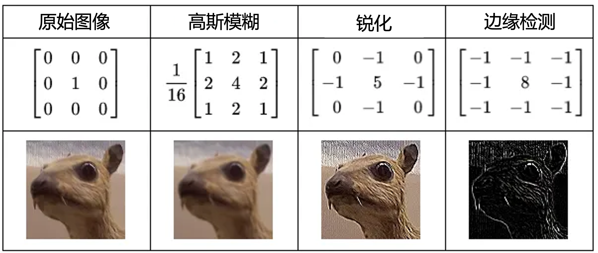<figcaption><p>图10-13 卷积核的作用 <a href="https://medium.com/@abhishekjainindore24/all-about-convolutions-kernels-features-in-cnn-c656616390a1">[来源]</a></p></figcaption></figure>

一个卷积层通常包括多个卷积核，每个卷积核生成一个输出特征图。输出特征图的数量一般被称为**输出通道**的数量。对于RGB图等多通道输入，每个标准卷积核在各**输入通道**上都有对应的权重。例如，处理RGB图像的一个 $$3\times 3$$卷积核也包含三通道的 $$3\times 3$$权重，分别与红、绿、蓝通道的局部区域计算对应元素之和，再将三个结果相加，得到输出特征图中的一个值。同一卷积核在不同空间位置使用相同的权重，这称为**权重共享**。权重共享方式显著减少了可训练参数的数量。

#### 卷积的扩展形式

观察图10-11中的卷积操作可以发现，卷积核完全位于输入图像内部。因此，卷积核的中心位置无法落在最外侧的像素上，导致边缘像素参与计算的次数更少，输出特征图的空间尺寸随之缩小。为使卷积核能够实现以边缘像素为中心计算，可以采用**零填充（zero-padding）**，即在输入图像的四周添加一圈零元素。例如（图10-14），对于一个 $$8 × 8$$ 的输入图像使用 $$3 × 3$$ 卷积核、步长为1时，填充后的输入尺寸为 $$10 × 10$$ ，输出特征图的尺寸则为$$8 × 8$$ 。因此，零填充既增加了边缘特征提取的程度，又保证了输出尺寸与原始输入一致。

<figure>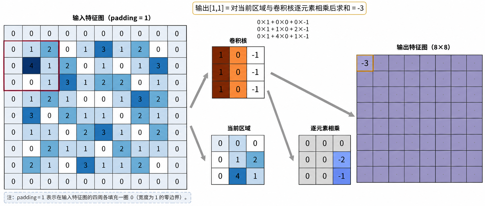<figcaption><p>图10-14 带零填充的卷积的例子</p></figcaption></figure>

此外，**步长（stride）**&#x6307;卷积核在输入图像上移动的步幅，例如图10-11～10-13中的卷积步长均为1。步长的大小影响输出特征图的尺寸。在输入尺寸、卷积核大小和填充方式相同的情况下，增大步长通常会减小小输出特征图的空间尺寸，从而减少卷积计算量，但也会降低输出的空间采样密度。例如，对于$$8\times  8$$ 的输入图像，使用$$3 × 3$$卷积核、步长为2且不进行填充时，输出特征图的尺寸变为$$3 × 3$$。

<figure>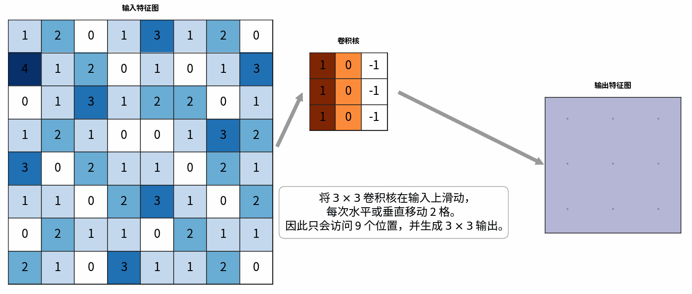<figcaption><p>图10-15 步长为2的卷积的例子</p></figcaption></figure>


算一算

对于$$m \times m$$像素的图片，使用$$k \times k$$的卷积核、步长为 $$s$$，并在四周各填充 $$p$$个像素时，请问输出特征图的边长时是多少？


<details>

<summary>查看答案</summary>

$$m_{\mathrm{out}} =\left\lfloor\frac{m+2p-k}{s}\right\rfloor+1$$

</details>

### 池化层

**池化层（Pooling Layer）** 是CNN中常用的特征汇聚层。它在输入特征图上滑动一个窗口，并按照特定规则将每个窗口内的特征值汇聚为一个输出值。当步长大于1时，池化通常能对特征图进行下采样，减小其空间尺寸，从而降低后续层的计算和存储开销。池化还可以减弱模型对局部特征位置微小变化的敏感性，但也会丢失部分细节和位置信息。因此，池化层既能控制计算量，也能保留显著特征，提高了模型的效率和鲁棒性。

池化层的主要设置包括：**窗口大小**、**步长**和**操作类型**。池化窗口的大小决定了每个输出值汇聚输入特征图中多大范围的信息，常见取值为 $$2 \times 2$$、 $$3 \times 3$$。较大的窗口汇聚范围更广，但也可能丢失更多局部细节。步长表示池化窗口每次移动的距离，与窗口大小共同决定输出特征图的空间尺寸。常见设置会使步长等于窗口大小，从而相邻池化窗口互不重叠；步长小于窗口大小时，相邻窗口则存在重叠。

常用的池化操作包括最大池化（Max Pooling）与平均池化（Average Pooling），二者采用不同的汇聚方式：

* **最大池化：**&#x9009;择池化窗口中的最大值作为输出，保留了局部区域中最强的特征响应。例如，当输入特征图表示对边缘的响应时，最大池化可以保留窗口内较强的边缘响应。
* **平均池化：**&#x5C06;池化窗口内的特征值取平均作为输出，反映局部区域的平均响应水平。它可以平滑局部变化，但也可能削弱较突出且范围较小的特征响应。

<figure>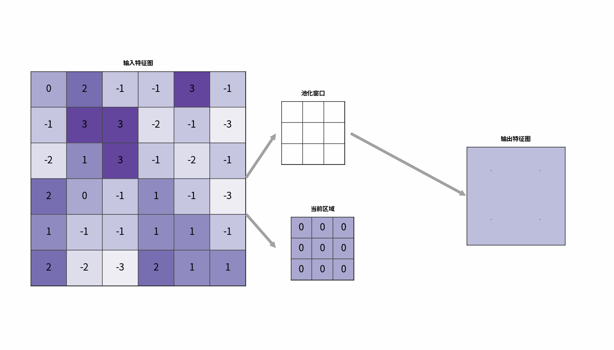<figcaption><p>图10-16 最大池化的例子：池化窗口的边长为3，步长为3</p></figcaption></figure>

### 全连接层

CNN常使用全连接层将提取到的特征整合并映射到任务所需的输出空间，完成分类或回归等任务。一个全连接层执行仿射变换；多个全连接层与非线性激活函数组合后，可以构成多层感知机。

在卷积神经网络中，卷积层提取局部特征，池化层汇聚局部响应。随着网络层数增加，后续层可以组合前面各层提取的特征，形成更复杂的表征。到达全连接层时，这些高阶的特征通常会被**展平（Flattening）**&#x4E3A;一维向量，然后输入到全连接层中。例如，尺寸为$$7 \times 7 \times 64$$的特征图包含64个通道，展平后得到长度为 $$7 \times 7 \times 64 = 3136$$ 的向量。CNN最后的**输出层**一般采用全连接层，其神经元数量和后续激活函数由任务决定。例如，在MNIST手写数字识别这样的10分类任务中，输出层通常包含10个神经元，分别输出各个类别的得分；这些得分经过Softmax函数后，转换为模型对每个类别的预测概率。

实际的卷积神经网络通常由多个特征提取模块逐级连接，而不是仅按“卷积层 $$\rightarrow$$池化层 $$\rightarrow$$全连接层”的顺序各使用一次。一个模块可以包含一个或多个卷积层及其激活函数，并根据需要加入池化层。不同模块可以采用不同的卷积核大小和通道数量，通过逐层加工与组合特征，学习更复杂的表征。经过多个模块后，网络通常通过展平或全局池化汇聚特征，再由全连接层等输出结构完成相关任务。图10-17提供了一个小型卷积神经网络的例子。

<figure>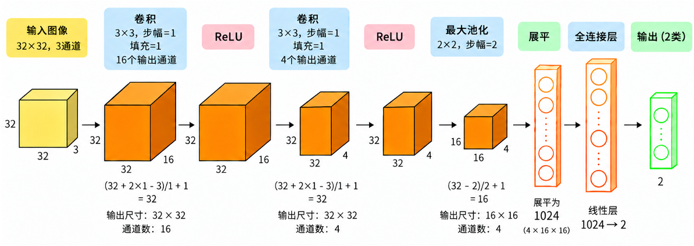<figcaption><p>图10-17 卷积神经网络结构举例</p></figcaption></figure>

## 应用实例

沿用前文的猫狗图像分类任务，我们保持数据和训练超参数不变，将多层感知机替换为卷积神经网络（如图10-17）。与多层感知机将图像展平为一维向量不同，卷积神经网络在特征提取阶段保留图像的空间特征，通过卷积层学习局部特征，再将这些特征整合，用于预测图像属于猫或狗的类别。

```python
import torch
import torch.nn as nn
from torch.optim import Adam
from torchvision import transforms
from datasets import load_dataset
### 所需包：pip install thop
from thop import profile

# ==================== 1. 加载数据 ====================
dataset = load_dataset("crystalhuang0228/cifar10-cat-dog-toy")
to_tensor = transforms.ToTensor()
train_set, test_set = dataset["train"], dataset["validation"]

def transform_to_torch(dataset):
    # CNN 输入: [N, 3, 32, 32]
    X = torch.stack([to_tensor(sample["image"]) for sample in dataset])
    Y = torch.tensor(dataset["label"], dtype=torch.long)
    return X, Y
X, Y = transform_to_torch(train_set)
X_test, Y_test = transform_to_torch(test_set)

print("X:", X.shape)
print("Y:", Y.shape)
# ==================== 2. 定义神经网络 ====================
mlp = nn.Sequential(nn.Linear(3072, 256), nn.ReLU(), nn.Linear(256, 2))
cnn = nn.Sequential(nn.Conv2d(in_channels=3, out_channels=16, kernel_size=3, stride=1, padding=1),
                    nn.ReLU(),
                    nn.Conv2d(in_channels=16, out_channels=4, kernel_size=3, stride=1, padding=1),
                    nn.ReLU(),
                    nn.MaxPool2d(kernel_size=2, stride=2),
                    nn.Flatten(),
                    nn.Linear(4 * 16 * 16, 2))
# CrossEntropyLoss 内部已经包含 LogSoftmax
# 因此模型不需要显式添加 Softmax
criterion = nn.CrossEntropyLoss()
optimizer = Adam(cnn.parameters(), lr=0.001, betas=(0.8, 0.8))
# ==================== 3. 模型训练 ====================
num_epochs = 100
for epoch in range(num_epochs):
    cnn.train()
    # 1. 清空上一轮梯度
    optimizer.zero_grad()
    # 2. 前向传播
    logits = cnn(X)
    # 3. 计算损失
    loss = criterion(logits, Y)
    # 4. 反向传播
    loss.backward()
    # 5. Adam 更新参数
    optimizer.step()

    if (epoch + 1) % 10 == 0: 
       # 6. 评估训练集和测试集
        cnn.eval()
        with torch.no_grad():
            # 训练集准确率
            train_logits = cnn(X)
            train_predictions = train_logits.argmax(dim=1)
            train_accuracy = (train_predictions == Y).float().mean()

            # 测试集准确率
            test_logits = cnn(X_test)
            test_predictions = test_logits.argmax(dim=1)
            test_accuracy = (test_predictions == Y_test).float().mean()

            print(
            f"Epoch [{epoch+1:3d}/{num_epochs}] "
            f"Train Loss: {loss.item():.4f} | "
            f"Train Acc: {train_accuracy.item():.2%} | "
            f"Test Acc: {test_accuracy.item():.2%}"
        )

# ==================== 4. 模型对比 ====================
## 4.1 参数量对比
## 4.2 计算复杂度对比

### 假设输入一个样本
mlp_input = torch.randn(1, 3072)
mlp_macs, mlp_params = profile(mlp, inputs=(mlp_input,), verbose=False)
cnn_input = torch.randn(1, 3, 32, 32)
cnn_macs, cnn_params = profile(cnn, inputs=(cnn_input,), verbose=False)

for name, macs, params in [("MLP", mlp_macs, mlp_params), ("CNN", cnn_macs, cnn_params),]:
    print(f"{name}:")
    print(f"  Parameters: {params:,}")
    print(f"  MACs:       {macs / 1e6:.3f} M")
    print(f"  FLOPs:      {2 * macs / 1e6:.3f} MFLOPs")
```

执行前文所有实例代码后，可以比较CNN与MLP在相同训练回合数下的损失、分类准确率和训练时长。实际结果显示，CNN获得了更低的损失和更高的准确率，但训练耗时更长。这说明，在本例中，采用更适合图像特征提取的网络结构改善了预测表现，同样也增加了训练的时间成本。因此，评价模型不能只看预测是否准确，还需综合考虑参数数量、运算量和实际运行时间。

为了进一步比较资源开销，本节代码还会输出两个模型的参数数量，以及处理单张图像时前向传播的估计运算量：

| 指标            |   MLP   |   CNN   |
| ------------- | :-----: | :-----: |
| 参数数量          |  787202 |   3078  |
| 乘加运算次数（MACs）  | 0.787 M | 1.034 M |
| 浮点运算次数（FLOPs） | 1.574 M | 2.068 M |

其中，M表示百万。CNN的参数数量约为MLP的 $$1/256$$，因此在采用相同存储精度时，存储模型参数所需的空间显著减少。然而，更少的参数并不意味着更少的计算量。实际上，卷积核的权重会在不同空间位置反复参与运算，导致运算成本的增加。MACs和FLOPs的统计结果显示，CNN的估计运算量约为MLP的1.31倍，即增加约为31%。这些指标并不固定，还受到硬件和计算实现等因素的影响。

本例因此展示了模型选择中的一种权衡：CNN用更少的参数得到了更好的分类表现，却需要更长的训练时间。在实际应用中，应根据任务对准确率、存储空间和运行时间的要求，综合判断模型是否合适。


## 拓展阅读

### 常见模型

在过去的十几年中，随着计算能力的提升和深度学习的广泛应用，许多经典的卷积神经网络架构被提出，这些架构在各种视觉任务中取得了优异的表现。以下是对一些经典的CNN架构进行简单的介绍，感兴趣的同学推荐可以直接阅读原始论文。

#### VGG (2014)

VGG由牛津大学的Simonyan和Zisserman于2014年提出，其关键设计是**反复堆叠**$$3\times 3$$**的小卷积核**，构建结构规则的深层网络。研究者通过比较不同深度的网络，展示了增加网络深度在大规模图像识别任务中的价值，代表性模型有VGG-16（图10-18）和VGG-19（16和19代表了网络的层数）。

VGG通常在每次池化之前连续使用多个卷积层，并在各卷积层后加入ReLU激活函数。其中，$$3\times 3$$的卷积采用步长为1和填充为1，使特征图的高度和宽度保持不变；随后使用窗口大小为2、步长为2的最大池化，将空间维度减半。因此，网络可以在同一空间尺寸下多次特征加工，再通过池化逐步下采样。

小卷积核的堆叠还可以扩大感受野。例如，在步长均为1的情况下，两个$$3\times 3$$卷积层等价于一层$$5\times 5$$卷积的感受野，但通过引入更多非线性变换，为学习更复杂的特征提供了更强大的表达能力。

<figure>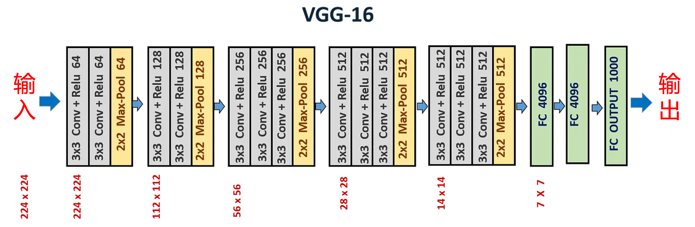<figcaption><p>图10-18 VGG-16的架构 <a href="https://medium.com/@siddheshb008/vgg-net-architecture-explained-71179310050f">[来源]</a></p></figcaption></figure>

#### ResNet (2016)

随着CNN的深度增加，研究者发现，单纯堆叠更多层并不一定改善模型表现，有时甚至导致训练误差上升。这一现象称为退化问题（degradation problem）。为了改善深层网络的优化，He等人提出了残差网络（ResNet），其核心结构是**残差块（residual block）。**&#x901A;过“捷径连接”（Skip Connection），将模块的输入与经过若干层变换后的结果相加（图10-19）。在输入与输出维度一致时，这一相加过程可以表示为:

$$
\mathbf{y} =\mathcal{F}(\mathbf{x}) + \mathbf{x} \qquad (10-38)
$$

其中， $$\mathbf{x}$$为输入， $$\mathcal{F}(\mathbf{x})$$是残差分支计算的结果。假设希望网络模块通过学习实现映射 $$\mathcal{H}(\mathbf{x})$$，则残差分支实际对应的学习目标为偏差项：

$$
\mathcal{F}(\mathbf{x}) = \mathcal{H}(\mathbf{x}) - \mathbf{x} \qquad (10-39)
$$

这种设计使模块能在输入的基础上学习需要进行的调整。当目标映射接近恒等映射时，残差分支只需学习接近0的输出，而不必通过多层变换重新构造输入。

残差连接改善了深度网络的优化，使得ResNet-50、ResNet-101和ResNet-152等模型得到有效训练。ResNet的重要贡献在于为更大的网络深度提供了有效的结构设计，而不会导致退化问题。残差连接也被应用于其他类型的神经网络中，比如大语言模型的常见框架Transformer在注意力和前馈神经网络模块都使用了残差连接。

<figure>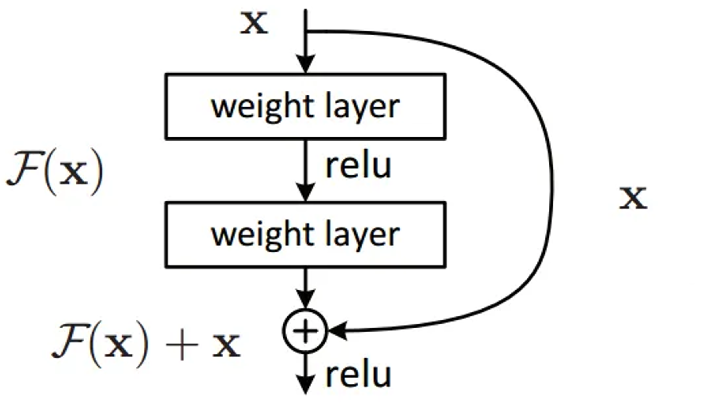<figcaption><p>图10-19 ResNet中的残差模块 <a href="https://medium.com/data-science/residual-blocks-building-blocks-of-resnet-fd90ca15d6ec">[来源]</a></p></figcaption></figure>

#### MobileNet (2017)

一些CNN虽然具有很好的预测表现，但较大的计算和存储开销限制了它们在移动设备上的部署。Howard等人于2017年提出的MobileNet为资源受限的视觉任务提供了轻量化选择。MobileNetV1 主要采用**深度可分离卷积**（depthwise separable convolution），将标准卷积拆分为两个步骤：先通过**逐通道卷积**（depthwise convolution）分别提取各输入通道的空间特征，再通过 $$1\times 1$$的**逐点卷积**（pointwise convolution）融合通道信息。

在标准卷积中，每个输出通道都使用覆盖全部输入通道的权重，因此参数数量和运算量都随输入、输出通道数量的增加而增加。假设输入为 $$m\times m$$的RGB图像，使用 $$3\times 3$$卷积核，步长为1、填充为0，输出通道为 $$n$$，则输出特征图的空间尺寸为 $$(m-2)\times (m-2)$$。忽略偏置等操作，标准卷积的乘加运算次数为：

$$
\mathrm{MACs}_{\mathrm{标准}}
=(m-2)^2\times n\times3\times3\times3
=27n(m-2)^2 \qquad (10-40)
$$

逐通道卷积则为每个输入通道分别使用一个 $$3\times 3$$卷积核，得到3个输出通道，其乘加运算次数为：

$$
\mathrm{MACs}_{\mathrm{逐通道}}
=(m-2)^2\times 3\times3\times3
=27(m-2)^2 \qquad (10-41)
$$

随后，逐点卷积在每个空间位置将这3个通道映射为 $$n$$个通道，需要的乘加运算次数为：

$$
\mathrm{MACs}_{\mathrm{逐点}}
=(m-2)^2\times3\times n=3n(m-2)^2 \qquad (10-42)
$$

因此，两步操作的总运算量与标准卷积之比为：

$$
\frac{\mathrm{MACs}_{\mathrm{可分离}}}
{\mathrm{MACs}_{\mathrm{标准}}}
=
\frac{(27+3n)(m-2)^2}{27n(m-2)^2}
=
\frac1n+\frac19 \qquad(10-43)
$$

当 $$n=16$$时，深度可分离卷积的乘加运算量约为标准卷积的17.4%。这一核心方法是MobileNet减少资源的重要基础。

<figure>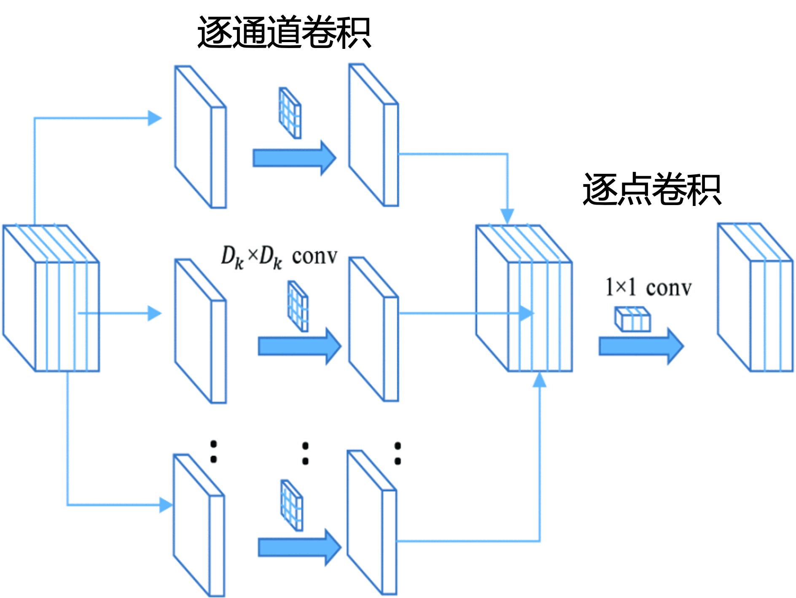<figcaption><p>图10-20 MobileNet的深度可分离卷积 <a href="https://ieeexplore.ieee.org/document/9175497">[来源]</a></p></figcaption></figure>

#### ConvNeXt (2022)

随着视觉Transformer（Vision Transformer，ViT）及其后续模型的发展，研究者开始重新审视CNN的结构设计。Liu等人在2022年提出的ConvNeXt，以ResNet为起点，借鉴视觉Transformer的部分设计，并结合改进的训练方法，构建了不依赖自注意力的卷积网络。其研究表明，经过系统改进的CNN仍能在图像分类、目标检测和图像分割等任务中与视觉Transformer竞争。

ConvNeXt的主要结构特点包括：

* **卷积模块**：使用 $$7\times 7$$逐通道卷积提取空间特征，再通过两个逐点变换融合通道信息。通道数先从 $$C$$扩展到 $$4C$$，再恢复为 $$C$$，形成与Transformer前馈模块相似的“扩展-压缩结构”。
* **残差连接**：沿用ResNet的残差思想，将每个模块的输入与该模块的变换结果相加，帮助优化深层网络。
* **层归一化**（Layer Normalization）：在卷积模块中，对每个空间位置的通道特征进行归一化。
* **激活函数**：采用GELU $$(\mathrm{GELU}(x)=x\Phi(x))$$，其中 $$\Phi(x)$$是标准正态分布的累积分布函数，它对输入进行平滑加权，允许负输入产生非零输出。
* **下采样与输出**：在不同阶段之间使用步长为2的卷积进行下采样。分类时，先通过全局平均池化（Global Average Pooling），将每个通道的空间特征汇聚为一个均值，再经过层归一化和全连接层输出类别得分。


<figure>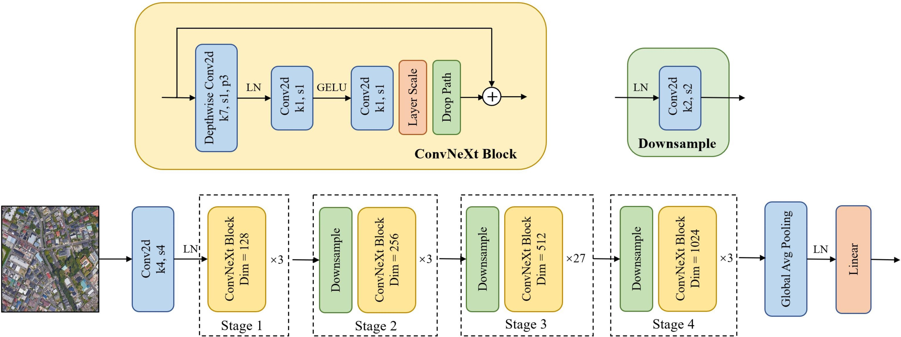<figcaption><p>图10-21 ConvNeXt架构</p></figcaption></figure>

## 参考文献

Simonyan, K., & Zisserman, A. (2014). Very deep convolutional networks for large-scale image recognition. _arXiv preprint arXiv:1409.1556_.

He, K., Zhang, X., Ren, S., & Sun, J. (2016). Deep residual learning for image recognition. In _Proceedings of the IEEE conference on computer vision and pattern recognition_ (pp. 770-778).

Howard, A. G., Zhu, M., Chen, B., Kalenichenko, D., Wang, W., Weyand, T., ... & Adam, H. (2017). Mobilenets: Efficient convolutional neural networks for mobile vision applications. _arXiv preprint arXiv:1704.04861_.

Liu, Z., Mao, H., Wu, C. Y., Feichtenhofer, C., Darrell, T., & Xie, S. (2022, June). A convnet for the 2020s. In _2022 IEEE/CVF conference on computer vision and pattern recognition (CVPR)_ (pp. 11966-11976). IEEE.


