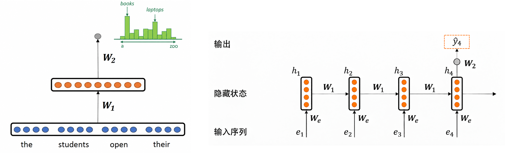
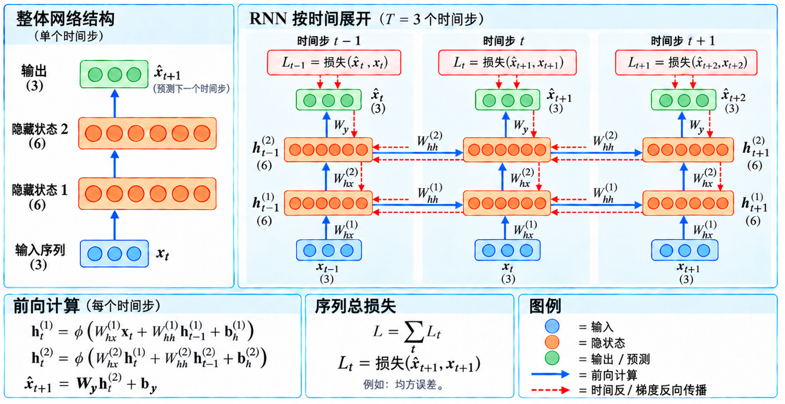
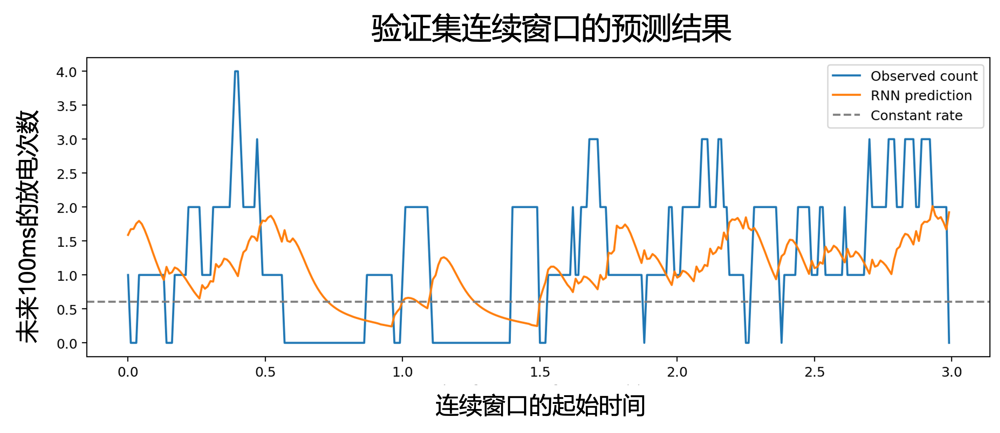
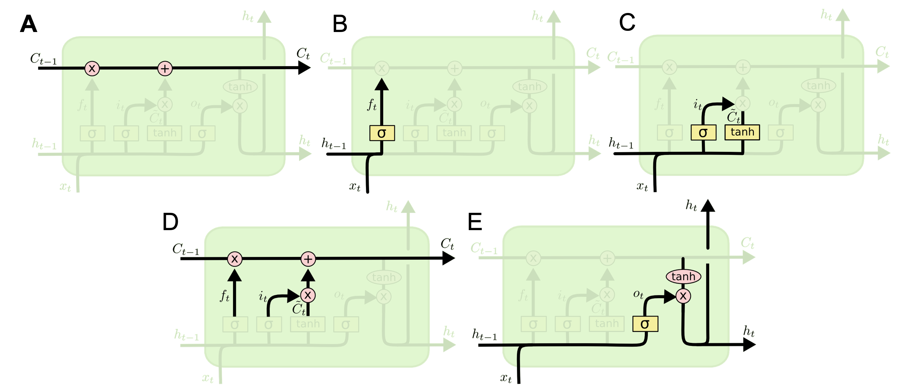
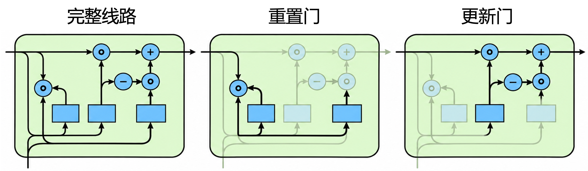

# 10.1.4 循环神经网络

前文介绍的全连接神经网络和卷积神经网络都可以学习输入特征间的关系，但其基本结构没有显式设置随序列位置更新的状态。对于文本、语音、视频或脑电信号等序列数据，当前输入往往与先前的信息有关。例如。理解句子中的一个词，需要结合上下文；分析某一时刻的脑电活动，也可能考虑先前的变化。因此，**序列建模**不仅需要提取当前输入的特征，还需要处理不同位置或时间点之间的依赖关系。

**循环神经网络（Recurrent Neural Network, RNN）**&#x662F;一种用于处理这类依赖关系的模&#x578B;**。**&#x5B83;通过**循环连接**，在每一步计算中结合当前输入与上一步的隐藏状态（hidden state），生成新的隐藏状态，并将其传递到下一步。隐藏状态可以看作网络对先前输入信息的内部表征，使先前信息能够参与后续计算。

## 基本结构

### 循环连接与隐藏状态

在前文介绍的MLP和CNN中，前向计算沿网络层次从输入传向输出。RNN则通过循环连接，将上一步的**隐藏状态**引入当前计算，使先前输入的信息能够影响后续处理。将RNN沿序列展开后，这种循环关系表现为隐藏状态在不同时间步之间依次传递。

以下一词元预测（next-token prediction）任务为例（图10-22），假设输入序列为“the students open their”，分别记为 $$x_1,x_2,x_3,x_4$$，对应的词元嵌入向量为 $$(\mathbf E=(\mathbf e_1,\mathbf e_2,\mathbf e_3,\mathbf e_4)^\top)$$。模型的任务是根据这四个词元，预测下一个词元的概率分布，例如“books”或"laptops"的概率。

对于仅包含一层隐藏层的MLP，隐藏层激活与输出概率为：

$$
\mathbf H=\mathrm{ReLU}(W_1\mathbf E+\mathbf b_1),
\qquad
\hat{\mathbf y}_4=\mathrm{Softmax}(W_2\mathbf H+\mathbf b_2) \qquad (10-44)
$$

MLP可以学习不同位置的输入特征之间的关系，但输入向量的长度由预先设定的上下文长度决定。RNN则依次读取各词元的嵌入向量，并结合上一步的隐藏状态更新当前状态。按照图中的符号，基本计算可以表示为：

$$
\mathbf h_t=
\phi\!\left(
W_{e}\mathbf e_t+W_1\mathbf h_{t-1}+\mathbf b_h
\right)
\qquad (10-45)
$$

其中， $$W_e$$为输入到隐藏状态的权重矩阵，$$W_1$$为隐藏状态之间的循环权重矩阵，$$\phi$$为激活函数，初始状态$$\mathbf h_0$$通常设为零向量。读取第四个词元后，模型根据$$\mathbf h_4$$计算输出得分，并通过Softmax得到下一个词元的概率分布：

$$
\mathbf z_4=W_2\mathbf h_4+\mathbf b_y,
\qquad
\hat{\mathbf y}_4=\mathrm{Softmax}(\mathbf z_4)
\qquad (10-46)
$$

图10-22的右图中，从左到右展示的是同一个循环模块在四个时间步上的计算，而不是四个不同的隐藏层。各时间步的输入和隐藏状态不同，但使用相同的权重与偏置。通过这种递归更新，隐藏状态可以携带先前输入的信息，为当前预测提供上下文。


<figure><figcaption><p>图10-22 不同神经网络处理序列数据的比较（以下一个词元预测为例）<br>左：多层感知机；右：循环神经网络。</p></figcaption></figure>

在上述词元预测的例子中，RNN每读取一个新的词元，就结合其嵌入向量与上一步的隐藏状态，形成新的隐藏状态。因此，隐藏状态 $$\mathbf h_t$$​ 是连接不同时间步的核心：它既受当前输入的影响，也携带先前输入的信息。将这一过程推广到一般序列，并用$$\mathbf x_t$$​ 表示时间步 $$t$$的输入，基本RNN的**状态更新公式**为：

$$
\mathbf h_t = \phi(W_{hx} \mathbf x_t + W_{hh} \mathbf h_{t-1} + \mathbf b_h) \qquad (10-47)
$$

其中， $$W_{hx}$$是输入到隐藏状态的权重矩阵，$$W_{hh}$$​ 是上一隐藏状态到当前隐藏状态的循环权重矩阵，$$\mathbf b_h$$​ 是偏置项，$$\phi$$ 是激活函数。这些权重与偏置在不同时间步之间共享。

### 前向计算与反向传播

在基本RNN中，权重矩阵 $$（W_{hx}, W_{hh}, W_{hy})$$​ 和偏置向量 $$(\mathbf b_h, \mathbf b_y)$$​ 在不同时间步 $$t$$之间共享。因此，输入序列长度增加时，模型的参数数量不会随之增加，使得RNN在处理长序列时更节省存储开销。同时由于**参数共享**，RNN通过沿时间维度**展开（unrolling）** 的方式进行**前向计算**。时间展开将RNN的递归计算转化为由多个时间步组成的计算图，每个时间步对应同一循环模块的一次计算。展开后的RNN网络展示了如何在每个时间步中使用相同的参数集合：

$$
\begin{aligned}
\mathbf h_1
&= \phi(W_{hx}\mathbf x_1 + W_{hh}\mathbf h_0 + \mathbf b_h),\\
\mathbf h_2
&= \phi(W_{hx}\mathbf x_2 + W_{hh}\mathbf h_1 + \mathbf b_h),\\
&\ \vdots\\
\mathbf h_T
&= \phi(W_{hx}\mathbf x_T + W_{hh}\mathbf h_{T-1} + \mathbf b_h).
\end{aligned}
\qquad (10-48)
$$

其中， $$T$$为序列长度， $$\mathbf h_0$$为初始隐藏状态。在前向传播中，网络依次读取输入序列 $$(\mathbf X=[\mathbf x_1,...,\mathbf x_T]^\top)$$。每一步都结合当前输入数据 $$\mathbf x_t$$ 与上一隐藏状态$$\mathbf h_{t-1}$$​ ，计算新的隐藏状态 $$\mathbf h_t$$​，再将其传递到下一时间步。根据任务需要，还可以由隐藏状态计算输出：

$$
\mathbf z_t = W_{hy}\mathbf h_t + \mathbf b_y,
\qquad
\hat{\mathbf y}_t = \psi(\mathbf z_t)
\qquad (10-49)
$$

其中， $$\mathbf z_t$$为输出得分， $$\psi$$为任务所需的输出函数。例如，在下一词元预测任务中， $$\psi$$通常为Softmax，将得分转换为词表中各词元的预测概率。模型可以在每个时间步进行预测，也可以像前文的示例一样，仅提取基于完整段输入的预测结果。

展开后的计算图也为反向传播提供了路径。损失的梯度不仅经过输出层，还沿隐藏状态之间的连接向先前时间步传播。这一过程称为**通过时间的反向传播（backpropagation through time，BPTT）**。由于各时间步使用相同的参数，计算参数梯度时，需要累加这些参数在不同时间步参与计算所产生的梯度贡献，再由优化器更新参数。

下面以每个时间步均参与损失计算的基本RNN为例，简易推导前向计算与通过时间的反向传播（BPTT）。沿用前文的符号， $$\hat{\mathbf y}_t$$表示模型预测， $$\mathbf y_t$$表示目标值，所有向量均为列向量。

1. **逐步进行前向计算**

在时间步 $$t$$，网络结合当前输入与上一隐藏状态，计算隐藏状态 和输出：

$$
\begin{aligned}
\mathbf a_t
&=W_{hx}\mathbf x_t+W_{hh}\mathbf h_{t-1}+\mathbf b_h,\\
\mathbf h_t&=\phi(\mathbf a_t),\\
\mathbf z_t&=W_{hy}\mathbf h_t+\mathbf b_y,\\
\hat{\mathbf y}_t&=\psi(\mathbf z_t).
\end{aligned}  \qquad (10-50)
$$

其中， $$\mathbf a_t$$是隐藏层激活前的加权和， $$\mathbf z_t$$是输出得分， $$\phi$$ 和$$\psi$$分别为隐藏层与输出层的激活函数。

2. **计算序列损失**

将各时间步的损失相加：

$$
\mathcal L=\sum_{t=1}^{T}\ell_t,
\qquad
\ell_t=\ell(\mathbf y_t,\hat{\mathbf y}_t) \qquad (10-51)
$$

其中，$$\ell$$ 是损失函数。如果任务仅在最后一个时间步计算损失，则 $$\mathcal L = \ell_T$$。

3. **计算输出层的梯度**

定义输出得分的梯度为：

$$
\mathbf q_t=\frac{\partial\ell_t}{\partial\mathbf z_t} \qquad (10-52)
$$

例如，已知当输出采用Softmax、损失采用交叉熵且目标为独热编码时， $$\mathbf q_t=\hat{\mathbf y}_t-\mathbf y_t$$。由于输出层参数在各时间步共享，梯度需要累加：

$$
\frac{\partial\mathcal L}{\partial W_{hy}}
=\sum_{t=1}^{T}\mathbf q_t\mathbf h_t^\top,
\qquad
\frac{\partial\mathcal L}{\partial\mathbf b_y}
=\sum_{t=1}^{T}\mathbf q_t
\qquad (10-53)
$$

4. **沿时间反向计算隐藏层的梯度**

令 $$\boldsymbol\delta_t=\partial\mathcal L/\partial\mathbf a_t$$。隐藏状态的梯度包含两部分：当前时间步输出产生的梯度，以及后续时间步经循环连接传回的梯度。因此：

$$
\begin{aligned}
\frac{\partial\mathcal L}{\partial\mathbf h_t}
&=W_{hy}^\top\mathbf q_t
 +W_{hh}^\top\boldsymbol\delta_{t+1},\\
\boldsymbol\delta_t
&=\left(
W_{hy}^\top\mathbf q_t
+W_{hh}^\top\boldsymbol\delta_{t+1}
\right)\odot\phi'(\mathbf a_t).
\end{aligned}
\qquad (10-54)
$$

其中， $$\odot$$表示逐元素的乘法。设 $$\boldsymbol\delta_{T+1}=\mathbf0$$，从 $$t=T$$开始，依次反向计算至 $$t=1$$。若仅在最后一步计算损失，则此前各步的 $$\mathbf q_t=\mathbf0$$，但仍会接收到后续时间步传回的梯度。

5. **累加共享参数的梯度**

得到各时间步的 $$\boldsymbol\delta_t$$后，计算：

$$
\begin{aligned}
\frac{\partial\mathcal L}{\partial W_{hh}}
&=\sum_{t=1}^{T}\boldsymbol\delta_t\mathbf h_{t-1}^{\top},\\
\frac{\partial\mathcal L}{\partial W_{hx}}
&=\sum_{t=1}^{T}\boldsymbol\delta_t\mathbf x_t^{\top},\\
\frac{\partial\mathcal L}{\partial\mathbf b_h}
&=\sum_{t=1}^{T}\boldsymbol\delta_t.
\end{aligned}
\qquad (10-55)
$$

此时，反向递推已将后续损失的影响纳入$$\boldsymbol\delta_t$$，求和则汇总同一参数在各时间步参与计算所产生的梯度贡献。

6. **更新网络参数**

以基本梯度下降为例，完成梯度计算后，对所有可训练参数进行更新：

$$
\theta\leftarrow\theta-\eta\frac{\partial\mathcal L}{\partial\theta},
\qquad
\theta\in
\{W_{hx},W_{hh},W_{hy},\mathbf b_h,\mathbf b_y\}
\qquad (10-56)
$$

其中，$$\eta$$ 是学习率。BPTT负责计算梯度，参数更新由优化器执行。

### 网络结构

RNN的结构可以从网络层级与序列时间步两个维度理解。从单个时间步来看，输入依次经过一个或多个循环隐藏层，再由输出生成预测。与前馈网络相比，每个循环隐藏层还接收该层上一时间步的隐藏状态。因此，设计RNN时，需要考虑循环层的数量、类型以及各层隐藏状态的维度。

图10-23中展示了一个包含两层循环隐藏层的网络：每个时间步的输入为三维向量，两层隐藏状态均为六维向量，输出为三维向量。第一层结合当前输入与自身的上一隐藏状态，生成当前隐藏状态；第二层结合第一层的当前隐藏状态与自身的上一隐藏状态，进一步加工信息。最后，输出层根据第二层的隐藏状态，预测下一时间步的输入 $$\hat{\mathbf x}_{t+1}$$。

从完整序列来看，两层隐藏状态都随时间步依次更新，且各层的参数在不同时间步之间共享。图中纵向连接表示同一时间步内的层间计算，横向连接表示同一循环层在相邻时间步之间的状态传递。**网络层数与时间步数是不同的概念**：将网络沿时间展开，并不会增加具有独立参数的网络层。

训练时，将每个时间步的预测  $$\hat{\mathbf x}_{t+1}$$ 与实际输入 $$\mathbf x_{t+1}$$ 比较，计算损失，再通过BPTT沿层间连接和时间连接反向计算梯度。

<figure><figcaption><p>图10-23 循环神经网络的结构与计算</p></figcaption></figure>

## 应用实例

为了探索基本RNN学习序列数据依赖关系的能力，我们设置了神经元放电计数的预测任务。数据记录了小鼠在运动相关任务中的某一特定神经元的放电活动。我们将时间划分为连续的10 ms时间窗，对放电活动进行二值编码：窗口内至少出现一次放电记为1，否则记为0。因此，每个时间步的输入是由神经元的放电指示值组成的向量。

模型以过去500 ms的活动作为输入，即连续50个时间步，预测随后100 ms内该神经元群体的放电总次数。该任务旨在检验模型能否利用近期活动中的时序信息，预测后续的放电水平。

```python
import torch
import torch.nn as nn
from torch.optim import Adam
from torch.utils.data import DataLoader, TensorDataset
from datasets import load_dataset
from pathlib import Path


# ==================== 1. 加载数据 ====================
dataset = load_dataset("crystalhuang0228/spike-toy-dataset")

# 输入：50 个连续 10 ms bin 中的 spike 数；目标：随后 10 个 bin 的 spike 总数。
train_set = dataset["train"].shuffle(seed=42).select(range(min(1_0000, len(dataset["train"]))))
val_set = dataset["validation"].shuffle(seed=42).select(range(min(2_000, len(dataset["validation"]))))

def transform_to_torch(split):
    X = torch.tensor(list(split["spike_counts"]), dtype=torch.float32)  # [N, 50]
    Y = torch.tensor(list(split["count"]), dtype=torch.float32)         # [N]
    return X, Y

X, Y = transform_to_torch(train_set)
X_val, Y_val = transform_to_torch(val_set)
print("X:", X.shape, "Y:", Y.shape)
print("Train mean spikes / 100 ms:", f"{Y.mean().item():.3f}")
print("Validation mean spikes / 100 ms:", f"{Y_val.mean().item():.3f}")

train_loader = DataLoader(TensorDataset(X, Y), batch_size=256, shuffle=True, generator=torch.Generator().manual_seed(42))
val_loader = DataLoader(TensorDataset(X_val, Y_val), batch_size=256)


# ==================== 2. 定义神经网络 ====================
# MLP 只用于模型大小和计算量对比，不参与训练。
mlp = nn.Sequential(nn.Linear(50, 16), nn.ReLU(), nn.Linear(16, 1),)

class SpikeRNN(nn.Module):
    def __init__(self):
        super().__init__()
        # 单个神经元的放电编码为一维向量，因此输入维度为1
        self.gru = nn.RNN(input_size=1, hidden_size=16, batch_first=True)
        self.output = nn.Linear(16, 1)

    def forward(self, x):
        x = x.unsqueeze(-1)       # [N, 50] -> [N, 50, 1]
        x, _ = self.gru(x)       # [N, 50, 16]
        return self.output(x[:, -1, :]).squeeze(-1)  # [N]，预测 log(期望 spike 数)

torch.manual_seed(42) #确保结果可复现
rnn = SpikeRNN()
# 预测放电次数常利用泊松分布计算损失
# PoissonNLLLoss 使用 log-rate 输出；exp(log-rate) 是预测的 spike 数。
criterion = nn.PoissonNLLLoss(log_input=True)
optimizer = Adam(rnn.parameters(), lr=0.001)

# ==================== 3. RNN 训练与验证 ====================
# 常数发放率基线：只用训练集估计每 100 ms 的平均 spike 数。
## 统计该神经元本身的放电特点
baseline_rate = Y.mean().clamp_min(1e-8)
baseline_log_rates = baseline_rate.log().expand_as(Y_val)
baseline_loss = criterion(baseline_log_rates, Y_val).item()
baseline_mae = (baseline_rate - Y_val).abs().mean().item()
print(f"Constant-rate baseline: Val Loss: {baseline_loss:.4f} | Val MAE: {baseline_mae:.3f}")

num_epochs = 100
for epoch in range(num_epochs):
    rnn.train()
    train_loss = 0.0
    for inputs, counts in train_loader:
        optimizer.zero_grad()
        log_rates = rnn(inputs)
        loss = criterion(log_rates, counts)
        loss.backward()
        optimizer.step()
        train_loss += loss.item() * len(counts)

    rnn.eval()
    val_loss = val_mae = 0.0
    with torch.no_grad():
        for inputs, counts in val_loader:
            log_rates = rnn(inputs)
            predictions = torch.exp(log_rates)
            val_loss += criterion(log_rates, counts).item() * len(counts)
            val_mae += (predictions - counts).abs().sum().item()
    mean_val_loss = val_loss / len(Y_val)

    if (epoch + 1) % 10 == 0:
        print(
            f"Epoch [{epoch + 1:2d}/{num_epochs}] "
            f"Train Loss: {train_loss / len(Y):.4f} | "
            f"Val Loss: {mean_val_loss:.4f} | "
            f"Val MAE: {val_mae / len(Y_val):.3f} "
        )


# ==================== 4. 可视化连续预测 ====================
import matplotlib.pyplot as plt

# 不打乱时间顺序：连续 300 个窗口，每个窗口向前移动 10 ms。
timeline_set = dataset["validation"].select(range(17_000, 17_300))
X_timeline, Y_timeline = transform_to_torch(timeline_set)
rnn.eval()
with torch.no_grad():
    predicted_counts = torch.exp(rnn(X_timeline))

seconds = torch.arange(len(Y_timeline)) * 0.01
plt.figure(figsize=(12, 4))
plt.plot(seconds, Y_timeline, label="Observed count")
plt.plot(seconds, predicted_counts, label="RNN prediction")
plt.axhline(baseline_rate.item(), color="gray", linestyle="--", label="Constant rate")
plt.xlabel("Time from start of segment (s)")
plt.ylabel("Spikes in following 100 ms")
plt.title("300 consecutive validation forecasts")
plt.legend()
plot_path = "prediction_timeline.png"
plt.savefig(plot_path, dpi=180, bbox_inches="tight")
plt.close()
print("Saved plot:", plot_path)


# ==================== 5. 模型对比 ====================
from thop import profile
### 假设输入一个样本
input = torch.randn(1, 50)
mlp_macs, mlp_params = profile(mlp, inputs=(input,), verbose=False)
rnn_macs, rnn_params = profile(rnn, inputs=(input,), verbose=False)

for name, macs, params in [("MLP", mlp_macs, mlp_params), ("GRU", rnn_macs, rnn_params),]:
    print(f"{name}:")
    print(f"  Parameters: {params:,}")
    print(f"  MACs:       {macs / 1e6:.3f} M")
    print(f"  FLOPs:      {2 * macs / 1e6:.3f} MFLOPs")
```

训练后的模型预测效果如图10-24所示：

<figure><figcaption><p>图10-24 RNN预测神经元放电次数的效果</p></figcaption></figure>

## 常见模型

### 长短期记忆网络

长短期记忆网络<sup>6</sup>（Long Short-Term Memory， LSTM）是一种改进的循环神经网络，由Hochreiter和Schmidhuber于1997年提出，主要用于缓解基本RNN在学习长期依赖关系时遇到的梯度消失问题。它通过记忆单元和门控机制，为信息跨时间步传递提供了更稳定的路径。

<figure><figcaption><p>图10-25 长短期记忆网络隐藏状态 <a href="https://colah.github.io/posts/2015-08-Understanding-LSTMs/">[来源]</a></p></figcaption></figure>


与基本RNN相比，LSTM同时维护单元状态 $$\mathbf c_t$$和隐藏状态 $$\mathbf h_t$$。单元状态用于携带跨时间步的信息，隐藏状态则参与后续计算，并可用于生成任务所需的预测。

三类门分别控制信息的保留、写入与输出：

* **遗忘门（Forget Gate）**：控制上一单元的信息保留多少。
* **输入门（Input Gate）**：控制候选信息写入单元状态的程度。
* **输出门（Output Gate）**：控制更新后的单元状态如何参与生成当前隐藏状态。

在每个时间步，LSTM接收当前输入 $$\mathbf x_t$$​ 、上一隐藏状态 $$\mathbf h_{t-1}$$​和上一单元状态 $$\mathbf  c_{t-1}$$，计算新的单元状态与隐藏状态。以下公式对应图10-25中的标准结构，其中 $$[\mathbf h_{t-1};\mathbf x_t]$$表示向量拼接， $$\odot$$表示逐元素乘法。

首先，计算遗忘门控制原有信息的保留程度：

$$
\mathbf f_t
=\sigma\!\left(
W_f[\mathbf h_{t-1};\mathbf x_t]+\mathbf b_f
\right)
\qquad (10-57)
$$

其中，Sigmoid $$\sigma$$使 $$f_t$$各元素取值介于0和1之间。某个元素越接近1，对应位置的原有信息保留得越多；越接近0，保留得越少。遗忘门是连续加权的过程，而非简单的“保留或删除”二选一。

接下来，计算输入门和候选单元状态：

$$
\begin{aligned}
\mathbf i_t
&=\sigma\!\left(
W_i[\mathbf h_{t-1};\mathbf x_t]+\mathbf b_i
\right),\\
\tilde{\mathbf c}_t
&=\tanh\!\left(
W_c[\mathbf h_{t-1};\mathbf x_t]+\mathbf b_c
\right).
\end{aligned}
\qquad (10-58)
$$

其中，候选状态$$\tilde{\mathbf c}_t$$由当前输入与上一隐藏状态共同生成，提供可写入的新信息；输入门 $$\mathbf i_t$$控制这些信息的写入程度。

随后，将保留的原有信息与新写入的信息相加，更新单元状态：

$$
\mathbf c_t
=\mathbf f_t\odot\mathbf c_{t-1}
+\mathbf i_t\odot\tilde{\mathbf c}_t \qquad (10-59)
$$

这种加法更新是LSTM的重要特点。当遗忘门接近1、输入门接近0时，单元状态可以在多个时间步之间保持相对稳定。

最后，计算输出门并生成隐藏状态：

$$
\begin{aligned}
\mathbf o_t
&=\sigma\!\left(
W_o[\mathbf h_{t-1};\mathbf x_t]+\mathbf b_o
\right),\\
\mathbf h_t
&=\mathbf o_t\odot\tanh(\mathbf c_t).
\end{aligned}
\qquad (10-60)
$$

其中， $$\mathbf o_t$$是输出门向量。更新后的 $$\mathbf c_t$$和$$\mathbf h_t$$共同传递到下一时间步。

<figure><figcaption><p>图10-26 LSTM的门控机制 <a href="https://colah.github.io/posts/2015-08-Understanding-LSTMs/">[来源]</a></p></figcaption></figure>

LSTM通过单元状态的加法更新和门控机制，缓解了基本RNN在学习长期依赖关系时的梯度消失问题。当遗忘门接近1时，单元状态中的信息及沿该路径传播的梯度能够跨多个时间步保留；输入门与输出门则分别控制新信息的写入，以及单元状态对当前隐藏状态的影响。这种结构使LSTM能够更灵活地处理不同时间跨度的信息，因此被应用于自然语言处理、时间序列预测和语音识别等任务。

### 门控循环单元

门控循环单元<sup>7</sup>（Gated Recurrent Unit，GRU）由Cho等人于2014年提出，是一种结构较简洁的门控循环网络。与LSTM分别维护单元状态和隐藏状态不同，GRU只维护隐藏状态，并通过重置门（reset gate）**和**更新门（update gate）控制信息的处理与传递。

<figure><figcaption><p>图10-27 门控循环单元的门控机制</p></figcaption></figure>

在每个时间步，GRU根据当前输入 $$\mathbf x_t$$​ 和上一隐藏状态 $$\mathbf h_{t-1}$$，计算两个门向量：

$$
\begin{aligned}
\mathbf r_t
&=\sigma\!\left(
W_r[\mathbf h_{t-1};\mathbf x_t]+\mathbf b_r
\right)\\
\mathbf z_t
&=\sigma\!\left(
W_z[\mathbf h_{t-1};\mathbf x_t]+\mathbf b_z
\right)
\end{aligned}
\qquad (10-61)
$$

其中， $$\mathbf r_t$$表示重置门， $$\mathbf z_t$$表示更新门。​

重置门控制历史信息如何参与候选隐藏状态的计算。先将重置门与上一隐藏状态逐元素相乘，再结合当前输入生成候选状态：

$$
\tilde{\mathbf h}_t
=\tanh\!\left(
W_h[\mathbf r_t\odot\mathbf h_{t-1};\mathbf x_t]
+\mathbf b_h
\right) \qquad (10-62)
$$

其中，$$\tilde{\mathbf h}_t$$​ 是用于更新隐藏状态的候选值。重置门的某个元素越接近0，对应的历史信息对候选状态的影响越小；越接近1，参与程度越高。重置门并不直接清除最终隐藏状态中的历史信息，因为旧状态还可以通过更新门保留。

更新门控制旧状态与候选状态的融合比例：

$$
\mathbf h_t
=\mathbf z_t\odot\mathbf h_{t-1}
+(\mathbf 1-\mathbf z_t)\odot\tilde{\mathbf h}_t \qquad (10-63)
$$

更新门的某个元素越接近1，当前隐藏状态的对应分量越倾向于保留旧值；越接近0，则越倾向于采用候选值。因此，重置门决定“如何利用历史信息生成候选状态”，更新门决定“保留多少旧状态、写入多少候选状态”。两者共同使GRU能够学习不同时间跨度的依赖关系。在输入维度和隐藏维度相同的条件下，标准GRU通常比标准LSTM具有更少的参数和较低的单步运算量。


