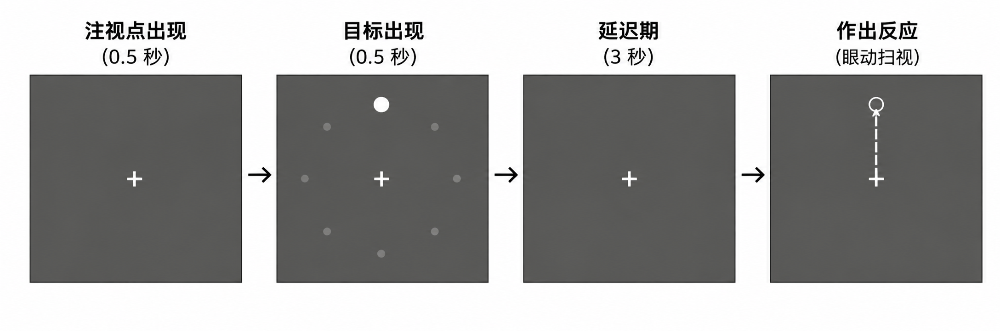

# 10.2.2 工作记忆

在拨打电话时，朋友刚刚报出的号码会在你脑中停留几秒钟，供你完成拨号；在心算 37×6 时，你需要先记住个位相乘产生的进位，再把它加到十位的结果上。这类在数秒到数十秒的尺度上保持并运用任务相关信息的能力，称为工作记忆<sup>7</sup>（working memory）。

工作记忆含义丰富，它不仅包括对信息的保持，还包括对信息的更新与操作、在干扰下的保护，以及容量的分配等。本节聚焦其中最基础的一个问题：**当外部刺激已经消失后，大脑靠什么把信息维持住？**

下文的实验和模型针对工作记忆的"维持"（maintenance）问题进行展开。已知神经元最快的放电活动转瞬即逝——一个动作电位只持续约 1 毫秒；膜电位和常规突触电流的时间常数也只有几十到上百毫秒。单靠这些快速过程的被动衰减，长达几秒钟的记忆从何而来？基于此问题，本节首先回顾了提出该问题的经典实验，然后通过实际搭建一个循环神经网络（RNN）模型，定性地再现实验中的关键发现，最后介绍当下计算认知神经科学中通过训练和分析RNN的表征探索工作记忆的研究路线。

## 经典实验：延迟反应任务与持续放电

二十世纪七十年代初，Fuster 和 Alexander 在猴前额叶记录到一类奇特的神经元：在延迟反应任务中，即使刺激早已消失，它们仍在持续放电，直到猴子做出反应为止<sup>8</sup>。Funahashi、Bruce 和 Goldman-Rakic 在 1989 年用眼动延迟反应任务（oculomotor delayed-response task）对这一现象进行了系统而经典的刻画<sup>9</sup>。如图10-32所示：猴子首先注视屏幕中心；随后 8 个可能位置之一闪现一个光点作为线索（0.5 秒）；线索消失后是约 3 秒的延迟期，屏幕上只剩注视点，猴子必须保持注视；注视点一熄灭，猴子要把视线跳向刚才光点出现的位置才能获得奖励。由于线索早已消失，正确的眼跳只能依靠对线索位置的记忆。

<figure><figcaption><p>图 10-32  眼动延迟反应任务示意图。<br>从左至右：注视 <span class="math">\rightarrow</span>线索呈现 <span class="math">\rightarrow</span>延迟期 <span class="math">\rightarrow</span>眼跳任务</p></figcaption></figure>

这项研究有三个经典发现：

1. 许多背外侧前额叶（dlPFC）神经元在延迟期内维持着明显高于基线的放电率，从线索消失一直延续到反应开始，这被称为持续放电（persistent activity）。
2. 许多具有延迟期活动的神经元表现出方向调谐：它们只在线索出现于某个特定方向附近时才持续放电，Funahashi 等人称之为"记忆野"（memory field）——就像视觉神经元有感受野一样，这些神经元"感受"的是一段被记住的方向<sup>9,10</sup>。
3. 放电与行为有关：在能够分析的错误试次中，如果猴子随后做出了错误的眼跳，相应神经元的延迟期活动往往较弱，并可能提前中断甚至缺失<sup>9</sup>。Romo 等人后来进一步发现，当猴子记忆振动频率时，一类前额叶神经元的延迟期放电率随被记住的频率单调变化<sup>11</sup>。这些研究使持续放电成为解释工作记忆信息维持的最有影响力的可能机制之一。

这些现象为持续放电带来一个计算问题：当输入撤除时，活动会以几十到几百毫秒的时间常数衰减回静息水平。单靠这些快速过程的被动衰减，很难把信息保持 3 秒之久。那么，跨越秒级的持续放电究竟是靠什么维持的？本节接下来要介绍的是最经典的一类答案：**循环连接**。

## 动力学模型

### 神经活动的衰减与循环网络的自我维持

神经元活动随时间的变化，可以用一个简单的发放率模型描述：

$$
\tau \frac{da}{dt} = -a + f(wa + I) \qquad \qquad (10-67)
$$

其中， $$a$$表示神经元的活动水平，  $$\tau$$为模型的时间常数（这里取 0.1 秒）； $$-a$$表示活动的泄漏或衰减，$$I$$表示外部输入。函数$$f$$ 将总输入转换为驱动活动的发放率：负输入对应零输出，较大的正输入则使输出逐渐饱和。 $$w$$表示循环连接的强度， $$wa$$表示当前活动经反馈连接再次影响自身。

当  $$w = 0$$时，模型没有循环反馈，是一种泄漏积分器（Leaky Integrator）。若外部输入撤除后 $$I=0$$，且 $$f(0)=0$$，则：

$$
a(t)=a(t_0)\exp\!\left(-\frac{t-t_0}{\tau}\right),
\qquad t\geq t_0 \qquad (10-68)
$$

&#x20;其中， $$t_0$$为输入撤除的时刻。经过一个时间常数，活动$$a$$降至原来的37%；经过五个时间常数，即0.5秒后，仅剩0.7%。因此，在这一模型及时间常数下，仅靠输入撤除后的活动衰减，难以维持持续数秒的信息表征。

加入兴奋性循环反馈后，反馈输入可以抵消部分活动衰减。当自反馈强度$$w$$与函数 $$f$$的形状满足一定条件时，系统可能出现稳定的非零活动状态，使活动在外部输入撤除后仍能持续。下面将比较不同反馈强度下的活动变化。

```python
import numpy as np
import matplotlib.pyplot as plt

rng = np.random.default_rng(2026) #随机种子设置，确保结果可复现
def f(x):
    '''放电率函数: 输入为负时不放电, 输入很大时饱和于最大值 1'''
    return np.tanh(np.maximum(x, 0))

def oneUnit(w, T=3, dt=0.01, tau=0.1):
    '''单个自反馈强度为 w 的神经元, 前 0.5 秒给外部输入'''
    a, trace = 0.0, []
    for t in np.arange(0, T, dt):
        I = 1.0 if t < 0.5 else 0.0
        a = a + dt/tau*(-a + f(w*a + I))
        trace.append(a)
    return np.array(trace)
# 模拟实验参数设置
T=3 # 模拟的总时长
dt=0.01 # 假设微小的时间变化单元为0.01s
tau=0.1 # 时间常数为0.1s
ts = np.arange(0, T, dt)
fig = plt.figure(figsize=(5, 3.2))
for w in [0.5, 1.5]: # 测试不同的循环反馈强度
    plt.plot(ts, oneUnit(w, T, dt, tau), label=f'w = {w}')
plt.axvspan(0, 0.5, color='gray', alpha=0.25, label='input on')
plt.xlabel('Time (s)')
plt.ylabel('Activity')
plt.legend()
plt.show()
```

<figure><figcaption><p>图10-33 单个神经元的活动轨迹。<br>自反馈较弱（w=0.5）时，输入撤除后活动迅速衰减；自反馈足够强（w=1.5）时，活动在输入撤除后自我维持。</p></figcaption></figure>

如图 10-33所示，当$$w=0.5$$时，外部输入撤除后，神经元活动在零点几秒内衰减至接近零；当$$w=1.5$$时，较强的循环兴奋反馈与模型中的非线性共同作用，使系统出现一个稳定的非零高活动不动点（non-zero fixed point）。外部输入将神经元的活动推升后，即使输入撤除，系统仍会趋于并维持这一高活动状态。


循环网络与吸引子

本例值得强调的是：**循环反馈产生的持续活动，其维持时间可以远长于单元自身的时间常数**。虽然 $$\tau$$ 只有 0.1 秒，但在无噪声、参数固定且没有额外扰动的理想模型中，高活动状态原则上可以无限期维持。这种持续性源于反馈对活动衰减的抵消。系统受到小幅扰动后仍会回到的稳定活动状态，称为吸引子状态（attractor state）；本例中的高活动不动点就是一种吸引子。

不过，在这里选用的非线性函数与参数条件下，当反馈足够强时，零活动状态对微小的正向扰动并不稳定。因此，这个极简例子展示的是循环反馈如何维持高活动状态，而不是一个同时拥有稳定静息态与稳定激活态的双稳态记忆开关。通过回路中的反复激励（reverberation）维持记忆，是Hebb细胞集群理论中的重要思想<sup>12</sup>。此后，循环网络与吸引子动力学成为解释工作记忆持续活动的重要计算框架之一<sup>13</sup>。


上述单元模型只能展示活动能否持续，却不能区分需要记住的不同空间位置。延迟反应任务要求记住光点相对于注视点的方向，而这个方向可以用圆周上的角度表示。我们将模型扩展为一群相互作用的神经元，并借鉴环形网络（ring network）的建模思路：Ben-Yishai等人曾用这类结构研究视觉皮层的朝向调谐<sup>14</sup>，Compte等人则构建了用于空间工作记忆的环形回路模型<sup>15</sup>。

在下面的简化模型中，$$N$$个神经元的偏好方向 $$\theta_i$$均匀分布在圆周上。连接强度取决于偏好方向之间的差异：偏好相近的神经元之间以兴奋性相互作用为主，偏好相远的神经元之间以抑制性相互作用为主。用 $$r_i$$表示第 $$i$$个神经元的活动，其动力学为：

$$
\tau \frac{dr_i}{dt}=-r_i +f\left(\sum_j W_{ij} r_j +I_i \right) \qquad {(10-69)}
$$

其中，连接强度表示为：

$$
W_{ij}
=
\frac{J_0 + J_1 \cos(\theta_i-\theta_j)}{N} \qquad{(10-70)}
$$

公式 10-69 将单神经元模型（公式 10-67） 推广到相互连接的神经元群体。其中， $$W_{ij}$$表示神经元 $$j$$对神经元 $$i$$的有效作用， $$I_i$$为外部输入。公式 10-70 中， $$J_0<0$$ 提供作用于所有神经元的全局抑制， $$J_1>0$$提供随偏好差距增大而衰减的局部兴奋。分母 $$N$$用于归一化，使总循环输入不随神经元数量增加而成比例增大。

这里需要说明两点：

1. $$W_{ij}$$ 表示单元之间的有效相互作用（effective coupling），不直接对应真实皮层中的单突触连接，同一个模型单元可以对偏好较近的单元产生正作用、对偏好相远的单元产生负作用；真实回路中的这种作用模式，则可以用兴奋性神经元与抑制性中间神经元共同实现。因此，模型将多个回路环节合并为一个有效连接。
2. 这是一个高度理想化的机制模型，公式10-70中的余弦连接并非对真实前额叶连接结构的精准描述。它的价值在于，用相关的要素（局部兴奋 + 全局抑制）给出一种机制性解释：持续放电和方向选择性可以如何由循环动力学产生。

下面用代码实现这一模型的有效连接强度：

```python
# ================= 环形吸引子网络 =================
N = 100
theta = np.linspace(-np.pi, np.pi, N, endpoint=False) # 每个神经元的偏好方向(弧度)
J0, J1 = -2, 8
W = (J0 + J1 * np.cos(theta[:, None] - theta[None, :])) / N
```

### 延迟反应实验复现

接下来，我们设置一个简化模拟试次，参照 Funahashi 等人空间延迟反应任务中“注视—线索—延迟”的阶段顺序：前 0.5 秒为注视期，模型不接收外部任务输入；随后在 90° 方向呈现0.5秒的线索，使偏好方向接近 90° 的一组单元获得额外的兴奋性输入；线索撤除后进入延迟期，观察网络能否维持与线索方向相关的活动。

为考察噪声对活动维持的影响，我们在数值更新中加入强度可调的噪声项，并将更新后的负值截断为零，以保证模型中的放电率非负：

```python
def runTrial(cue_rad, delay=3.0, sigma=0.0, dt=0.01, tau=0.1):
    '''模拟一个延迟反应试次 (线索方向 cue_rad 以弧度给出),
    返回时间轴和所有神经元的放电率矩阵'''
    r = np.zeros(N)
    ts = np.arange(0, 1.0 + delay, dt)   # 0-0.5s 注视, 0.5-1s 线索, 之后为延迟期
    R = np.zeros((ts.size, N))
    for k, t in enumerate(ts):
        I = 1.5*np.exp(3*(np.cos(theta - cue_rad) - 1)) if 0.5 <= t < 1.0 else 0.0
        noise = sigma*np.sqrt(dt)*rng.normal(size=N)
        r = np.maximum(r + dt/tau*(-r + f(W@r + I)) + noise, 0)  # 放电率不为负
        R[k] = r
    return ts, R

ts, R = runTrial(cue_rad=np.pi/2)
print('线索结束时的峰值放电率:', round(R[100].max(), 2))
print('延迟期结束时的峰值放电率:', round(R[-1].max(), 2))
```

```
线索结束时的峰值放电率: 0.98
延迟期结束时的峰值放电率: 0.79
```

线索消失 3 秒后，网络里仍有一群神经元在高水平放电。把所有神经元的活动随时间画成热图：

```python
fig = plt.figure(figsize=(6.5, 3.4))
plt.imshow(R.T, aspect='auto', origin='lower', cmap='viridis',
           extent=[0, ts[-1], -180, 180])
plt.colorbar(label='Firing rate')
plt.axvline(0.5, color='w', ls='--', lw=1)
plt.axvline(1.0, color='w', ls='--', lw=1)
plt.xlabel('Time (s)')
plt.ylabel('Preferred direction (deg)')
plt.show()
```

<figure><figcaption><p>图 10-34 环形网络中的持续放电。<br>热图为全部 100 个神经元（纵轴按偏好方向排列）的放电率随时间的变化；两条虚线之间为线索呈现期（线索方向 90°）。</p></figcaption></figure>

图10-34展示了模型中的持续活动：线索在偏好方向接近90°的单元之间激起了一个**活动峰（bump）**；线索撤除后，活动峰的幅度略有下降，但在随后3秒的延迟期内仍保持。这与“线索消失后仍存在与空间位置相关的持续活动”这一特征上，与 Funahashi 等人的实验观察相呼应。

虽然网络中每个单元的时间常数只有 0.1 秒，但偏好相近的单元通过循环兴奋相互支持，并在抑制作用的约束下维持局部活动峰。活动峰的中心位置编码所记忆的方向：改变线索方向，同一个网络便可以在相应位置形成并维持活动峰。

在连续极限且旋转对称性成立的理想条件下，网络可以形成一族由峰位置连续标记的稳定状态，构成**连续吸引子（continuous attractor）**&#x6216;"峰吸引子"（bump attractor）模型<sup>15</sup>。这里使用的 100 个离散单元是对这一连续模型的数值近似。

接下来，我们考察模型能否呈现类似试验中"记忆野"的方向选择性。在不同试次中分别呈现 8 个方向的线索，保持其余条件一致，并统计每个神经元在延迟期最后 1 秒的平均放电率，即可得到该神经元的延迟期方向调谐曲线：

```python
cues_deg = np.arange(-180, 180, 45)      # 8 个线索方向(度)
delayAct = np.zeros((8, N))
for i, c in enumerate(cues_deg):
    ts, R = runTrial(cue_rad=np.radians(c))
    delayAct[i] = R[-100:].mean(axis=0)  # 延迟期最后 1 秒的平均放电率

fig = plt.figure(figsize=(5.2, 3.4))
for u in [12, 37, 62]:
    plt.plot(cues_deg, delayAct[:, u], '-o',
             label=f'unit {u} (pref {np.degrees(theta[u]):.0f})')
plt.xlabel('Cue direction (deg)')
plt.ylabel('Delay-period activity')
plt.legend()
plt.show()
```

<figure><figcaption><p>图 10-35 网络中三个神经元的延迟期调谐曲线（"记忆野"）。<br>每个神经元只为一小段线索方向维持延迟活动。</p></figcaption></figure>

如图10-35所示，模型的每个单元都表现出局部的方向选择性：线索靠近其偏好方向时延迟活动较强，离得越远越弱。不同单元的偏好方向覆盖整个圆周，其延迟期调谐与 Funahashi 等人报告的前额叶“记忆野”具有定性相似性<sup>9</sup>。不过，本例仅用 8 个方向进行粗略采样；这种相似性也来自预先设定连接结构的模型，并不构成对实验数据的定量拟合。

最后，还需要把网络维持的活动转化为可用于行为的方向估计。一种简单的读出方法是**群体向量（population vector）**：将每个单元的偏好方向表示为单位向量，以其当前放电率为权重求和，再取合量的方向：

$$
\hat{\theta}(t)
=
\operatorname{atan2}\!\left(
\sum_{i=1}^{N}r_i(t)\sin\theta_i,\;
\sum_{i=1}^{N}r_i(t)\cos\theta_i
\right)
\qquad (10-71)
$$

其中， $$\mathrm{atan2}$$根据合向量的纵向、横向分量计算角度，并区分其所在象限。模型可以将延迟期结束时的 $$\hat{\theta}$$ 作为眼跳的目标方向。

```python
def decode(r):
    '''群体向量解码: 由全体神经元的放电率读出记忆的方向(度)'''
    return np.degrees(np.arctan2((r*np.sin(theta)).sum(),
                                 (r*np.cos(theta)).sum()))
```

至此，模型定性呈现了经典实验的两个核心现象：持续放电与记忆野，并提供了一种机制性解释：在适当参数条件下，局部兴奋与全局抑制构成的循环作用，可以使时间常数较短的单元共同维持表示方向的活动峰。这种集体动力学为短时保持连续变量提供了一种可能机制。

### 漂移的记忆与行为误差

在前文的无噪声模拟中，活动峰的位置在所考察的延迟期内保持稳定。但真实神经活动存在波动。为考察这种波动的影响，我们通过 `runTrial` 中的 `sigma` 参数引入强度可调的噪声。

在噪声较弱、活动峰仍能维持的条件下，峰的形状可以保持相对稳定，但其中心位置会随时间发生**随机漂移**。这与理想对称环形网络的动力学结构有关：不同方向上的活动峰都是等价的稳态，沿圆周移动峰的位置并不会产生将它拉回初始位置的恢复力。因此，**峰的位置是中性稳定的**。噪声引起的位置扰动可以逐渐累积，使峰中心呈现近似随机扩散。

由于峰中心表示模型所记忆的方向，这种漂移会转化为读出方向与原始线索方向之间的偏差，从而为延迟后的行为误差提供一种可能的解释。

```python
fig, axes = plt.subplots(1, 2, figsize=(9.5, 3.4))
for i in range(10):
    ts, R = runTrial(np.pi/2, delay=6.0, sigma=0.05) #线索为90度方向，延迟6s，噪声标准差为0.05
    dec = [decode(r) for r in R[100::10]] #从延迟期开始，每0.1s解码一次行为
    axes[0].plot(ts[100::10], dec, lw=1)
axes[0].axhline(90, color='gray', ls='--', lw=1)
axes[0].set_xlabel('Time (s)')
axes[0].set_ylabel('Decoded direction (deg)')

delays = np.array([1, 2, 4, 6]) # 不同延迟期持续时间
sd = np.empty(delays.size)
for i, d in enumerate(delays):
    errs = [decode(runTrial(np.pi/2, delay=d, sigma=0.05)[1][-1]) - 90 # 计算解码误差
            for j in range(50)]
    sd[i] = np.std(errs)

print('delay (s):', delays)
print('SD (deg) :', np.round(sd, 2))
axes[1].plot(delays, sd, '-o')
axes[1].set_xlabel('Delay (s)')
axes[1].set_ylabel('SD of memory error (deg)')
plt.show()
```

```
delay (s): [1 2 4 6]
SD (deg) : [0.65 0.91 1.4  1.76]
```

<figure><figcaption><p>图 10-36 噪声导致的记忆漂移。<br>左：10 个试次中解码方向随时间的轨迹（线索方向 90°）；右：记忆误差的标准差随延迟时长增长。</p></figcaption></figure>

图 10-36展示了计算模型的重要作用：它不仅能够再现已有现象，还能从机制假设出发，推导可检验的假设。如果记忆由理想连续吸引子上的活动峰位置表示，噪声便可能推动活动峰沿中性方向随机扩散。在最简单的无偏扩散近似下，位置误差的方差随延迟时间近似线性增加；本例的模拟结果也呈现出误差随延迟增大的趋势（图10-36右）。这一预测还依赖于理想化假设，连接异质性、位置恢复力和系统性偏差等因素都可能改变偏移规律。

Compte 等人在 2000 年的模型研究中已讨论了空间工作记忆活动峰在噪声下的随机漂移<sup>15</sup>；Wimmer 等人在2014 年进一步推导出：如果行为误差源于活动峰漂移，那么延迟期神经活动的逐试次波动应与最终眼跳的方向误差存在特征关系。他们在猴前额叶神经活动记录与行为数据中观察到了模型所预测的关系，为峰吸引子机制提供了重要的实验支持<sup>16</sup>。这一研究体现了计算认知神经科学中从机制假设、模型预测到实验检验的研究路径。

### 工作记忆维持的多种神经机制

前文通过吸引子网络，展示了循环连接如何产生持续活动，并为工作记忆的维持提供了一种机制解释。但工作记忆、持续放电与吸引子网络并不等价；其他研究进一步表明：记忆信息的维持不一定表现为固定神经元群体保持恒定的放电水平。

首先，延迟期的神经编码可以随时间变化。在一些任务中，携带记忆信息的群体活动模式会随时间系统地演化：用延迟早期的数据训练的解码器，在延迟晚期的预测性能可能下降，尽管使用各时刻的数据分别训练和测试，仍能解码出记忆内容。这表明，记忆信息可以持续存在于活动中，但其对应的活动模型随时间改变。Stokes 将这类现象概括为**动态编码（dynamic coding）**&#x7684;框架<sup>17</sup>。

其次，记忆信息在某些阶段可能难以从正在记录的神经活动中直接读出，却仍能影响后续响应。Wolff 等人在人类脑电研究中，于延迟期呈现与记忆内容无关的视觉脉冲刺激，发现脉冲诱发的响应中可以包含此前难以从延迟期活动中解码的记忆信息，而且这种响应与后续记忆表现有关<sup>18</sup>。这类观察促使研究者提&#x51FA;**"活动静默"（activity-silent）的工作记忆机制**：记忆可以暂时保存在不依赖持续内容特异性放电的生理变量中。Mongillo 等人的理论模型则提出，**循环连接中的短时程突触易化**可以留下暂时的突触状态变化，使信息在缺少持续放电时仍得以保留，并在后续输入到来时影响网络响应<sup>19</sup>。需要强调，突触易化是对这类现象的一种候选解释，而不是已被证实的唯一载体。

这些维持方式可能共同参与工作记忆，并随任务要求、脑区和延迟阶段而变化。持续放电仍是理解许多空间工作记忆任务的重要现象，吸引子网络也提供了有价值的机制模型；同时，动态编码与活动静默研究提示，工作记忆的神经基础可以包含稳定活动、变化中的群体表征以及潜在状态的共同作用。

## 任务驱动的 RNN 建模

前文环形网络的连接结构由研究者根据机制假设人为设定。这有助于理解特定连续如何产生持续活动，但面对更复杂的任务，研究者往往难以预先确定怎样的连接能够支持所需的计算。

另一条建模路线是**任务驱动建模（task-driven modeling）**：研究者设定网络结构、输入输出和训练目标，通过训练调整连接权重，再分析网络如何完成任务，并将其内部活动与神经数据比较。利用任务训练人工神经网络、再比较其内部表征与神经活动的研究已有较长历史。Zipser 和 Andersen 在 1988 年使用反向传播训练前馈网络完成空间坐标转换，发现部分隐藏单元的响应特性与后顶叶神经元相似<sup>20</sup>。在任务驱动 RNN的研究中，Mante、Sussillo、Shenoy 和 Newsome于2013年发表了一项代表性工作：训练 RNN 根据情境线索，选择性地整合视觉刺激中的运动或颜色信息，再将训练出的网络动力学与猴前额叶神经群体活动相对照<sup>21</sup>。Yang 等人进一步训练同一个网络完成 20 种认知任务，考察多种认知功能如何在同一个网络中组织起来<sup>22</sup>。

下面我们以延迟反应任务为例，训练一个小型 RNN。网络采用与公式 10-69相对应的离散时间更新形式：

$$
\mathbf h_{t+1}
=(1-\alpha)\mathbf h_t
+\alpha\,\phi\!\left(
W_{hh}\mathbf h_t+W_{hx}\mathbf x_t+\mathbf b_h
\right),
\qquad
\alpha=\frac{\Delta t}{\tau} \qquad (10-72)
$$

其中， $$\Delta t$$为时间步长， $$\tau$$为时间常数；这里取 $$0<\alpha\leq 1$$。每一步保留上一隐藏状态的 $$1-\alpha$$，再加入权重为 $$\alpha$$的非线性变换结果。与前文人为设计的模型不同，循环权重、输入权重以及偏置将通过任务训练来学习。

这里采用允许正、负输出的激活函数，因此隐藏单元的活动是抽象的人工状态变量，不直接对应生物神经元的非负放电率。分析时，我们主要关注网络如何通过群体活动及其动力学维持方向信息。

任务中每个试次共 30 个时间步，第 5–9 步用呈现线索方向 $$\theta$$，用二维向量 $$(\cos\theta,\sin\theta)^\top$$作为输入；其余时间步的任务输入均为零。线索撤除后进入延迟期，隐藏状态依靠已有状态、循环连接、偏置及泄漏项继续演化。网络需要在最后一个时间步输出所记忆方向的二维表示，再由该表示读出预测角度：

```python
import torch
import torch.nn as nn
import numpy as np

torch.manual_seed(2026)
np.random.seed(2026)

def makeBatch(B=64, T=30):
    '''生成一批延迟反应试次: 第 5-9 步呈现线索方向, 最后一步要求报告'''
    ang_rad = 2*np.pi*np.random.rand(B) - np.pi
    x = torch.zeros(B, T, 2)
    x[:, 5:10, 0] = torch.tensor(np.cos(ang_rad), dtype=torch.float32)[:, None]
    x[:, 5:10, 1] = torch.tensor(np.sin(ang_rad), dtype=torch.float32)[:, None]
    y = torch.tensor(np.stack([np.cos(ang_rad), np.sin(ang_rad)], 1),
                     dtype=torch.float32)
    return x, y, ang_rad
```

```python
class LeakyRNN(nn.Module):
    '''公式10-72的实现'''
    def __init__(self, nHid=64, alpha=0.2):
        super().__init__()
        self.nHid = nHid
        self.Win = nn.Linear(2, nHid)
        self.Wrec = nn.Linear(nHid, nHid)
        self.Wout = nn.Linear(nHid, 2)
        self.alpha = alpha                 # alpha = dt/tau

    def forward(self, x):
        h = x.new_zeros(x.shape[0], self.nHid)
        H = []
        for t in range(x.shape[1]):
            h = (1 - self.alpha)*h + self.alpha*torch.tanh(
                self.Win(x[:, t]) + self.Wrec(h))
            H.append(h)
        H = torch.stack(H, 1)              # 每个时刻所有隐藏单元的活动
        return self.Wout(H[:, -1]), H
```

```python
net = LeakyRNN()
opt = torch.optim.Adam(net.parameters(), lr=3e-3)

for step in range(1501):
    x, y, ang_rad = makeBatch()
    yhat, H = net(x)
    loss = ((yhat - y)**2).mean()
    opt.zero_grad(); loss.backward(); opt.step()
    if step % 300 == 0:
        print(f'step {step:4d}: loss = {loss.item():.4f}')
```

```
step    0: loss = 0.5320
step  300: loss = 0.0000
step  600: loss = 0.0000
step  900: loss = 0.0000
step 1200: loss = 0.0000
step 1500: loss = 0.0001
```

输出显示，损失迅速收敛。接下来通过一个测试函数来量化行为表现，即在新试次上计算网络报告方向与真实方向之间的平均绝对角度误差：

```python
def testError(T, B=1000):
    '''在 B 个新试次上测试, 返回平均绝对角度误差(度); T 为试次总时长'''
    x, y, ang_rad = makeBatch(B, T)
    with torch.no_grad():
        out, H = net(x)
    out = out.numpy()
    err_rad = np.angle(np.exp(1j*(np.arctan2(out[:, 1], out[:, 0]) - ang_rad)))
    return np.abs(np.degrees(err_rad)).mean()

print('T=30(训练时长) 平均绝对误差:', round(testError(30), 1), '度')
```

```
T=30(训练时长) 平均绝对误差: 0.8 度
```

训练后的网络能够较准确地报告线索方向。接下来，我们分析其内部活动，考察网络如何维持方向信息。参照电生理研究中分析方向调谐的方法，分别呈现8个方向的线索，并根据各隐藏单元在延迟期内的平均活动，将引起最大响应的线索方向定义为该单元的**估计偏好方向**。随后，按照估计偏好方向对隐藏单元排序，绘制线索方向为 90°时 的一个试次中全部隐藏单元随时间变化的热图。

```python
import matplotlib.pyplot as plt
def makeInput(cue_rad, T=30):
    '''单个试次的输入, 线索方向 cue_rad 以弧度给出'''
    x = torch.zeros(1, T, 2)
    x[0, 5:10, 0] = np.cos(cue_rad)
    x[0, 5:10, 1] = np.sin(cue_rad)
    return x

angs_deg = np.arange(-180, 180, 45)
with torch.no_grad():
    delayAct = np.stack([net(makeInput(np.radians(a)))[1][0, -1].numpy()
                         for a in angs_deg])   # 8 x 64
pref_deg = angs_deg[delayAct.argmax(axis=0)]   # 每个隐藏单元的"偏好方向"
order = np.argsort(pref_deg)

with torch.no_grad():
    H = net(makeInput(np.pi/2))[1][0].numpy()  # 线索为 90 度的一个试次

fig = plt.figure(figsize=(6.5, 3.4))
plt.imshow(H[:, order].T, aspect='auto', origin='lower', cmap='viridis')
plt.colorbar(label='Hidden activity')
plt.axvline(5, color='w', ls='--', lw=1)
plt.axvline(10, color='w', ls='--', lw=1)
plt.xlabel('Time step')
plt.ylabel('Hidden unit (sorted by pref.)')
plt.show()
```

<figure><figcaption><p>图 10-37 训练后的 RNN 在一个试次（线索 90°）中全部 64 个隐藏单元的活动（按偏好方向排序）。<br>两条虚线之间为线索呈现期。线索撤走后，隐藏活动模式变化缓慢，保持到延迟期末。</p></figcaption></figure>

```python
c = np.corrcoef(H[12], H[29])[0, 1]
print('延迟早期与末期活动模式的相关:', round(c, 3))
```

```
延迟早期与末期活动模式的相关: 0.913
```

图10-37中，线索撤除后，各隐藏单元的活动模式变化较为缓慢，并维持到延迟期结束。延迟早期与末期活动模式的相关系数为 0.91，且网络在最后一步能准确报告方向。这些结果共同表明，网络在所使用的延迟长度内保留了可供输出层读出的方向信息。训练目标并未要求网络维持固定的活动模式；这种活动特征是在任务训练中形成的。但这些结果尚不足以证明网络形成了固定点（fixed point）或连续吸引子（continuous attractor）。在当前设置中，线索时机和延迟长度固定，损失也仅在最后一步计算。网络因此可能学到一段变化缓慢、但最终仍会衰减或偏离的瞬态轨迹（slow transient）。此外，较高的相关系数也并不意味着活动幅度保持不变，更不能单独表明状态具有吸引性。任务表现良好，是分析机制的起点，而不是机制已经得到解释的证据。

一个初步检验是延长训练时未曾出现的延迟期，同时保持参数不变。例如，把试次长度从 30 步延长到 60 步，并继续在第 5–9 步呈现线索。这相当于把线索之后没有外部任务输入的阶段从 20 步延长到 50 步，即原来的 2.5 倍。随后，比较延长延迟后的方向报告误差，检验所学动力学能否在更长时间内维持信息：

```python
print('T=60(线索后阶段延长至 2.5 倍) 平均绝对误差:', round(testError(60), 1), '度')
```

```
T=60(线索后阶段延长至 2.5 倍) 平均绝对误差: 29.3 度
```

延长延迟期后，网络的方向报告误差从约 0.8° 上升至约 29°，达到约原来的36倍。这表明，该网络在明显超出训练时长后，维持方向的能力大幅下降。训练时观察到的近似稳定活动，因此不足以证明网络形成了能够长期保持记忆的理想吸引子。不过，长延迟下的失败也不能唯一确定网络采用了何种机制：缓慢瞬态、存在漂移或弱不稳定性的近似吸引子等，都可能产生类似效果。反过来，即使延长延迟后误差依然很小，也只能说明与吸引子解释相容，尚不能构成证明。

更系统的机制检验可以从以下几个方面展开：

* **扰动后的恢复**：对延迟期的隐藏状态施加小幅扰动，观察后续轨迹。对于理想连续吸引子，应区分偏离吸引子流形的扰动与沿流形方向的扰动：前者可以衰减，后者则可能改变所记忆的方向，而不返回原来的位置。
* **固定点与局部稳定性**：在零输入任务条件下，寻找固定点或状态变化缓慢的"慢点"（slow point），并通过局部线性化，分析 Jacobian 矩阵的特征值，判断附近状态如何随时间演化。
* **群体状态的几何结构**：考察不同线索方向对应的群体状态是否形成环状结构，并进一步检验其上的动力学。

以往研究中，Sussillo和Barak系统介绍了利用固定点、慢点及其附近的线性化动力学分析训练后RNN的方法<sup>23</sup>；Mante 等人则把类似的动力系统分析用于情境依赖计算任务，揭示了训练出的网络如何组织与任务相关的循环动力学<sup>21</sup>。这些分析将任务表现与内部计算过程联系起来，是理解训练后网络机制的重要步骤。

此外，任务训练并不要求每个隐藏单元都形成简单、易于解释的单变量调谐。单元活动可以较为复杂，而任务变量可能更清楚地体现在群体活动的几何结构中。因此，除了分析单个单元的调谐曲线，还需要考察群体活动构成的**神经状态空间（neural state space）**&#x53CA;其动力学。例如，真实前额叶神经元还常同时对多个任务变量及其组合表现出选择性，这称为**混合选择性（mixed selectivity）**<sup>24</sup>。

## 小结

本节围绕"刺激消失后，信息如何被维持"这一问题，介绍了从实验观察、模型构建到机制检验的研究过程。经典延迟反应实验提示了持续放电与记忆野；简化单元模型则表明，在所设定的较短时间常数下，被动衰减难以支持秒级信息的维持，而循环反馈可以产生远长于单元时间常数的持续活动。进一步构建的环形吸引子网络通过局部兴奋与全局抑制维持表示方向的活动峰，为持续放电和记忆野提供了一种机制性解释。噪声下的活动峰漂移还导出了神经活动波动与行为误差之间的可检验关系，相关研究获得了与这一解释一致的实验证据。尽管如此，持续放电是可能的解释之一，而工作记忆的维持也可能涉及多种过程。动态编码研究表明，信息可以存在于随时间变化的群体活动模式中；活动静默框架则提出，短时程突触变化等潜在状态变量也可能参与信息维持。这些过程可能与持续活动共同作用，其贡献取决于任务要求、脑区和记忆阶段。

任务驱动的RNN则展示了另一条建模路线：通过训练获得能够执行任务的网络，再分析其内部计算。训练成果并不等于机制已经得到解释，还需要检验网络能否适应新的任务条件，分析群体状态的几何结构与动力学，并通过扰动、固定点搜索和局部稳定性分析，区分不同的机制假设，进而与真实神经数据比较。计算模型的价值在于将认知机制的假设转化为可以运行、可以扰动并能够产生预测的系统。本节强调的研究路径是：从任务与实验现象出发，提出计算机制，分析其神经动力学与行为预测，再回到实验进行检验和修正。这一研究闭环，也是全书反复采用的方法论。

