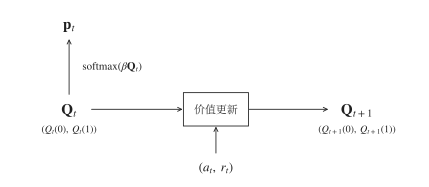
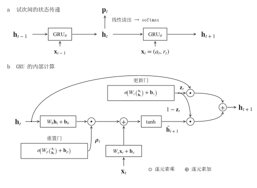
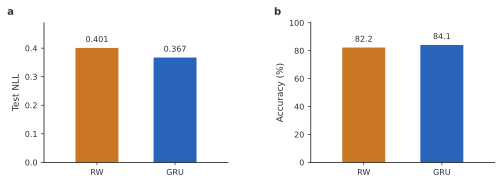

# 10.2.4 强化学习

在第八章中，我们介绍了如何用强化学习模型描述个体根据奖励调整行为的过程。例如，RW 模型根据实际奖励与预期奖励之间的差异更新价值，再将价值转换为选择概率。这类模型的优势在于，它把关于学习机制的假设写成了明确的数学公式。然而，真实个体是否完全按照这些规则学习？如果模型不能充分预测行为，我们又该怎样寻找更合适的更新规则？

上一节利用神经网络研究价值函数与概率权重函数的形状。本节进一步关注一个随时间展开的问题：**经历一次选择及其结果后，个体如何改变内部状态，并据此作出下一次选择？** 我们将以猴子的反转学习任务为例，先比较经典模型与小型循环神经网络的预测，再分析它们如何响应相同的反馈。

这一思路借鉴了 Ji-An 等\[15]的 tiny RNN 研究。该研究使用只有少量循环单元的网络拟合选择行为，并通过低维状态动力学研究候选学习策略。本节用自行实现的 RW 与两隐藏单元 GRU 展示这一方法：预测比较回答模型是否更好地描述了行为，动力学分析则进一步考察这种描述由怎样的状态更新产生。

## 从反转学习任务开始

设想你经常光顾两家餐厅，起初其中一家更容易提供满意的食物，后来两家的质量发生了变化。你需要根据新的用餐经历调整偏好，但一次不满意的经历未必足以说明这家餐厅已经变差。反转学习任务将类似的问题放进受控实验，用来研究个体如何在保留过去经验和响应新反馈之间取得平衡。

在本案例所用实验中，猴子每次在两个选项之间作出选择，随后获得奖励或没有获得奖励。一个选项的奖励概率为 0.7，另一个为 0.3；每个完整实验块（block）包含 80 次试次，其中发生一次无提示的概率反转，两个选项的奖励概率互换。原实验将反转安排在 block 中部的随机试次，具体位置不固定，也不取决于猴子当时的表现\[16]。

任务包含两类 block。在 **what block** 中，奖励概率与图像身份有关，图像的左右位置逐试次变化；在 **where block** 中，奖励概率与左右位置有关。整理数据时，前者使用图像选择，后者使用位置选择，将相关的两个选项统一编码为动作 0 和动作 1。奖励编码为 1，无奖励编码为 0。因此，动作 0 并不总是指屏幕左侧。

<figure><figcaption></figcaption></figure>

**图 10.2.4-1｜反转学习任务。** a，单次试次的呈现、选择与反馈；几何图形代指两幅刺激图像，虚线圈标出所选项。动物只获得所选项的反馈。b，一个完整 block 包含 80 次试次，两个选项的奖励概率在中部无提示地互换一次。图中初始高低概率的归属及反转位置均为示意。what block 的选项按图像编码，where block 按位置编码。

由于奖励具有概率性，选择高奖励概率的选项也可能没有获得奖励。因此，一次无奖励并不能直接说明规则已经反转。模型需要利用此前的选择与反馈预测行为，这为比较不同的历史整合方式提供了研究场景。我们要预测的是猴子实际会选什么，而不是判断哪个选项在实验规则下更优。

本例只使用公开数据集\[17]中的行为矩阵 `Y`，不使用神经记录。一次 session 对应一个数据文件，一个 session 中有多个 block；`session_name` 与 `block_order` 共同标识一条独立序列。

完整实验见配套文件 `reversal_learning.ipynb`。请按文件开头的说明安装依赖，将另行下载的原始 `.mat` 数据放在 notebook 同级的 `data` 文件夹，并在 Jupyter 中依次运行。下文展开模型和训练的关键步骤；数据读取、记录整理和绘图辅助函数使用附件中的定义。

先读取猴子 V 的行为数据。`load_blocks` 已在附件“读取行为记录”部分定义，它按 session 整理完整 block，并截取指定范围的试次。

```python
from pathlib import Path

# 数据路径按实际存放位置修改。
DATA_DIR = Path("data")
if not DATA_DIR.is_dir() and Path("../data").is_dir():
    DATA_DIR = Path("../data")
blocks = load_blocks(
    data_dir=DATA_DIR,
    animal_name="V",
    trial_start=11,
    trial_end=70,
)

print("block 数：", len(blocks))
print("动作数组形状：", blocks[0]["actions"].shape)
print("奖励数组形状：", blocks[0]["rewards"].shape)
```

猴子 V 的四个 session 共有 96 个完整 block，读取结果如下：

```
block 数： 96
动作数组形状： (60,)
奖励数组形状： (60,)
```

当前实现从每个 block 中截取原始第 11–70 次，共 60 次；下文以 $$t$$ 表示这段保留序列中的时刻。两种模型均在保留序列的起点将内部状态设为零，未使用前 10 次试次作预热，在 block 内发生反转时则继续更新状态。这是本例的建模约定，意味着模型不再保留截取起点之前的行为历史。

送入模型的只有动作与奖励。真实任务类型用于预先确定动作编码，反转位置用于标注图片；两者均不作为模型输入。因此，本例研究的是这种编码下的选择更新，并未要求模型同时判断当前属于 what 还是 where 任务。

## 用 RW 模型建立参照

我们先采用具有两个动作价值的 RW 型模型。令 $$Q_t(a)$$ 表示第$$t$$次选择之前，模型对动作$$a$$的价值估计。模型通过 softmax 将价值转换为选择概率：

$$
p_t(a)=\frac{\exp[\beta Q_t(a)]}{\exp[\beta Q_t(0)]+\exp[\beta Q_t(1)]}
$$

其中，逆温度参数 $$\beta$$ 控制选择对价值差异的敏感程度：$$\beta$$ 越大，模型越倾向于选择价值较高的动作。猴子随后选择 $$a_t$$，并获得奖励 $$r_t$$，被选动作的价值更新为

$$
Q_{t+1}(a_t)=Q_t(a_t)+\alpha[r_t-Q_t(a_t)]
$$

未选动作的价值保持不变。学习率 $$\alpha$$ 控制新反馈的影响，方括号中的差值就是奖励预测误差。

例如，当前 $$Q_t(0)=0.8$$、$$\alpha=0.2$$，如果猴子选择动作 0 后没有获得奖励，则 $$Q_{t+1}(0)=0.8+0.2(0-0.8)=0.64$$。另一个动作的价值没有变化，下一次选择动作 0 的概率随之降低。这里的两个数值只用于说明更新公式，实际参数需要由行为数据估计。

这个简单例子体现了 RW 的约束：反馈通过预测误差影响价值，学习率固定，只有被选动作的价值改变。拟合 RW，就是在这些假设下寻找最能预测真实选择的 $$\alpha$$ 和 $$\beta$$。同一只猴子的多个训练 block 共同确定一套参数，每个 block 内的价值状态则独立演化。

我们把价值读出和反馈更新写成 `RWModel`。`choice_probabilities` 计算选择概率，`update_values` 按预测误差更新价值；`predict_block` 则把这两步按时间顺序连接起来。代码中的 `iTemp` 对应逆温度 $$\beta$$。

```python
import numpy as np

class RWModel:
    def __init__(self, alpha=0.5, iTemp=5.0):
        self.alpha = alpha
        self.iTemp = iTemp

    def choice_probabilities(self, values):
        # 由当前价值计算两个动作的选择概率。
        values = np.asarray(values, dtype=float)
        scores = self.iTemp * (values - values.max())
        weights = np.exp(scores)
        return weights / weights.sum()

    def update_values(self, values, action, reward):
        # 只更新被选动作，保留未选动作的价值。
        new_values = values.copy()
        prediction_error = reward - new_values[action]
        new_values[action] += self.alpha * prediction_error
        return new_values

    def predict_block(self, actions, rewards):
        values = np.zeros(2)
        probabilities, states = [], []
        for action, reward in zip(actions, rewards):
            # 先预测当前选择，再读取这次的动作与奖励。
            states.append(values.copy())
            probabilities.append(self.choice_probabilities(values))
            values = self.update_values(values, action, reward)
        return {
            "probabilities": np.array(probabilities),
            "states": np.array(states),
            "final_state": values.copy(),
        }

    def update_state(self, state, action, reward):
        # 从指定状态更新一步，供后面的动力学分析使用。
        return self.update_values(np.asarray(state, dtype=float), action, reward)
```

循环中，预测发生在价值更新之前。减去最大价值是 softmax 的数值稳定处理，不改变选择概率。`states` 保存反馈前的价值，`final_state` 另存最后一次反馈后的价值，二者一起构成后续动力学分析所需的完整状态轨迹。

<figure><figcaption></figcaption></figure>

**图 10.2.4-2｜RW 模型。**&#x5F53;前价值状态 $$\mathbf Q_t$$ 经 softmax 产生选择概率 $$\mathbf p_t$$。观察到真实动作 $$a_t$$ 与奖励 $$r_t$$ 后，模型按预测误差更新被选动作的价值，未选动作的价值保持不变，得到 $$\mathbf Q_{t+1}$$。

## 让 GRU 学习状态更新

循环神经网络同样可以用一个随时间变化的内部状态概括行为历史。本例采用门控循环单元（gated recurrent unit，GRU），并将隐藏状态维度设为 2：

$$
\mathbf h_t=(h_{1,t},h_{2,t})^\mathsf T
$$

网络先从当前状态读出两个动作的分数，再转换为选择概率：

$$
\mathbf p_t=\operatorname{softmax}(W_{\mathrm{out}}\mathbf h_t+\mathbf b_{\mathrm{out}})
$$

观察到本次真实动作与奖励后，网络更新状态：

$$
\mathbf h_{t+1}=\operatorname{GRU}_{\theta}([a_t,r_t],\mathbf h_t)
$$

GRU 内部包含两个门。将本次输入记为 $$\mathbf x_t=(a_t,r_t)^\mathsf T$$，把它与旧状态 $$\mathbf h_t$$ 上下拼接，得到一个四维列向量。两个门分别计算为

$$
\boldsymbol{\rho}_t=\sigma\!\left[W_\rho \begin{pmatrix}\mathbf x_t\\\mathbf h_t\end{pmatrix} +\mathbf b_\rho\right],\qquad \mathbf z_t=\sigma\!\left[W_z \begin{pmatrix}\mathbf x_t\\\mathbf h_t\end{pmatrix} +\mathbf b_z\right]
$$

$$W_\rho$$ 与 $$W_z$$ 是各自的 $$2\times4$$ 权重矩阵，$$\mathbf b_\rho$$ 与 $$\mathbf b_z$$ 是二维偏置。每个门先做矩阵乘法、加上偏置，再通过 sigmoid 函数 $$\sigma$$，得到两个介于 0 与 1 之间的数。

重置门调节旧状态对候选状态的贡献。按照 notebook 所用 PyTorch GRU 的计算方式，候选状态为

$$
\widetilde{\mathbf h}_{t+1}=\tanh\!\left[ W_x\mathbf x_t+\mathbf b_x +\boldsymbol{\rho}_t\odot(W_h\mathbf h_t+\mathbf b_h) \right]
$$

其中，$$\odot$$ 表示逐元素相乘。重置门作用在旧状态经过线性变换后的分支上：某个分量接近 0 时，这部分历史信息对候选状态的贡献较小。当前输入则通过另一条分支参与候选状态的计算。

更新门再将旧状态与候选状态组合起来：

$$
\mathbf h_{t+1}=\mathbf z_t\odot\mathbf h_t +(1-\mathbf z_t)\odot\widetilde{\mathbf h}_{t+1}
$$

更新门的某个分量接近 $$1$$ 时，对应维度更多保留旧状态；接近 0 时，更多采用候选状态。两个门都会随当前输入和历史状态改变，因此同一种无奖励反馈可以产生不同的状态更新。

<figure><figcaption></figcaption></figure>

**图 10.2.4-3｜GRU 的时间结构与内部计算。**&#x61;，同一组参数 $$\theta$$ 在各试次重复使用，当前预测 $$\mathbf p_t$$ 从 $$\mathbf h_t$$ 读出，本次输入 $$\mathbf x_t=(a_t,r_t)^\mathsf T$$ 用于更新下一状态。b，两个门的方框直接列出矩阵运算，括号内上下排列的 $$\mathbf x_t$$ 与 $$\mathbf h_t$$ 表示向量拼接。门的两部分权重并列、两项偏置相加，仅为书写简便。重置门调节旧状态变换后的贡献，更新门控制旧状态与候选状态的混合。$$\odot$$ 表示逐元素乘，圆圈中的加号表示逐元素加；隐藏状态及两个门均为二维向量。

RW 和 GRU 的预测都遵守同样的时间顺序。虽然代码把动作与奖励放在同一个输入数组中，预测 $$a_t$$ 时仍然只能使用此前的历史。配套实现将初始零状态放在状态序列开头，使第一个保留试次由初始状态预测，第二个试次由读完第一条反馈后的状态预测，以此类推。它不会先读取当前动作，再“预测”这个动作。

下面用 PyTorch 定义 `GRUModel`。`forward` 完成整段序列的计算，`predict_block` 将结果转为便于评价的数组；另外两个方法分别用于单步状态更新和概率读出。输入 `inputs` 的形状为 `(T, B, 2)`：`T` 是试次数，`B` 是同时处理的 block 数，最后两项为动作与奖励。

```python
import torch
from torch import nn

class GRUModel(nn.Module):
    def __init__(self, hidden_dim=2):
        super().__init__()
        self.hidden_dim = hidden_dim
        self.gru = nn.GRU(input_size=2, hidden_size=hidden_dim)
        self.linear = nn.Linear(hidden_dim, 2)

    def forward(self, inputs):
        # 每个 block 从独立的零状态开始。
        h0 = torch.zeros(
            1, inputs.size(1), self.hidden_dim,
            dtype=inputs.dtype, device=inputs.device,
        )
        updated_states, final_state = self.gru(inputs, h0)
        # 预测当前动作时，只使用读入当前反馈之前的状态。
        states = torch.cat([h0, updated_states[:-1]], dim=0)
        return {
            "logits": self.linear(states),
            "states": states,
            "final_state": final_state.squeeze(0),
        }

    def predict_block(self, actions, rewards):
        parameter = next(self.parameters())
        inputs = np.stack([actions, rewards], axis=-1)
        inputs = torch.tensor(inputs, dtype=parameter.dtype, device=parameter.device)
        self.eval()
        with torch.no_grad():
            result = self(inputs.unsqueeze(1))
            probabilities = torch.softmax(result["logits"], dim=-1)
        return {
            "probabilities": probabilities[:, 0].cpu().numpy(),
            "states": result["states"][:, 0].cpu().numpy(),
            "final_state": result["final_state"][0].cpu().numpy(),
        }

    def update_state(self, state, action, reward):
        # 从给定隐藏状态读取一次反馈。
        parameter = next(self.parameters())
        hidden = torch.tensor(state, dtype=parameter.dtype, device=parameter.device)
        hidden = hidden.reshape(1, 1, self.hidden_dim)
        inputs = torch.tensor(
            [[[action, reward]]], dtype=parameter.dtype, device=parameter.device,
        )
        self.eval()
        with torch.no_grad():
            _, next_hidden = self.gru(inputs, hidden)
        return next_hidden[0, 0].cpu().numpy()

    def choice_probabilities(self, state):
        parameter = next(self.parameters())
        hidden = torch.tensor(state, dtype=parameter.dtype, device=parameter.device)
        with torch.no_grad():
            probabilities = torch.softmax(self.linear(hidden), dim=-1)
        return probabilities.cpu().numpy()
```

`nn.GRU` 内部完成图中两个门与候选状态的计算，`nn.Linear` 将隐藏状态转换成两个动作分数。这里最关键的一行是 `torch.cat([h0, updated_states[:-1]], dim=0)`：它将状态与预测目标对齐，保证模型预测当前动作时还没有读到该动作。评估时对 `logits` 使用 softmax 得到概率；训练时直接将 `logits` 交给交叉熵损失，保留梯度以更新权重。

RW 与 GRU 都是二维状态模型，但这不意味着它们同样简单。RW 只拟合两个参数，本例 GRU 连同线性读出层共有 42 个可训练参数。较小的状态维度便于画出状态空间；较多的参数则使 GRU 能表示更灵活的更新规则。隐藏维度、参数数量和训练试次数描述的是不同的事情。

这里还需区分两种“学习”。**拟合时，网络通过监督学习调整权重，使预测接近猴子的真实选择；拟合完成后，权重保持固定，隐藏状态随每次动作与奖励改变。** 前者是模型训练，后者用来描述猴子在任务中的学习过程。与训练网络完成工作记忆任务的示例相比，本例的目标是拟合个体行为；奖励是输入信息，优化目标是选择预测，而不是网络自己获得的奖励总量。

## 在相同测试数据上比较预测

为了比较两种模型，我们按完整 block 划分数据，保留各 block 内的试次顺序。同一个 block 只能属于训练、验证、测试中的一个集合。训练集用于拟合参数，验证集用于选择 GRU 的训练停止时机，测试集用于最后的预测比较。

```python
# 只打乱 block 的顺序，不打乱 block 内的试次。
rng = np.random.default_rng(0)
indices = np.arange(len(blocks))
rng.shuffle(indices)

n_validation = int(len(blocks) * 0.1)
n_test = int(len(blocks) * 0.1)
n_train = len(blocks) - n_validation - n_test
train_blocks = [blocks[i] for i in indices[:n_train]]
validation_blocks = [blocks[i] for i in indices[n_train:n_train + n_validation]]
test_blocks = [blocks[i] for i in indices[n_train + n_validation:]]

print(len(train_blocks), len(validation_blocks), len(test_blocks))
```

这次划分包含 78 个训练 block、9 个验证 block 和 9 个测试 block，分别对应 4680、540 和 540 次试次。模型按猴子分别拟合，但同一只猴子的多个 session 可以共同用于训练；并非一个 session 或一个 block 各拟合一套权重。

两种模型均以提高真实选择的预测概率为目标。评价指标采用每试次平均负对数似然（negative log-likelihood，NLL）：

$$
\operatorname{NLL}=-\frac{1}{N}\sum_{t=1}^{N}\ln p_t(a_t)
$$

其中，N 为所评估试次的总数。NLL 越小，表示模型整体上赋予真实选择的概率越高。选择准确率则检查概率最大的动作是否与真实动作相同。NLL 还区分预测的确信程度：给真实动作分配 0.9 和 0.6 的概率，虽然都可能预测正确，损失却不同。

先把评价指标写成函数。我们在每个 block 内独立计算选择概率，再汇总所有试次的损失和预测正确次数。

```python
def evaluate(model, blocks):
    # 每个 block 独立初始化，再按试次数汇总。
    total_nll, total_correct, n_trials = 0.0, 0, 0
    for block in blocks:
        actions = block["actions"]
        probabilities = model.predict_block(
            actions, block["rewards"]
        )["probabilities"]
        p_true = probabilities[np.arange(len(actions)), actions]
        total_nll -= np.log(np.clip(p_true, 1e-10, None)).sum()
        total_correct += np.sum(probabilities.argmax(axis=1) == actions)
        n_trials += len(actions)
    return {
        "n_trials": n_trials,
        "nll": float(total_nll / n_trials),
        "accuracy": float(total_correct / n_trials),
    }
```

有了这个函数，就可以估计 RW 的两个参数。下面让优化器寻找使训练集 NLL 最小的学习率和逆温度。

```python
from scipy.optimize import minimize

rw_model = RWModel()

def rw_objective(parameters):
    rw_model.alpha, rw_model.iTemp = parameters
    return evaluate(rw_model, train_blocks)["nll"]

result = minimize(
    rw_objective,
    x0=[0.5, 1.0],
    bounds=[(0, 1), (1e-8, None)],
    method="L-BFGS-B",
)
if not result.success:
    raise RuntimeError(f"RW 参数优化失败：{result.message}")
rw_model.alpha, rw_model.iTemp = result.x
print(f"alpha={rw_model.alpha:.3f}, beta={rw_model.iTemp:.3f}")
```

接下来训练 GRU。先把多个 block 沿批量维度排列，保留各 block 内的时间顺序：

```python
def prepare_batch(blocks, model):
    # 输入为 (试次, block, 动作与奖励)，目标为真实动作。
    inputs = np.stack([
        np.stack([b["actions"], b["rewards"]], axis=-1)
        for b in blocks
    ], axis=1)
    targets = np.stack([b["actions"] for b in blocks], axis=1)
    parameter = next(model.parameters())
    inputs = torch.tensor(
        inputs, dtype=parameter.dtype, device=parameter.device
    )
    targets = torch.tensor(
        targets, dtype=torch.long, device=parameter.device
    )
    return inputs, targets
```

每轮训练先计算选择预测损失，再通过反向传播调整权重。我们同时计算验证 NLL；连续 100 轮没有改善就停止，并恢复验证表现最好时的参数。

```python
import copy

torch.manual_seed(0)
gru_model = GRUModel(hidden_dim=2)
train_inputs, train_targets = prepare_batch(train_blocks, gru_model)
val_inputs, val_targets = prepare_batch(validation_blocks, gru_model)
optimizer = torch.optim.AdamW(gru_model.parameters(), lr=0.005, weight_decay=0)
criterion = nn.CrossEntropyLoss()
best_validation_loss, best_state = float("inf"), None
epochs_without_improvement = 0
history = {"epoch": [], "train_nll": [], "validation_nll": [], "best_epoch": 0}

for epoch in range(1, 1001):
    gru_model.train()
    optimizer.zero_grad()
    logits = gru_model(train_inputs)["logits"]
    nll = criterion(logits.reshape(-1, 2), train_targets.reshape(-1))
    # 与附件一致，对全部参数（包括偏置）加入 L1 惩罚。
    l1_penalty = sum(p.abs().sum() for p in gru_model.parameters())
    train_loss = nll + 1e-4 * l1_penalty
    train_loss.backward()
    optimizer.step()

    # 验证集不计算梯度，只用于选择保留哪一轮参数。
    gru_model.eval()
    with torch.no_grad():
        val_logits = gru_model(val_inputs)["logits"]
        validation_loss = criterion(
            val_logits.reshape(-1, 2), val_targets.reshape(-1)
        ).item()
    history["epoch"].append(epoch)
    history["train_nll"].append(train_loss.item())
    history["validation_nll"].append(validation_loss)

    if validation_loss < best_validation_loss:
        best_validation_loss = validation_loss
        best_state = copy.deepcopy(gru_model.state_dict())
        history["best_epoch"] = epoch
        epochs_without_improvement = 0
    else:
        epochs_without_improvement += 1

    if epoch == 1 or epoch % 100 == 0:
        print(f"第 {epoch} 轮：训练目标={train_loss.item():.4f}，"
              f"验证 NLL={validation_loss:.4f}")
    if epochs_without_improvement >= 100:
        break

if best_state is None:
    raise RuntimeError("未得到有效的验证损失，请检查数据和训练参数。")
gru_model.load_state_dict(best_state)
models = {"RW": rw_model, "GRU": gru_model}
print("恢复训练轮次：", history["best_epoch"])
```

上面的两段代码分别估计 RW 参数和 GRU 权重。GRU 使用的优化器学习率为 0.005，它控制权重调整的步长，与 RW 中描述反馈影响的 $$\alpha$$ 含义不同。训练目标包含 L1 惩罚，而验证和测试 NLL 不含这一项；因此，`history["train_nll"]` 记录的训练目标不能直接与验证 NLL 比较。测试数据始终不参与参数估计。

模型训练好后，我们用同一组测试 block 比较预测。下面先保存每次选择的预测概率和状态，再计算 NLL 与准确率。记录整理和绘图使用附件中定义的辅助函数，生成的图片保存在 `FIGURE_DIR`。

```python
records = collect_predictions(models, test_blocks)

for name, model in models.items():
    scores = evaluate(model, test_blocks)
    print(f"{name}: NLL={scores['nll']:.3f}, "
          f"accuracy={scores['accuracy']:.1%}")

# 将同一组测试结果画成比较图。
FIGURE_DIR = Path("reversal_learning_results/monkey_V_seed0/figures")
comparison = summarize_model_comparison(records)
plot_model_comparison(comparison, FIGURE_DIR)
show_svg(FIGURE_DIR / "model_comparison.svg")
```

<figure><figcaption></figcaption></figure>

**图 10.2.4-4｜测试集上的选择预测。** a，每试次平均 NLL，越低越好。b，选择预测准确率，越高越好。两个模型均评价猴子 V 的同一组 9 个测试 block，共 540 次试次。图中为一次固定数据划分的描述性结果，未作统计推断。

图 10.2.4-4 展示的是原示例运行：RW 的 $$\alpha=0.445$$、$$\beta=3.387$$，测试 NLL 分别为 0.401（RW）和 0.367（GRU），准确率分别为 82.2% 和 84.1%。当前附件 notebook 保存的测试输出为 RW：NLL 0.400852、准确率 82.22%；GRU：NLL 0.367496、准确率 84.44%。旧图与附件保存的结果略有差异，重新运行时应以本次输出及生成的图像为准。在这两组示例结果中，两隐藏单元 GRU 都比当前 RW 基线更好地预测了猴子 V 的选择。

这个结果的范围也需要明确。测试 block 未用于拟合，但它们所在的 session 也有其他 block 出现在训练集中，因此这里评价的是同一只猴子、已有 session 中留出 block 的预测，不能据此声称能泛化到新的 session 或新的个体。本例采用一次固定划分，也只比较了一个经典基线；如果要得出更广泛的模型优劣结论，还需比较其他经典模型，并考察不同划分、初始化和个体下的稳定性。

## 用整个测试集观察状态动力学

更好的预测并没有自动告诉我们模型采用了什么策略。接下来固定已经拟合的参数，让两个模型分别读取全部测试 block 中的真实行为，记录每次反馈前后的状态。这里分析的是**固定模型的状态如何变化**，而不是训练过程中权重怎样变化。

对于 RW，状态是 $$\mathbf s_t=(Q_t(0),Q_t(1))^\mathsf T$$；对于 GRU，状态是 $$\mathbf s_t=(h_{1,t},h_{2,t})^\mathsf T$$。二维状态可以表示为平面上的一个点，每次更新就是从 $$\mathbf s_t$$ 移动到 $$\mathbf s_{t+1}$$。如果把每个 block 的点按时间连接起来，得到的是各自的状态轨迹；但要比较更新规律，还需要区分是什么反馈引发了这些移动。

动作和奖励均为二值，因此共有四种输入条件：(0,0)、(0,1)、(1,0)、(1,1)。固定一种条件后，模型的更新可写为

$$
\mathbf s_{t+1}=F_{a,r}(\mathbf s_t),\qquad \Delta\mathbf s=F_{a,r}(\mathbf s)-\mathbf s
$$

这样，每个模型都对应四个条件更新函数。实际执行任务时，模型随着输入改变而在这四种更新之间切换。我们将所有测试 block 中属于同一种输入的更新放入同一个面板，从而观察它在不同历史状态下产生的影响。

现在把四种反馈条件画在同一张图上。下面调用附件“条件状态动力学”部分的计算和绘图函数，使用前面得到的 `models` 与 `records`。网格每个方向取 41 个点，并保留全部测试事件。

```python
fields = {}
for name, model in models.items():
    limits = (0.0, 1.0) if name == "RW" else (-1.0, 1.0)
    fields[name] = compute_model_dynamics(
        model=model,
        records=records,
        model_name=name,
        grid_size=41,
        state_limits=limits,
        max_arrows_per_condition=None,  # 保留全部测试事件。
        sample_seed=0,
    )

plot_dynamics_comparison(fields, FIGURE_DIR)
show_svg(FIGURE_DIR / "dynamics_comparison.svg")
```

函数先在每个 block 内计算状态更新，再按输入条件汇总。它不会把前一个 block 的末状态与下一个 block 的初状态连接起来。每个 block 的最后一次反馈也有更新后的末状态，因此 9 个 block 的 540 次反馈都能进入分析。

<figure><figcaption></figcaption></figure>

**图 10.2.4-5｜整个测试集的条件动力学。**&#x4E0A;排为 RW，下排为 GRU；四列依次为选择 0 无奖励、选择 0 有奖励、选择 1 无奖励、选择 1 有奖励。黑箭头表示真实行为驱动的模型状态更新，四列分别包含 101、188、116、135 次事件；每个模型共显示 540 次更新。背景色及细等值线表示在网格状态上施加该列输入时的更新幅度 $$\|\Delta\mathbf s\|_2$$。同一模型四个面板共用色标，两种模型的色标独立。橙色虚线为 $$P(a=0)=0.5$$ 的边界。图中包含全部 9 个测试 block，而非单个 block 的轨迹。

阅读这张图时，可以依次区分三类信息。

首先看**黑箭头**。箭尾是反馈前的模型状态，箭头指向反馈后的状态。同一面板中的箭头可能来自不同 block 或相隔很远的试次，它们共有的是输入条件，并不构成一条按时间排列的路径。箭头来自真实行为驱动的模型计算，坐标本身并不是实验测得的神经活动。

其次看**背景色与细等值线**。为了查看真实状态附近的更新规律，代码在覆盖测试状态范围的矩形区域内建立网格，对每个网格点施加同一种输入，计算 $$\|F_{a,r}(\mathbf s)-\mathbf s\|_2$$。颜色偏黄表示更新幅度较大，偏紫表示较小；同一条细线上的更新幅度相同。它们类似地形图中的等高线，但这里的“高度”是更新幅度。细线不表示状态会沿线运动，颜色也不表示选择概率；网格中的部分状态可能从未在测试行为中出现。

最后看**橙色虚线**。它表示两个动作的预测概率相等，连接状态更新与行为偏好。对 RW 而言，$$Q_t(0)=Q_t(1)$$ 时两动作等概率，因此边界正好是对角线；线下方 $$Q_t(0)>Q_t(1)$$，模型更偏向动作 0。若状态更新跨过边界，概率最大的动作就改变了；即使没有跨线，选择概率也可能发生变化。

GRU 的边界由读出层决定。令两个动作的读出分数之差为

$$
d(\mathbf h)=(\mathbf w_0-\mathbf w_1)^\mathsf T\mathbf h+(b_0-b_1), \qquad P(a=0\mid\mathbf h)=\frac{1}{1+e^{-d(\mathbf h)}}
$$

边界就是 $$d(\mathbf h)=0$$。图 10.2.4-5 所用示例权重给出的分数差约为 $$-2.060h_1+2.073h_2+0.132$$，所以图中的虚线虽然接近对角线，却不是严格的 $$h_1=h_2$$；在线上方，模型更偏向动作 0。所谓“读出方向”，就是使 $$d(\mathbf h)$$ 增大的方向，在这里由向量 $$(\mathbf w_0-\mathbf w_1)$$ 决定。沿与边界平行的方向移动可以改变隐藏状态，却不改变当前读出概率。因此，状态移动的距离本身不足以说明选择偏好改变了多少。重新拟合后，可以用 `get_readout(gru_model)` 查看本次模型的读出向量和偏置。

### 两种模型的更新有何不同？

先看 RW 的四个面板。选择动作 0 时，只有横坐标 $$Q_0$$ 更新：无奖励时向左移动，有奖励时向右移动。选择动作 1 时，只有纵坐标 $$Q_1$$ 更新：无奖励时向下，有奖励时向上。更新幅度为 $$\alpha|r-Q_t(a)|$$，完全由被选动作的当前价值及奖励决定。因此，相同 $$Q_0$$ 下的动作 0 更新幅度相同，形成竖直等值线；动作 1 的等值线则是水平的。图中的几何结构可以直接从 RW 公式推出。

再看 GRU。箭头可以同时改变两个隐藏坐标，方向与幅度也随所在位置改变；等值线呈现弯曲形状。以“选择 0 并获得奖励”的 f 面板为例，处于右下区域的状态会向左上方移动，而已经处于左上区域的部分状态变化较小。结合当前读出层可知，向左上方移动通常会增加选择动作 0 的概率。这展示了网络如何把同一种反馈转换为依赖当前状态的更新。

这样的分析使我们能够在真实行为访问过的区域，检查相同反馈在不同历史状态下如何改变下一次的选择概率。RW 的更新同样依赖当前价值；这里要比较的是这种依赖能否由固定学习率、仅更新被选动作的规则概括。不过，两个隐藏坐标是共同参与读出的，不能直接把 $$h_1$$ 和 $$h_2$$ 命名为两个动作的 Q 值，也不能仅因两个坐标都发生变化，就断言猴子更新了未选动作的价值。

跨模型比较时，更合适的共同尺度是概率变化

$$
\Delta p_0=p_0(\mathbf s_{t+1})-p_0(\mathbf s_t)
$$

它描述同一次反馈使模型对动作 0 的偏好增强还是减弱。相反，Q 值与隐藏状态的坐标单位不同，不能通过两行色彩的深浅或箭头长度判断哪一个模型“学习更快”。等值线弯曲或箭头局部汇聚也不能单独证明存在吸引子；如果要提出这一解释，还需检验固定点及其稳定性。

## 从网络更新提出可检验的认知假设

在第八章中，我们先规定价值更新公式，再用行为估计参数。本节增加了另一条研究路径：先用一个能够预测行为的小型网络学习状态更新，再把其中的规律转化为可以检验的认知假设。例如，相同的无奖励反馈是否会因先前积累的证据不同而产生不同影响？一个固定学习率能否概括这些变化？这些问题可以进一步落实为带有明确机制约束的模型，并在独立数据上与原有模型比较。

本例完成了这条路径的前两步：GRU 在当前测试集上的预测优于 RW；条件动力学图展示了两个模型如何处理同一组反馈。预测差异并不自动确定其原因，图中的状态依赖也还不是对动物真实机制的证明。要把观察到的更新规律解释为认知策略，需要验证它是否稳定，并检验由此建立的机制模型是否改善预测。

本节的实现也保留了教学上的简化：采用动作与奖励两个输入、普通线性读出层，以及一次固定的数据划分。它借鉴了 tiny RNN 的研究方法，并非原论文模型与图 4 的逐项复现。小型网络在这里的作用，是提供一个既能拟合行为、又能在低维空间中检查的计算系统，帮助我们把“模型预测得更好”推进为“哪些更新假设值得进一步检验”。

## 参考文献

本节参考文献统一列于第十章 Appendix，编号为 15–17。
