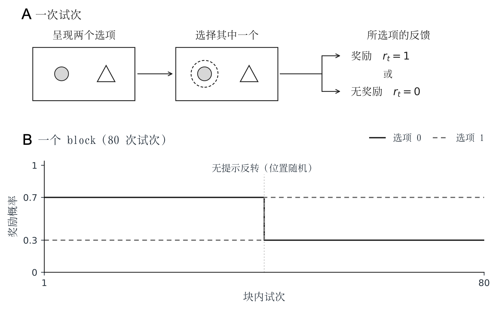
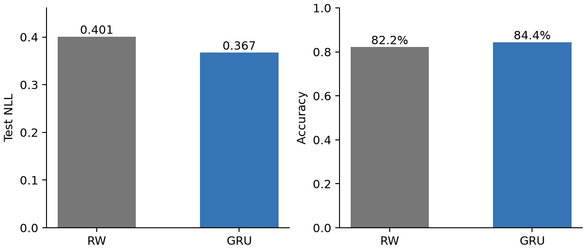
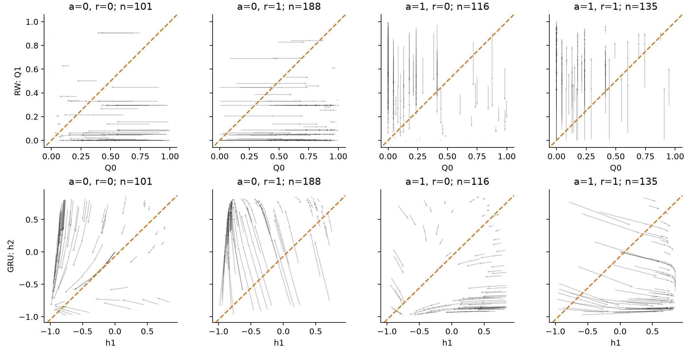

# 10.2.4 强化学习

本章的“工作记忆”部分利用了循环神经网络的隐藏状态来模拟信息维持的过程。本节将进一步关注另一个随时间展开的问题：**经历一次选择及其结果后，个体如何改变内部状态，并据此作出下一次选择？** 我们将以猴子的反转学习任务为例，先比较经典模型与小型循环神经网络的预测，再分析它们如何响应相同的反馈。这一思路借鉴了 Ji-An 等<sup>26</sup>的 tiny RNN 研究。该研究使用包含少量循环单元的网络拟合选择行为，并通过低维状态动力学研究候选学习策略。本节以RW模型和包含两个隐藏单元的GRU为例，展示这一研究方法：通过预测表现比较模型对行为的描述能力，再通过动力学分析，考察模型如何更新内部状态并产生行为预测。

## 反转学习任务

设想你经常光顾两家餐厅，起初其中一家更容易提供满意的食物，后来两家的质量发生了变化。你需要根据新的用餐经历调整偏好，但一次不满意的经历未必足以说明这家餐厅已经变差。反转学习任务将类似的问题放进受控实验，用来研究个体如何在保留过去经验和响应新反馈之间取得平衡。

在本节所参考的实验中，猴子每次在两个选项之间做出选择，随后可能获得奖励。一个选项的奖励概率为 0.7，另一个为 0.3；每个完整的试次区组（block）包含 80 个试次，其中发生一次无提示的概率反转，两个选项的奖励概率互换。原实验将反转安排在 block 中部的随机试次，具体位置不固定，也不取决于猴子当时的表现<sup>27</sup>。

任务包含两类 block。在 **what block** （身份相关）中，奖励概率取决于所选图像的身份，而图像的左右位置随试次变化；在 **where block** （位置相关）中，奖励概率取决于所选的左侧或右侧位置。整理数据时，what block 按照图像身份编码选择，where block按照左右位置编码选择，均将两个选项记为动作 0 和动作 1。获得奖励记为 1，未获得奖励记为 0。因此，动作编码表示各区组中与奖励相关的选项，动作0并不始终对应屏幕左侧。

由于奖励具有概率性，选择高奖励概率的选项也可能没有获得奖励。因此，一次无奖励并不能直接说明规则已经反转。模型需要利用此前的选择与反馈预测行为，这为比较不同的历史整合方式提供了研究场景。我们要预测的是猴子实际会选什么，而不是判断哪个选项在实验规则下更优。

<figure><figcaption><p>图 10-41  反转学习任务的实验设置<strong>。</strong> <br>A. 单次试次的呈现、选择与反馈；B. 一个区组中选项的奖励概率会在中部无提示地互换一次。</p></figcaption></figure>

随书配套文件包提供本例可运行的 Notebook、预处理后的数据和运行结果。数据为公开的 Mendeley Data 数据集（版本 1）28 中猴子 V 的行为数据，经整理后保存在 data/monkey\_V\_blocks.csv。请在此前配置好的 Python/Jupyter 环境中运行 Notebook；生成的图像会直接显示在 Notebook 中。

本例使用随书提供的预处理 CSV；正文中的读取代码按 animal\_name、session\_name 和 block\_order 分组，按 trial\_number 排序，再将 action 与 reward 列转换为 NumPy 数组。每个 block 因而保留独立的动作与奖励序列。原始 MAT 数据的筛选和预处理代码放在附件中。

下面导入本节所需的依赖，并指定随书 CSV。

```python
from pathlib import Path
import copy
import numpy as np
from scipy.optimize import minimize
import matplotlib.pyplot as plt
import torch
from torch import nn
import csv

DATA_FILE = Path("data") / "monkey_V_blocks.csv"
if not DATA_FILE.is_file() and Path("../data/monkey_V_blocks.csv").is_file():
    DATA_FILE = Path("../data/monkey_V_blocks.csv")
if not DATA_FILE.is_file():
    raise FileNotFoundError(
        "找不到随书数据 data/monkey_V_blocks.csv，请确认已解压配套文件包。"
    )

# 使用 CPU 和固定随机种子；单线程便于重复核对。
torch.set_num_threads(1)
torch.manual_seed(0)
```

下面直接读取随书提供的预处理 CSV：

```python
grouped_rows = {}
with DATA_FILE.open(newline="", encoding="utf-8") as stream:
    for row in csv.DictReader(stream):
        key = (row["animal_name"], row["session_name"], int(row["block_order"]))
        grouped_rows.setdefault(key, []).append(row)

blocks = []
for rows in grouped_rows.values():
    rows.sort(key=lambda row: int(row["trial_number"]))
    blocks.append({
        "actions": np.array([int(row["action"]) for row in rows]),
        "rewards": np.array([int(row["reward"]) for row in rows]),
    })
print(f"block 数：{len(blocks)}")
print(f"动作数组形状：{blocks[0]['actions'].shape}")
print(f"奖励数组形状：{blocks[0]['rewards'].shape}")
```

CSV 中共有 96 个 block。每个 block 保留原始第 11–70 次试次，共 60 次；运行下面代码可核对读取结果：

```
block 数： 96
动作数组形状： (60,)
奖励数组形状： (60,)
```

下文以 t=0,…,59 表示每个 block 内的试次编号。两种模型均在序列开始时将内部状态初始化为零，不使用序列开始前的行为信息进行预热；block 内发生奖励关系反转时，状态不重置，而是继续根据选择与奖励更新。因此，模型的初始状态不包含当前序列开始前的行为历史。

模型接收的试次信息仅包括动作与奖励，并遵循“先预测、后更新”的顺序。任务类型用于预先确定动作编码，反转位置仅用于图10-41中的标注，均不作为额外输入。因此，本例考察的是在任务相关选项已统一编码的条件下，模型如何利用选择与奖励历史预测后续选择，并不要求模型自行识别当前属于what block还是where block。

## RW 模型

首先采用动作空间为二维向量的 RW 模型。令 $$Q_t(a)$$ 表示第$$t$$次选择之前，模型对动作$$a$$的价值估计。模型通过 Softmax函数将价值转换为选择概率： $$\mathbf p_t=\operatorname{softmax}(\beta\mathbf Q_t)$$&#x20;

逐动作展开，就是：

$$
p_t(a)=\frac{\exp[\beta Q_t(a)]}{\exp[\beta Q_t(0)]+\exp[\beta Q_t(1)]} \qquad (10-73)
$$

其中，逆温度参数 $$\beta$$ 控制选择对价值差异的敏感程度：$$\beta$$ 越大，模型越倾向于选择价值较高的动作。猴子随后选择 $$a_t$$，并获得奖励 $$r_t$$，被选动作的价值更新为：

$$
Q_{t+1}(a_t)=Q_t(a_t)+\alpha[r_t-Q_t(a_t)] \qquad (10-74)
$$

其中，未选动作的价值保持不变。奖励与当前动作价值的差值记为奖励的预测误差，学习率 $$\alpha$$ 控制该误差反馈的影响。

RW模型需要通过拟合学习率 $$\alpha$$ 和逆温度参数$$\beta$$，来反映真实的学习特点。对同一只猴子，使用多个训练区组共同估计$$\alpha$$和$$\beta$$。这两个参数在区组之间保持一致；两个选项的价值则在每个区组开始时重新初始化，并根据区组内的选择与奖励独立更新。

我们把价值读出和反馈更新写成 `RWModel`。`choice_probabilities` 计算选择概率，`update_values` 按预测误差更新价值；`predict_block` 则把这两步按时间顺序连接起来。代码中的 `iTemp` 对应逆温度 $$\beta$$。

```python
import numpy as np

class RWModel:
    def __init__(self, alpha=0.5, iTemp=5.0):
        self.alpha = alpha
        self.iTemp = iTemp

    def choice_probabilities(self, values):
        # 由当前价值计算两个动作的选择概率。
        values = np.asarray(values, dtype=float)
        scores = self.iTemp * (values - values.max())
        weights = np.exp(scores)
        return weights / weights.sum()

    def update_values(self, values, action, reward):
        # 只更新被选动作，保留未选动作的价值。
        new_values = values.copy()
        prediction_error = reward - new_values[action]
        new_values[action] += self.alpha * prediction_error
        return new_values

    def predict_block(self, actions, rewards):
        values = np.zeros(2)
        probabilities, states = [], []
        for action, reward in zip(actions, rewards):
            # 先预测当前选择，再读取这次的动作与奖励。
            states.append(values.copy())
            probabilities.append(self.choice_probabilities(values))
            values = self.update_values(values, action, reward)
        return {
            "probabilities": np.array(probabilities),
            "states": np.array(states),
            "final_state": values.copy(),
        }

    def update_state(self, state, action, reward):
        # 从指定状态更新一步，供后面的动力学分析使用。
        return self.update_values(np.asarray(state, dtype=float), action, reward)
```

循环中，预测发生在价值更新之前。 Softmax通过减去最大值以保证数值的稳定性，不改变选择概率。`states` 保存反馈前的价值，`final_state` 另存最后一次反馈后的价值，二者一起构成后续动力学分析所需的完整状态轨迹。

## GRU 模型

循环神经网络同样可以用一个随时间变化的内部状态概括行为历史。本例采用门控循环单元GRU（见本章1.4的详细介绍），并将隐藏状态维度设为 2：

$$
\mathbf h_t=(h_{1,t},h_{2,t})^\mathsf T \qquad (10-75)
$$

网络先从当前状态读出两个动作的分数，再转换为选择概率：

$$
\mathbf p_t=\operatorname{softmax}(W_{\mathrm{out}}\mathbf h_t+\mathbf b_{\mathrm{out}}) \qquad (10-76)
$$

观察到本次真实动作与奖励后，网络更新状态：

$$
\mathbf h_{t+1}=\operatorname{GRU}_{\theta}([a_t,r_t],\mathbf h_t) \qquad (10-77)
$$

GRU 内部包含重置门和更新门：

$$
\begin{aligned}
\mathbf r_t
&=\sigma\!\left(
W_r[\mathbf h_{t-1};\mathbf x_t]+\mathbf b_r
\right)\\
\mathbf z_t
&=\sigma\!\left(
W_z[\mathbf h_{t-1};\mathbf x_t]+\mathbf b_z
\right)
\end{aligned}\qquad (10-78)
$$

其中，输入记为 $$\mathbf x_t=(a_t,r_t)^\mathsf T$$，与当前状态 $$\mathbf h_t$$ 拼接后得到一个四维向量。$$W_r$$ 与 $$W_z$$ 是形状为 $$2\times4$$ 的权重矩阵，$$\mathbf b_r$$ 与 $$\mathbf b_z$$ 是二维偏置。两个门经过加权求和以及 sigmoid 函数 $$\sigma$$，得到两个介于 0 与 1 之间的数。

重置门调节旧状态对候选状态的贡献：

$$
\widetilde{\mathbf h}_{t+1}=\tanh\!\left[ W_x\mathbf x_t+\mathbf b_x +\boldsymbol{r}_t\odot(W_h\mathbf h_t+\mathbf b_h) \right] \qquad (10-79)
$$

其中，$$\odot$$ 表示逐元素相乘。重置门作用在旧状态经过线性变换后的分支上：某个分量接近 0 时，这部分历史信息对候选状态的贡献较小。当前输入则通过另一条分支参与候选状态的计算。

更新门再将旧状态与候选状态组合起来：

$$
\mathbf h_{t+1}=\mathbf z_t\odot\mathbf h_t +(1-\mathbf z_t)\odot\widetilde{\mathbf h}_{t+1} \qquad (10-80)
$$

更新门的某个分量接近 $$1$$ 时，对应维度更多保留旧状态；接近 0 时，更多采用候选状态。两个门都会随当前输入和历史状态改变，因此同一种无奖励反馈可以产生不同的状态更新。

RW和GRU均遵循**先预测当前选择，再利用当前选择与奖励更新状态**的时间顺序。虽然代码将动作和奖励存放在同一个输入数组中，但预测 $$a_t$$ 时，模型只能使用此前试次的历史，即 $$(a_1,r_1),\ldots,(a_{t-1},r_{t-1})$$。

配套实现将初始零状态放在状态序列的开头，使状态与预测目标错开一个试次：第一个纳入分析的试次由初始状态预测；第二个试次由处理完第一个试次的动作与奖励后得到的状态预测，后续依此类推。这样可以避免将当前动作提前用于预测自身，造成信息泄漏。

下面用 PyTorch 定义 `GRUModel`。`forward` 完成整段序列的计算，`predict_block` 将结果转为便于评价的数组；另外两个方法分别用于单步状态更新和概率读出。输入 `inputs` 的形状为 `(T, B, 2)`：`T` 是试次数，`B` 是同时处理的 block 数，最后两项为动作与奖励。

```python
import torch
from torch import nn

class GRUModel(nn.Module):
    def __init__(self, hidden_dim=2):
        super().__init__()
        self.hidden_dim = hidden_dim
        self.gru = nn.GRU(input_size=2, hidden_size=hidden_dim)
        self.linear = nn.Linear(hidden_dim, 2)

    def forward(self, inputs):
        # 每个 block 从独立的零状态开始。
        h0 = torch.zeros(
            1, inputs.size(1), self.hidden_dim,
            dtype=inputs.dtype, device=inputs.device,
        )
        updated_states, final_state = self.gru(inputs, h0)
        # 预测当前动作时，只使用读入当前反馈之前的状态。
        states = torch.cat([h0, updated_states[:-1]], dim=0)
        return {
            "logits": self.linear(states),
            "states": states,
            "final_state": final_state.squeeze(0),
        }

    def predict_block(self, actions, rewards):
        parameter = next(self.parameters())
        inputs = np.stack([actions, rewards], axis=-1)
        inputs = torch.tensor(inputs, dtype=parameter.dtype, device=parameter.device)
        self.eval()
        with torch.no_grad():
            result = self(inputs.unsqueeze(1))
            probabilities = torch.softmax(result["logits"], dim=-1)
        return {
            "probabilities": probabilities[:, 0].cpu().numpy(),
            "states": result["states"][:, 0].cpu().numpy(),
            "final_state": result["final_state"][0].cpu().numpy(),
        }

    def update_state(self, state, action, reward):
        # 从给定隐藏状态读取一次反馈。
        parameter = next(self.parameters())
        hidden = torch.tensor(state, dtype=parameter.dtype, device=parameter.device)
        hidden = hidden.reshape(1, 1, self.hidden_dim)
        inputs = torch.tensor(
            [[[action, reward]]], dtype=parameter.dtype, device=parameter.device,
        )
        self.eval()
        with torch.no_grad():
            _, next_hidden = self.gru(inputs, hidden)
        return next_hidden[0, 0].cpu().numpy()

    def choice_probabilities(self, state):
        parameter = next(self.parameters())
        hidden = torch.tensor(state, dtype=parameter.dtype, device=parameter.device)
        with torch.no_grad():
            probabilities = torch.softmax(self.linear(hidden), dim=-1)
        return probabilities.cpu().numpy()
```

`nn.GRU` 内部完成图中两个门与候选状态的计算，`nn.Linear` 将隐藏状态转换成两个动作分数。这里最关键的一行是 `torch.cat([h0, updated_states[:-1]], dim=0)`：它将状态与预测目标对齐，保证模型预测当前动作时还没有读到该动作。评估时对 `logits` 使用 Softmax 计算概率；训练时直接将 `logits` 交给交叉熵损失，保留梯度以更新权重。

虽然RW与GRU都使用二维状态，但这并不意味着二者具有相同的模型复杂度。RW 只拟合学习率和逆温度系数两个参数，本例的 GRU 连同线性读出层共有 42 个可训练参数。二维状态便于可视化，较多的参数则使 GRU 能够表示更灵活的状态更新规则。因此，状态维度、参数数量和用于拟合的行为试次数需要分别考虑：它们描述的是内部状态的大小、可调整参数的数量和数据量。

这里还需区分两种“学习”。**模型拟合时，通过优化算法调整参数，使模型预测的选择概率更符合猴子的真实选择；拟合完成后，参数保持固定，内部状态则根据每次选择与奖励继续更新。** 前者是研究者对模型的训练，后者用于描述猴子在任务中随经验调整行为的学习过程。

与前文训练网络完成工作记忆任务的示例不同，本例旨在拟合个体行为。奖励作为已观察到的反馈输入模型，优化目标是提高对猴子选择的预测能力，而不是让模型通过自主选择获得更多奖励。

## 模型比较

为了比较两种模型，我们按完整 block 划分数据，保留各 block 内的试次顺序。同一个 block 只能属于训练、验证、测试中的一个集合。训练集用于拟合参数，验证集用于选择 GRU 的训练停止时机，测试集用于最后的预测比较。

```python
# 只打乱 block 的顺序，不打乱 block 内的试次。
rng = np.random.default_rng(0)
indices = np.arange(len(blocks))
rng.shuffle(indices)

n_validation = int(len(blocks) * 0.1)
n_test = int(len(blocks) * 0.1)
n_train = len(blocks) - n_validation - n_test
train_blocks = [blocks[i] for i in indices[:n_train]]
validation_blocks = [blocks[i] for i in indices[n_train:n_train + n_validation]]
test_blocks = [blocks[i] for i in indices[n_train + n_validation:]]

print(len(train_blocks), len(validation_blocks), len(test_blocks))
```

输出为：

```
78 9 9
```

本次划分包含 78 个训练 block、9 个验证 block 和 9 个测试 block，分别对应 4680、540 和 540 次试次。模型对不同的猴子分别进行拟合，但同一只猴子的多个 session 可以共同用于训练；并非一个 session 或一个 block 各拟合一组模型参数。

选择准确率检查预测概率最大的动作是否与实际选择一致；交叉熵还考虑模型赋予实际动作的概率。例如，在当前任务中，给实际动作分配0.9和0.6的概率都会预测正确，但对应的交叉熵分别约为0.105和0.511。

有了这个函数，就可以估计 RW 的两个参数。下面让优化器寻找使训练集 NLL 最小的学习率和逆温度。

```python
from scipy.optimize import minimize

rw_model = RWModel()

def rw_objective(parameters):
    rw_model.alpha, rw_model.iTemp = parameters
    total_nll, n_trials = 0.0, 0

    for block in train_blocks:
        actions = block["actions"]
        probabilities = rw_model.predict_block(
            actions, block["rewards"]
        )["probabilities"]
        p_true = probabilities[np.arange(len(actions)), actions]
        total_nll -= np.log(np.clip(p_true, 1e-10, None)).sum()
        n_trials += len(actions)
    return total_nll / n_trials

result = minimize(
    rw_objective,
    x0=[0.5, 1.0],
    bounds=[(0, 1), (1e-8, None)],
    method="L-BFGS-B",
)
if not result.success:
    raise RuntimeError(f"RW 参数优化失败：{result.message}")
rw_model.alpha, rw_model.iTemp = result.x
print(f"alpha={rw_model.alpha:.3f}, beta={rw_model.iTemp:.3f}")
```

输出为：

```
alpha=0.445, beta=3.387
```

接下来训练 GRU。先把多个 block 沿批量维度排列，保留各 block 内的时间顺序：

```python
def prepare_batch(blocks, model):
    # 输入为 (试次, block, 动作与奖励)，目标为真实动作。
    inputs = np.stack([
        np.stack([b["actions"], b["rewards"]], axis=-1)
        for b in blocks
    ], axis=1)
    targets = np.stack([b["actions"] for b in blocks], axis=1)
    parameter = next(model.parameters())
    inputs = torch.tensor(
        inputs, dtype=parameter.dtype, device=parameter.device
    )
    targets = torch.tensor(
        targets, dtype=torch.long, device=parameter.device
    )
    return inputs, targets
```

每轮训练先计算选择预测损失，再通过反向传播调整权重。我们同时计算验证 NLL；连续 100 轮没有改善就停止，并恢复验证表现最好时的参数。

```python
import copy

torch.manual_seed(0)
gru_model = GRUModel(hidden_dim=2)
train_inputs, train_targets = prepare_batch(train_blocks, gru_model)
val_inputs, val_targets = prepare_batch(validation_blocks, gru_model)
optimizer = torch.optim.AdamW(gru_model.parameters(), lr=0.005, weight_decay=0)
criterion = nn.CrossEntropyLoss()
best_validation_loss, best_state = float("inf"), None
epochs_without_improvement = 0
history = {"epoch": [], "train_nll": [], "validation_nll": [], "best_epoch": 0}

for epoch in range(1, 1001):
    gru_model.train()
    optimizer.zero_grad()
    logits = gru_model(train_inputs)["logits"]
    nll = criterion(logits.reshape(-1, 2), train_targets.reshape(-1))
    # 与附件一致，对全部参数（包括偏置）加入 L1 惩罚。
    l1_penalty = sum(p.abs().sum() for p in gru_model.parameters())
    train_loss = nll + 1e-4 * l1_penalty
    train_loss.backward()
    optimizer.step()

    # 验证集不计算梯度，只用于选择保留哪一轮参数。
    gru_model.eval()
    with torch.no_grad():
        val_logits = gru_model(val_inputs)["logits"]
        validation_loss = criterion(
            val_logits.reshape(-1, 2), val_targets.reshape(-1)
        ).item()
    history["epoch"].append(epoch)
    history["train_nll"].append(train_loss.item())
    history["validation_nll"].append(validation_loss)

    if validation_loss < best_validation_loss:
        best_validation_loss = validation_loss
        best_state = copy.deepcopy(gru_model.state_dict())
        history["best_epoch"] = epoch
        epochs_without_improvement = 0
    else:
        epochs_without_improvement += 1

    if epoch == 1 or epoch % 100 == 0:
        print(f"第 {epoch} 轮：训练目标={train_loss.item():.4f}，"
              f"验证 NLL={validation_loss:.4f}")
    if epochs_without_improvement >= 100:
        break

if best_state is None:
    raise RuntimeError("未得到有效的验证损失，请检查数据和训练参数。")
gru_model.load_state_dict(best_state)
models = {"RW": rw_model, "GRU": gru_model}
print("恢复训练轮次：", history["best_epoch"])
```

输出为：

```
第 1 轮：训练目标=0.7690，验证 NLL=0.8038
第 100 轮：训练目标=0.5492，验证 NLL=0.4881
第 200 轮：训练目标=0.4439，验证 NLL=0.3350
第 300 轮：训练目标=0.4211，验证 NLL=0.3121
第 400 轮：训练目标=0.4085，验证 NLL=0.3029
第 500 轮：训练目标=0.4004，验证 NLL=0.2943
第 600 轮：训练目标=0.3979，验证 NLL=0.2930
恢复训练轮次： 534
```

上面的两段代码分别估计 RW 参数和 GRU 权重。GRU 使用的优化器学习率为 0.005，它控制权重调整的步长，与 RW 中描述反馈影响的 $$\alpha$$ 含义不同。训练使用的损失指标还额外包含正则化，而验证和测试的直接使用交叉熵作为评估指标；因此，`history["train_nll"]` 记录的训练目标不能直接与验证 NLL 比较。测试数据始终不参与参数估计。

模型训练好后，我们用同一组测试 block 比较预测。下面的代码先定义评价函数，再计算每试次平均 NLL 和选择准确率，并绘制两组柱形图；图像直接显示在页面中。

```python
def evaluate(model, blocks):
    # 每个 block 独立初始化，再按试次数汇总。
    total_nll, total_correct, n_trials = 0.0, 0, 0
    for block in blocks:
        actions = block["actions"]
        probabilities = model.predict_block(
            actions, block["rewards"]
        )["probabilities"]
        p_true = probabilities[np.arange(len(actions)), actions]
        total_nll -= np.log(np.clip(p_true, 1e-10, None)).sum()
        total_correct += np.sum(probabilities.argmax(axis=1) == actions)
        n_trials += len(actions)
    return {
        "n_trials": n_trials,
        "nll": float(total_nll / n_trials),
        "accuracy": float(total_correct / n_trials),
    }

scores = {name: evaluate(model, test_blocks)
          for name, model in models.items()}
for name, score in scores.items():
    print(f"{name}: NLL={score['nll']:.6f}, accuracy={score['accuracy']:.2%}")

names = list(models)
fig, axes = plt.subplots(1, 2, figsize=(7, 3), layout="constrained")
for axis, metric, label in zip(
    axes, ("nll", "accuracy"), ("Test NLL", "Accuracy")
):
    values = [scores[name][metric] for name in names]
    axis.bar(names, values, color=["#777777", "#3575b5"], width=0.55)
    axis.set_ylabel(label)
    axis.set_ylim(0, 1.15 * max(values) if metric == "nll" else 1)
    for i, value in enumerate(values):
        label_text = f"{value:.3f}" if metric == "nll" else f"{value:.1%}"
        axis.text(i, value, label_text, ha="center", va="bottom")
    axis.spines[["top", "right"]].set_visible(False)
plt.show()
```

本次从头运行得到 RW 的学习率 $$\alpha=0.445$$、逆温度 $$\beta=3.387$$。两个模型的测试输出如下：

<pre><code>RW: NLL=0.400852, accuracy=82.22%
<strong>GRU: NLL=0.367496, accuracy=84.44%
</strong></code></pre>

<figure><figcaption><p>图 10-42 测试集上的选择预测。 <br>左：每试次平均 NLL，越低越好；右：选择预测准确率，越高越好。两个模型均评价猴子 V 的同一组 9 个测试 block，共 540 次试次。图中为一次固定数据划分的描述性结果，未作统计推断。</p></figcaption></figure>

在当前数据划分下，两隐藏单元 GRU 比 RW 基线更准确地预测了猴子 V 的选择。图 10-42 使用上面同一次运行的结果。固定随机种子有助于重复核对，但不同软件版本或计算设备仍可能产生数值差异；重新运行时应以实际输出和生成的图像为准。

不过，测试 block 虽然未参与拟合，但所属 session 中的其他 block 仍出现在训练集中。因此，这一结果反映的是同一个体、已有session内留出 block 的预测能力，不能直接推广到新的 session 或新的个体。更广泛的模型比较还需纳入其他基线，并检验结果在不同数据划分、随机初始化和个体之间的稳定性。

## 动力学分析

预测表现的改善并不直接揭示模型采用了什么策略。接下来，我们固定拟合后的参数，让两个模型分别读取各测试 block 中的实际动作与奖励，记录状态更新的过程。这里考察的是参数固定后，内部状态如何随经验变化。

对于 RW，状态是 $$\mathbf s_t=(Q_t(0),Q_t(1))^\top$$；对于 GRU，状态是 $$\mathbf s_t=(h_{1,t},h_{2,t})^\top$$。二维状态对应平面上的一个点，每次更新就使其从 $$\mathbf s_t$$ 移动到 $$\mathbf s_{t+1}$$。将同一block内的状态按时间连接，可以得到一条状态轨迹；要进一步比较更新规律，则需要区分不同动作与奖励条件下的状态变化。

动作与奖励均为二值，因此共有四种反馈条件：$$(a,r)=(0,0)$$、$$(0,1)$$、$$(1,0)$$ 和 $$(1,1)$$。固定模型参数及一种反馈条件后，下一状态由当前状态决定：

$$
\begin{aligned}
\mathbf s_{t+1}&=F_{a,r}(\mathbf s_t), \qquad
\Delta\mathbf s_t=\mathbf s_{t+1}-\mathbf s_t
\end{aligned}\qquad (10-81)
$$

这里的 $$F_{a,r}$$ 表示给定动作与奖励时的状态更新规则。我们将一次反馈表示为从反馈前状态指向反馈后状态的箭头，再按四种条件分别观察更新方向与幅度。

#### 记录每次反馈前后的状态

下面逐个处理测试 block，调用前面在 RWModel 和 GRUModel 中定义的 predict\_block 方法。该方法返回每次选择前的状态序列 states，以及最后一次反馈后的状态 final\_state。将 states\[1:] 与 final\_state 配对，就得到每次反馈前后的状态。先在各 block 内完成配对，再汇总结果；这样会保留每个 block 的末次更新，也不会把不同 block 的首尾连起来。

```python
records = {}
for name, model in models.items():
    before, after, actions, rewards = [], [], [], []
    for block in test_blocks:
        result = model.predict_block(block["actions"], block["rewards"])
        states = result["states"]
        next_states = np.vstack([states[1:], result["final_state"]])
        before.append(states)
        after.append(next_states)
        actions.append(block["actions"])
        rewards.append(block["rewards"])
    records[name] = {
        "states": np.vstack(before),
        "next_states": np.vstack(after),
        "actions": np.concatenate(actions),
        "rewards": np.concatenate(rewards),
    }

conditions = [(0, 0), (0, 1), (1, 0), (1, 1)]
for action, reward in conditions:
    mask = ((records["RW"]["actions"] == action)
            & (records["RW"]["rewards"] == reward))
    print(f"动作 {action}，奖励 {reward}：{mask.sum()} 次")
```

输出为：

```
动作 0，奖励 0：101 次
动作 0，奖励 1：188 次
动作 1，奖励 0：116 次
动作 1，奖励 1：135 次
```

即本次四种条件分别有 101、188、116、135 次事件，每个模型共 540 次更新。

#### 从模型中提取选择边界

选择边界连接内部状态与行为预测。对 RW 而言，$$Q_t(0)=Q_t(1)$$ 时两动作等概率；对 GRU 而言，边界由训练后的线性读出层决定。将两个动作的读出分数之差记为：

$$
d(\mathbf h)=(\mathbf w_0-\mathbf w_1)^\mathsf T\mathbf h+(b_0-b_1),
\qquad P(a=0\mid\mathbf h)=\frac{1}{1+e^{-d(\mathbf h)}} \qquad (10-82)
$$

$$d(\mathbf h)=0$$ 是两个动作等概率的边界，$$d(\mathbf h)>0$$ 表示模型更偏向动作 0。下面直接从模型提取权重和偏置，不预设 GRU 的边界为 $$h_1=h_2$$

因此，边界虽然接近对角线，却不是严格的 $$h_1=h_2$$。向量 $$(\mathbf w_0-\mathbf w_1)$$ 指向动作 0 预测概率增大的方向；沿边界平行方向移动，可以改变状态而不改变当前读出概率。

#### 绘制条件状态更新图

下面将全部测试事件按动作与奖励分为四列，上排 RW、下排 GRU。黑色箭头从反馈前状态指向反馈后状态，橙色虚线表示两个动作等概率。各模型的一行使用相同的坐标范围。图中只展示真实行为访问过的状态更新；网格仅用于绘制选择边界。

```python
fig, axes = plt.subplots(2, 4, figsize=(12, 6),
                         sharex="row", sharey="row", layout="constrained")
for row, (name, model) in enumerate(models.items()):
    record = records[name]
    before, after = record["states"], record["next_states"]
    changes = after - before
    all_states = np.vstack([before, after])
    padding = np.maximum(np.ptp(all_states, axis=0) * 0.06, 0.03)
    low, high = all_states.min(axis=0) - padding, all_states.max(axis=0) + padding
    x, y = np.meshgrid(np.linspace(low[0], high[0], 25),
                       np.linspace(low[1], high[1], 25))
    if name == "RW":
        w = np.array([model.iTemp, -model.iTemp])
        b = 0.0
    else:
        readout = model.linear
        w = (readout.weight[0] - readout.weight[1]).detach().cpu().numpy()
        b = (readout.bias[0] - readout.bias[1]).item()
    for col, (action, reward) in enumerate(conditions):
        axis = axes[row, col]
        mask = ((record["actions"] == action) & (record["rewards"] == reward))
        start, delta = before[mask], changes[mask]
        axis.quiver(start[:, 0], start[:, 1], delta[:, 0], delta[:, 1],
                    angles="xy", scale_units="xy", scale=1,
                    color="0.15", alpha=0.35, width=0.004)
        axis.contour(x, y, w[0] * x + w[1] * y + b,
                     levels=[0], colors=["#d17820"], linestyles="--")
        axis.set(xlim=(low[0], high[0]), ylim=(low[1], high[1]),
                 title=f"a={action}, r={reward}; n={mask.sum()}",
                 xlabel="Q0" if name == "RW" else "h1")
        axis.set_aspect("equal", adjustable="box")
        axis.spines[["top", "right"]].set_visible(False)
    axes[row, 0].set_ylabel(f"{name}: " + ("Q1" if name == "RW" else "h2"))


plt.show()
```

<figure><figcaption><p>图 10-43 整个测试集的条件状态更新<strong>。</strong> <br>上排 RW，下排 GRU；四列依次为选择 0 无奖励、选择 0 有奖励、选择 1 无奖励、选择 1 有奖励。每列标题列出事件数，每个模型均包含全部 540 次反馈。黑箭头表示真实行为驱动的模型更新；橙色虚线为 <span class="math">P(a=0)=0.5</span> 的边界。箭头来自不同 block 或相隔较远的试次，不能串成一条连续轨迹；坐标也不表示实验测得的神经活动。</p></figcaption></figure>

#### 两种模型如何响应相同的反馈？

先看 RW。在图 10-43 的上排，选择动作 0 时只有横坐标 $$Q_t(0)$$ 改变，选择动作 1 时只有纵坐标 $$Q_t(1)$$ 改变。无奖励使被选动作的价值向 0 靠近，有奖励使其向 1 靠近，未选动作的价值保持不变。因此，箭头沿坐标轴移动；其长度为 $$\alpha|r-Q_t(a)|$$，价值越接近本次奖励，更新幅度越小。这些图形特征直接对应 RW 的固定学习率更新规则。

再看 GRU。图 10-43 的下排中，一次反馈可以同时改变两个隐藏坐标；在同一反馈条件下，不同起点的箭头也可能有不同的方向和幅度。这说明拟合后的网络利用当前隐藏状态调节反馈的作用。两个坐标共同编码行为历史，并共同参与选择概率的读出，不能直接将它们解释为两个动作的 Q 值。

两种模型的更新都依赖当前状态，因此不能把差异简单概括为“RW 不依赖状态，GRU 依赖状态”。这里要比较的是：状态依赖能否由“固定学习率、仅更新被选动作价值”的规则描述。四列箭头的起点来自各条件下实际出现的状态，分布并不相同；若要进一步比较同一起点下奖励与无奖励的作用，还需固定状态，再比较相应的更新映射。

#### 状态变化如何影响下一次选择？

状态移动的方向还需要结合选择边界解释。对 GRU，反馈引起的读出分数变化为 $$\Delta d=(\mathbf w_0-\mathbf w_1)^\mathsf T\Delta\mathbf h$$：沿边界平行方向移动不会改变读出概率，沿其法向移动才会改变对动作 0 的偏好。跨过边界表示预测概率最大的动作发生改变，但没有跨过边界时，选择概率也可能明显变化。

RW 的 Q 值与 GRU 隐藏状态含义和尺度不同，不能直接用两行箭头的长度比较学习强弱。为了在共同的行为尺度上描述反馈效应，我们计算动作 0 预测概率的变化：

$$
\Delta p_0=p_0(\mathbf s_{t+1})-p_0(\mathbf s_t) \qquad (10-83)
$$

$$\Delta p_0>0$$ 表示该次反馈提高了下一试次选择动作 0 的预测概率，$$\Delta p_0<0$$ 表示降低。例如，在 RW 中，选择动作 0 后没有获得奖励，会使 $$Q_t(0)$$ 向 0 靠近，并在另一动作价值不变时降低选择动作 0 的概率。GRU 中相同反馈的作用，则需要由具体的隐藏状态更新和读出共同确定。下面对同一批测试事件计算这一量，结果保存在各模型的 `delta_p0` 数组中，顺序与 `actions`、`rewards` 一致。

```python
for name, model in models.items():
    record = records[name]
    p_before = np.array([model.choice_probabilities(s)[0]
                         for s in record["states"]])
    p_after = np.array([model.choice_probabilities(s)[0]
                        for s in record["next_states"]])
    record["delta_p0"] = p_after - p_before
```

这里的概率变化描述的是拟合后模型对反馈的响应，尚不能视为动物真实选择概率变化的直接测量。图中箭头的局部汇聚也不足以证明存在吸引子；还需针对所分析的更新映射寻找固定点并检验稳定性，并考察它是否与真实任务中不断变化的动作和奖励序列相关。

## 认知假设的提出

第八章采用的研究路径是先提出价值更新规则，再通过行为数据估计参数。本节介绍了另一条互补路径：先训练小型网络预测行为，分析其状态更新规律，再据此提出可检验的认知假设。例如，无奖励反馈对后续选择的影响，是否随先前积累的证据而变化？这些变化能否由RW的固定学习率规则解释，还是需要引入其他历史依赖？随后，可以将这些假设写成具有明确机制约束的模型，并在独立数据上与原有模型比较。

本例展示了行为预测与状态更新两个环节：GRU在当前测试集上的预测优于 RW，条件动力学图则呈现了两个模型处理相同动作与奖励反馈时的更新差异。但预测优势尚不能确定差异的来源，状态更新图也不能直接证明动物采用了某种认知策略。进一步研究需要检验观察到的更新规律在不同数据划分、随机初始化和个体之间是否稳定，并考察由此构建的机制模型是否改善对独立数据的预测。

本节的实现保留了教学上的简化，包括仅输入动作与奖励，使用线性读出层以及采用一次固定的数据划分。它借鉴了 tiny RNN 的研究思路，并非对原论文模型与图4的逐项复现。小型网络在这里提供了一个既能拟合行为、又便于检查内部状态的计算系统，帮助我们从比较预测表现进一步走向提出并检验状态更新机制的假设。

